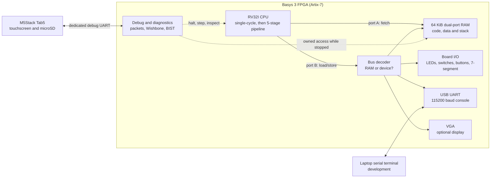
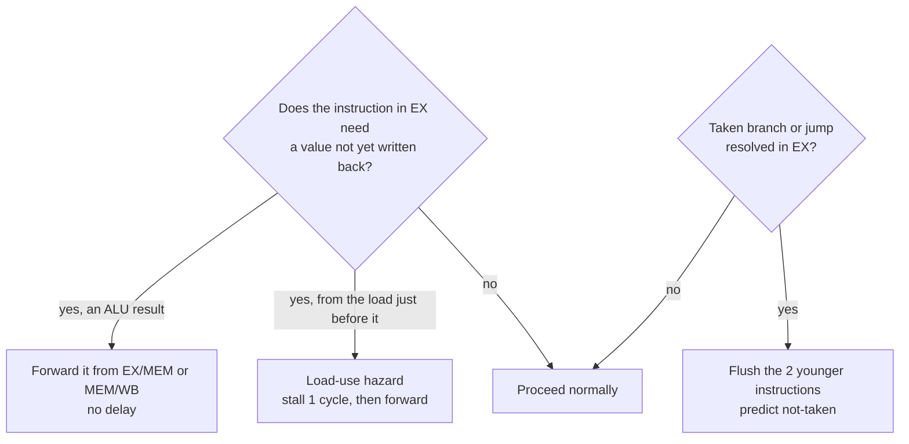
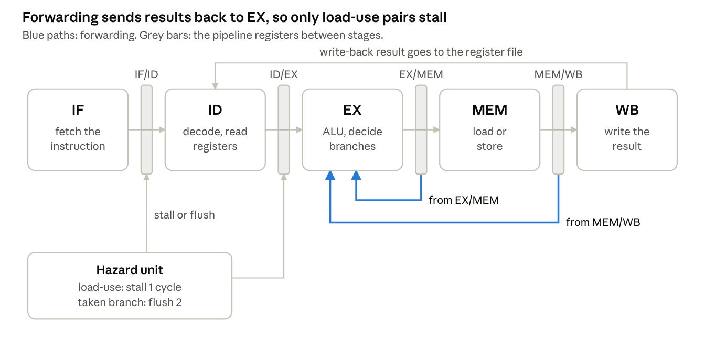
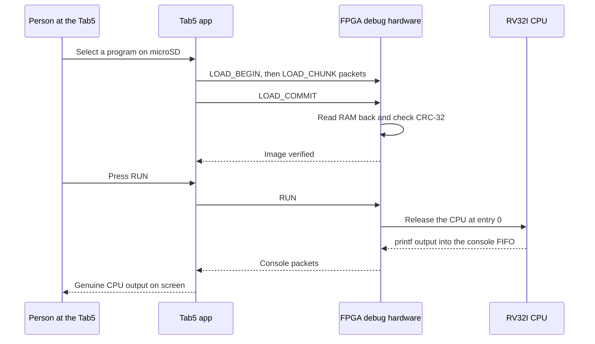
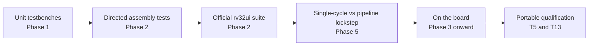
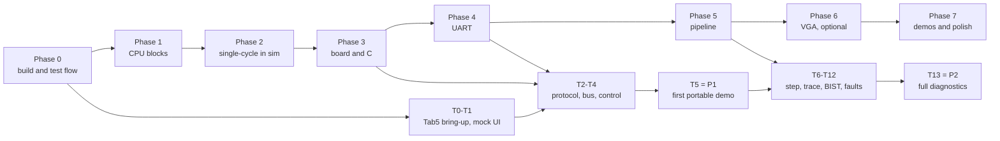

<div align="center">

# 🧠 RISC-V Computer

**A computer built from scratch in SystemVerilog: a five-stage pipelined RV32I processor, its memory and I/O,<br>
and a portable touchscreen debugger, running on a Digilent Basys 3 FPGA.**


-informational)

[What it is](#what) ·
[Status](#status) ·
[Architecture](#architecture) ·
[How a CPU runs code](#walkthrough) ·
[Getting started](#getting-started) ·
[Roadmap](#roadmap) ·
[Docs map](#docs-map)

</div>

> [!IMPORTANT]
> **This project is at the planning stage.** The repository holds the folder skeleton, the
> repository rules and a complete set of design documents. **No CPU RTL, testbench, script,
> pin-constraint file, C runtime, CI workflow or Tab5 firmware exists yet**, so nothing here
> has been simulated, synthesized or run on a board. Every hardware capability below is a
> **planned** design and is labelled as one. The next task is the Phase 0 counter and its
> self-checking Verilator smoke test.

---

<a id="what"></a>

## 📖 What this project is

A computer, at its heart, is a machine that reads a list of very simple instructions from
memory ("add these two numbers", "store this value there", "if this is zero, jump over
there") and carries them out one after another, millions of times a second.

This project builds that machine **from the logic up**, rather than buying one:

- 🧩 **The processor (CPU)** is written in **SystemVerilog**, a hardware description language.
  Instead of listing steps for a computer to follow, it describes circuits: wires, registers
  and logic.
- 🔌 **The hardware** is a Digilent **Basys 3** board. Its **FPGA** (field-programmable gate
  array, a Xilinx Artix-7) is a chip whose internal wiring can be reconfigured, so the
  SystemVerilog becomes a real working circuit when it is loaded.
- 📜 **The instruction set** is **RV32I**, the 32-bit base integer instruction set of the open
  RISC-V standard. Because it is a standard, ordinary C compiled with the RISC-V GCC
  toolchain is planned to run on the finished CPU.
- 📱 **The portable debugger** is an **M5Stack Tab5** touchscreen (ESP32-P4). It is planned to
  load programs from its microSD card, show their output, and halt, step, inspect and
  self-test the CPU, all without a laptop.

### Why it matters

Building a processor exercises nearly every layer of computer engineering at once: digital
logic, computer architecture, verification, FPGA timing, embedded C, bus protocols and
hardware/software co-design. The project is planned as a demonstration of **processor
bring-up and post-silicon-style diagnostics**: not only "it runs programs", but "here is the
hardware that lets me prove *how* it runs them, and find out when it doesn't."

One rule runs through the whole design: **every program shown running on "our CPU"
genuinely executes on the FPGA.** The Tab5 controls and observes; it never quietly does the
CPU's work, and simulated or recorded data is always labelled as such.

---

<a id="status"></a>

## 📊 Project status

Every README in this repository uses the same four labels:

| Label | Meaning |
| --- | --- |
| ✅ **IMPLEMENTED** | Present in the repository now. |
| 🚧 **IN PROGRESS** | Partly implemented, with evidence in the repository. |
| 📋 **PLANNED** | Specified in a design document, not implemented. |
| ❔ **NOT VERIFIED** | Stated somewhere, but not confirmed by anything in the repository. |

| Area | Status | Evidence |
| --- | --- | --- |
| Folder skeleton (`rtl/`, `tb/`, `sw/`, …) | ✅ IMPLEMENTED | Directories with `.gitkeep` placeholders and READMEs |
| Repository rules ([AGENTS.md](AGENTS.md), `.gitignore`, `.gitattributes`) | ✅ IMPLEMENTED | Files at the repository root |
| Build plan, architecture and protocol documents | ✅ IMPLEMENTED (documents only) | [docs/](docs/README.md) |
| Phase 0 flow: smoke test, `run_tests.py`, `build.tcl`, scripted blink, CI | 🚧 IN PROGRESS: skeleton task done, the rest 📋 | [Phase 0](docs/BUILD_PLAN.md#phase-0-fresh-start) checkboxes |
| CPU building blocks, single-cycle CPU, pipeline | 📋 PLANNED | Phases 1, 2 and 5 |
| RAM, bus, board I/O, UART, VGA | 📋 PLANNED | Phases 2, 3, 4 and 6 |
| C runtime (startup code, linker script, `mmio.h`, `printf`) | 📋 PLANNED | Phases 3 and 4 |
| Tab5 firmware, debug protocol, debug and diagnostic hardware | 📋 PLANNED | Milestones T0–T13 |
| Toolchain installs (Verilator 5, RISC-V GCC, Vivado) | ❔ NOT VERIFIED | The plan assumes them; nothing checks them yet |
| Tab5 model and revision, Basys 3 revision and flash part | ❔ NOT VERIFIED | Recorded as unknown in [HARDWARE_CHECKLIST.md](docs/HARDWARE_CHECKLIST.md) |
| Clock speed, CPI, FPGA resource use, power | ❔ none measured yet | Only measured numbers will ever be reported |

Phase-by-phase task counts are kept in the [progress dashboard](docs/BUILD_PLAN.md#progress-dashboard).

Earlier work (a Week 1 LED blink demo and the original week-by-week roadmap) is preserved
in the Git history at commit `9341a22` and earlier. It is reference material, not current
validated RTL.

---

<a id="architecture"></a>

## 🏗️ Architecture at a glance

> 📋 Everything in this section is the **planned** design from the
> [build plan](docs/BUILD_PLAN.md) and the [integration architecture](docs/TAB5_INTEGRATION.md).

The CPU only ever does three things with the outside world: **fetch** instructions,
**load** data and **store** data. The address alone decides where a load or store goes.
That idea, **memory-mapped I/O**, means LEDs, switches, the UART and the screen are all
controlled with ordinary load and store instructions; no special I/O instructions are needed.



| Block | Job | Planned in |
| --- | --- | --- |
| **CPU** | Fetches, decodes and executes RV32I instructions. Built single-cycle first, then as a 5-stage pipeline checked against it. | Phases 1, 2, 5 |
| **RAM** | One 64 KiB block RAM with two ports: port A fetches instructions while port B serves loads and stores. | Phase 2 |
| **Bus decoder** | Sends addresses at `0x8000_0000` and above to devices instead of RAM. | Phase 3 |
| **Board I/O** | 16 LEDs, 16 switches, 5 buttons and the 4-digit 7-segment display. | Phase 3 |
| **UART** | 115200 baud, 8 data bits, no parity, 1 stop bit, over the board's existing USB cable. | Phase 4 |
| **VGA** | 640 × 480 at 60 Hz; 80 × 30 text and a 160 × 120 pixel mode. Optional track. | Phase 6 |
| **Debug hardware** | Packet engine, debug-only Wishbone bus, halt/step/breakpoints, trace, counters, self-test, fault hooks. | T2–T12 |
| **Tab5** | Portable launcher, console, debugger and diagnostics screen. | T0–T13 |

### 🗺️ Memory map

RAM starts at address 0, where the CPU begins after reset. Every device lives at
`0x8000_0000` or above.

| Address | Size | Contents | Access |
| --- | --- | --- | --- |
| `0x0000_0000 – 0x0000_FFFF` | 64 KB | Main RAM: code, data, stack. Reset starts here. | read, write, execute |
| `0x0001_0000 – 0x0001_07FF` | 2 KB | Boot ROM for the optional UART bootloader (Phase 4) | read, execute |
| `0x8000_0000` | 4 B | LEDs (16 bits) | write |
| `0x8000_0004` | 4 B | 7-segment display: 16-bit value shown in hex | write |
| `0x8000_0008` | 4 B | Switches (16 bits) | read |
| `0x8000_000C` | 4 B | Buttons (5 bits) | read |
| `0x8000_0010` | 4 B | UART transmit byte | write |
| `0x8000_0014` | 4 B | UART status: bit 0 = transmitter busy, bit 1 = byte received | read |
| `0x8000_0018` | 4 B | UART received byte | read |
| `0x8000_0020` | 4 B | Cycle counter | read |
| `0x8000_0024` | 4 B | Instructions-retired counter | read |
| `0x8000_0028` | 4 B | VGA status: bit 0 = in vertical blank (safe to draw) | read |
| `0x8001_0000 – 0x8001_0FFF` | 4 KB | VGA text buffer, 80 × 30 characters | write |
| `0x8002_0000 – 0x8002_3FFF` | 16 KB | VGA pixel framebuffer | write |
| `0xF000_0000` | 4 B | Simulation only: tests write pass/fail here to end the run | write |

The debug hardware has its own separate address space (`0x4000_0000 – 0x4000_07FF`) that
the CPU cannot reach; see the
[debug-only allocation](docs/TAB5_INTEGRATION.md#debug-only-address-allocation). The C header
`sw/common/mmio.h` (planned) will name every row so programs never hard-code addresses.

---

<a id="walkthrough"></a>

## 🔬 How the CPU will run a program

> 📋 A walkthrough of the **planned** design, to make the rest of the documentation easy to
> follow. No CPU exists yet to run it.

### The five steps of every instruction

Every RV32I instruction goes through the same five steps. Think of a sandwich counter:
take the order, read it, make it, fetch any extras from the back, hand it over.

| Step | Name | What happens |
| :-: | --- | --- |
| **IF** | Instruction Fetch | Read the 32-bit instruction at the address held in the **program counter (PC)**. |
| **ID** | Instruction Decode | Work out what the instruction means and read its source **registers**: the CPU's 32 small, fast storage slots `x0`–`x31` (`x0` always reads as zero). |
| **EX** | Execute | The **ALU** (arithmetic logic unit) adds, subtracts, compares or shifts. Branches decide whether to jump. |
| **MEM** | Memory | Loads read RAM or a device; stores write it. Other instructions pass straight through. |
| **WB** | Write Back | Write the result into the destination register. |

### A five-instruction example

This tiny program adds two numbers and shows the answer on the board's LEDs:

```asm
addi x1, x0, 5        # x1 = 0 + 5                  encoding 0x00500093
addi x2, x0, 7        # x2 = 0 + 7                  encoding 0x00700113
add  x3, x1, x2       # x3 = 5 + 7 = 12             encoding 0x002081B3
lui  x4, 0x80000      # x4 = 0x8000_0000, the LED register address
sw   x3, 0(x4)        # store 12 there: the LEDs show 0b1100
```

Take `add x3, x1, x2`. Its 32 bits are split into fixed fields that the decoder reads
directly, which is a large part of why RISC-V is pleasant to implement:

```text
 funct7    rs2    rs1   funct3   rd    opcode
0000000   00010  00001   000   00011  0110011      = 0x002081B3
  add      x2     x1     add     x3   register-register ALU operation
```

The last line, `sw x3, 0(x4)`, is where memory-mapped I/O appears: it is an ordinary store,
but because its address is `0x8000_0000`, the bus decoder sends it to the LED register
instead of RAM.

### Single-cycle first, then a pipeline

**Single-cycle (Phases 2–4):** each instruction does all five steps in one long clock cycle.
It is slow but simple, so it is the easiest version to get exactly right. It then becomes the
**reference model**: the pipeline is checked against it instruction by instruction.

**Pipelined (Phase 5):** like an assembly line, each step works on a different instruction at
the same time, so up to five instructions are in flight. In the planned design, the example
above finishes in 9 cycles with no stalls:

| Cycle → | 1 | 2 | 3 | 4 | 5 | 6 | 7 | 8 | 9 |
| --- | :-: | :-: | :-: | :-: | :-: | :-: | :-: | :-: | :-: |
| `addi x1` | IF | ID | EX | MEM | WB | | | | |
| `addi x2` | | IF | ID | EX | MEM | WB | | | |
| `add x3` | | | IF | ID | **EX** | MEM | WB | | |
| `lui x4` | | | | IF | ID | EX | MEM | WB | |
| `sw x3` | | | | | IF | ID | **EX** | MEM | WB |

In cycle 5, `add` needs `x2`, which `addi x2` has computed but not yet written back.
**Forwarding** hands the value straight from the EX/MEM pipeline register to the ALU, so
nothing waits. In cycle 7, `sw` gets its address register `x4` the same way, and its store
data `x3` from MEM/WB. The pipeline's three classic situations are handled like this:





<details>
<summary><b>Instruction-set and timing details for engineers</b></summary>

- All **40 RV32I base instructions** are recognized: 37 ordinary operations plus FENCE,
  ECALL and EBREAK. FENCE runs as a no-op. ECALL and EBREAK each retire once and then halt;
  this is the project's own execution-environment policy, not a privileged trap
  implementation, and tests and reports must label it that way.
- RV32M multiply/divide, CSRs, traps, interrupts and branch prediction are stretch goals.
  RV32I has no multiply or divide instructions, so C code links GCC's software versions with
  `-lgcc`.
- Misaligned loads and stores stop with a documented error rather than being emulated.
- Single-cycle memory timing: falling-edge block RAM reads are the initial candidate, and a
  dedicated memory/fetch/load testbench must prove the full edge schedule at 25 MHz before
  CPU integration. If it fails, the decision is revised explicitly.
- Pipeline memory timing: normal synchronous reads. The block RAM's output register doubles
  as the IF/ID register, so a stall must hold the RAM enable low.
- The register file has a `BYPASS` parameter: off for single-cycle (on, it would create a
  combinational loop) and on for the pipeline, covering write-back to decode.
- Clocks: an MMCM turns the 100 MHz board clock into 25 MHz for the single-cycle CPU and for
  VGA pixels. The pipeline will run as fast as timing allows, and that limit will be measured.

</details>

---

## 📱 The portable debugging system

> 📋 **PLANNED** (milestones T0–T13). Details: [Tab5 integration](docs/TAB5_INTEGRATION.md).

The finished system is two devices: the Basys 3, which runs the CPU plus the hardware that
controls and observes it, and the Tab5, which is the touchscreen interface to that hardware.
A typical planned interaction:



| Gate | What must work | Status |
| --- | --- | --- |
| **P1** (milestone T5) | Laptop-free cold boot, a program chosen from microSD, verified load into FPGA RAM, genuine CPU output and counters, and running program A then B without rebuilding the bitstream. The single-cycle CPU is enough. | 📋 PLANNED |
| **P2** (milestone T13) | P1 plus the verified pipeline, exact instruction stepping, pre-execution breakpoints, register and memory access, coherent snapshots, retirement trace, performance counters, hardware self-test, controlled fault detection and offline reference comparison. | 📋 PLANNED |

Key design choices:

- A **dedicated debug UART**, kept separate from the CPU's own console so program text can
  never become a command.
- A versioned packet protocol with **COBS framing, CRC-32 and replay-safe request IDs**, so a
  retried command can never run twice.
- A **debug-only Wishbone B4 Classic** bus with adapters; the CPU keeps its native memory ports.
- **Exclusive RAM ownership** (CPU, debug or self-test, never two at once), because both RAM
  ports already have CPU jobs and there is no third port.
- HALT **drains** the pipeline instead of gating the clock, and STEP means **exactly one
  retired instruction**, not one clock cycle.

---

## 🧰 Technology stack

| Layer | Tool or standard | Used for | Status |
| --- | --- | --- | --- |
| Hardware description | SystemVerilog | All RTL and testbenches | 📋 PLANNED |
| Simulation | Verilator 5, in WSL | Self-checking tests, `-Wall` clean | ❔ install NOT VERIFIED |
| Waveforms | GTKWave | Inspecting simulations | ❔ install NOT VERIFIED |
| FPGA build | Xilinx Vivado, non-project Tcl mode, on Windows | Synthesis, place and route, bitstreams | ❔ install NOT VERIFIED |
| Software | RISC-V GCC, `-march=rv32i -mabi=ilp32`, no standard library | C and assembly programs | ❔ NOT VERIFIED; prefix may be `riscv32-` or `riscv64-unknown-elf-` |
| Scripts | Python 3, standard library preferred | Test runner, image conversion, host client | 📋 PLANNED |
| CI | GitHub Actions | Run every test on every push | 📋 PLANNED |
| Tab5 firmware | ESP-IDF, FreeRTOS, LVGL | Touchscreen application | 📋 PLANNED; versions pinned after T0 |
| Hardware | Digilent Basys 3 (Artix-7), M5Stack Tab5 (ESP32-P4) | Target boards | Exact revisions ❔ NOT VERIFIED |

---

## 📁 Repository structure

Every folder below exists now. Apart from `docs/`, each holds only its README and a
`.gitkeep` placeholder until real files arrive.

```text
risc-v-computer/
├── rtl/                 Hardware (RTL): the circuits           → rtl/README.md
│   ├── core/            CPU blocks, single-cycle CPU, pipeline
│   ├── mem/             Unified RAM and optional boot ROM
│   ├── io/              Bus decoder, board I/O, UART, VGA
│   ├── debug/           Packet engine, Wishbone bridge, CPU control, trace
│   ├── diag/            Memory/ALU self-test and fault hooks
│   └── top/             Basys 3 top level, clocks, reset
├── tb/                  Testbenches, with debug/ and diag/ suites → tb/README.md
├── sw/                  Software that runs ON the CPU            → sw/README.md
│   ├── common/          Startup code, linker script, mmio.h, printf
│   ├── tests/           Directed assembly tests, hazard zoo
│   ├── riscv-tests/     Reserved for the official rv32ui submodule
│   └── programs/        C and assembly demo programs
├── scripts/             Test runner, Vivado build, converters    → scripts/README.md
├── fpga/                Basys 3 pin and timing constraints       → fpga/README.md
├── firmware/tab5/       Tab5 touchscreen application             → firmware/tab5/README.md
├── host/                Python debug client and prep tools       → host/README.md
├── protocol/            Shared protocol schemas and vectors      → protocol/README.md
├── docs/                Plan, architecture, protocol, diagrams   → docs/README.md
├── AGENTS.md            Rules for people and coding agents working here
└── README.md            You are here
```

Generated output goes in `build/`, which Git ignores, along with Vivado projects, bitstreams,
logs and compiled binaries. Source memory images (`.mem`, `.coe`) and reviewed reports in
`docs/` stay trackable. Before the official test suite is added as a submodule, its
`.gitkeep` placeholder must be removed.

---

<a id="getting-started"></a>

## 🚀 Getting started

### What you can do today

```bash
git clone https://github.com/Nishant150876/risc-v-computer.git
cd risc-v-computer
```

Then read the documentation along one of the [reading paths](#docs-map). There is no code
to build or run yet.

### Prerequisites the plan expects

> ❔ **NOT VERIFIED.** These are the tools the plan is designed around. Check your own
> installation before relying on them.

| Environment | Needs |
| --- | --- |
| **WSL** (Linux on Windows) | Verilator 5, GTKWave, Python 3, RISC-V GCC (`riscv32-unknown-elf-` or a multilib `riscv64-unknown-elf-`; `ls /opt/riscv/bin` shows which) |
| **Windows** | Vivado, on `PATH` for batch builds; a serial terminal such as PuTTY or Tera Term |
| **Hardware** | Basys 3 and its USB cable. Later: the Tab5, a microSD card and a signal-only UART cable approved at milestone T0 |

### Planned commands

> 📋 **PLANNED. These scripts do not exist yet, so neither command works today.** They are
> the documented entry points Phase 0 will create.

```bash
# Run every simulation test and print a pass/fail table (WSL, repository root)
python3 scripts/run_tests.py
```

```bash
# Rebuild the bitstream plus timing and utilization reports (Windows, Vivado on PATH)
vivado -mode batch -source scripts/build.tcl
```

The full route from a C file to the board is in [sw/README.md](sw/README.md#from-c-to-the-board).

### Troubleshooting

<details>
<summary><b>Pitfalls the plan already anticipates</b></summary>

| Symptom | Likely cause | What to do |
| --- | --- | --- |
| `riscv32-unknown-elf-gcc: command not found` | The toolchain was installed with a `riscv64-unknown-elf-` prefix | Use that prefix with the same flags, if it was built with 32-bit (multilib) support |
| Simulation tools missing in a Windows shell | Verilator and GCC are planned for WSL; Vivado and the serial port for Windows | Run each step in its intended environment |
| Instructions off by one, or loads return the previous value (future) | Block RAM's one-cycle read delay | Revisit the memory-timing decision; the dedicated memory testbench exists to catch this |
| Passes in simulation, fails on the board (future) | Timing, clock or reset problem | Read the Vivado timing report first; check clock and reset; show internal values on the 7-segment display or use Vivado's ILA |
| Slow or locked builds | The working folder is synced by a cloud service such as OneDrive | Keep generated output in the ignored `build/` folder, or build from an unsynced path |

</details>

---

## 🧪 How the project will be tested

> 📋 **PLANNED.** No tests exist yet. Each bug should be caught at the cheapest layer that
> can catch it.



Every RTL module will land together with a **self-checking testbench**: it compares results
against a reference model and fails by itself, rather than relying on someone reading
waveforms. One command will run every layer that works in simulation, and GitHub Actions will
run it on every push. Details: [tb/README.md](tb/README.md) and the
[verification matrix](docs/VERIFICATION_MATRIX.md).

---

<a id="roadmap"></a>

## 🛣️ Roadmap

The core CPU follows phases in order, and each ends with a **gate**: a concrete test that
must pass before the next phase starts. The Tab5 milestones (T0–T13) have their own stated
dependencies. VGA (Phases 6–7) is optional and blocks neither portable gate.



| Phase | Goal | Gate | Status |
| --- | --- | --- | --- |
| **0** Fresh start | One-command tests and bitstreams | `run_tests.py` passes in WSL and on GitHub Actions; scripted blink runs on the board | 🚧 skeleton done, 5 tasks left |
| **1** Building blocks | ALU, register file, immediates, decoder, branch unit | Every Phase 1 testbench passes locally and in CI | 📋 |
| **2** Single-cycle CPU | Every instruction in one clock, in simulation | All of rv32ui and every directed test pass | 📋 |
| **3** Board and C | Real C on real hardware | A C program shows fib(switches) on the 7-segment; fib(20) = 6765 = `0x1A6D` | 📋 |
| **4** UART | Text to a laptop | "hello, world", a live counter, and echo of typed text | 📋 |
| **5** Pipeline | Five stages with forwarding and hazards | Lockstep, hazard zoo and rv32ui pass; C runs on the board; performance table filled | 📋 |
| **6** VGA | Text and pixels on a monitor | One C program prints text and draws pixels | 📋 optional |
| **7** Demos and polish | Game of Life, prime sieve, Snake or Pong | All three run from cold power-on; rebuildable from the README alone | 📋 |

The full task lists, Tab5 milestones, risks, open questions and stretch goals (RV32M, branch
prediction, CSRs and traps, formal verification, CoreMark, Tiny Tapeout) are in the
[build plan](docs/BUILD_PLAN.md).

---

<a id="docs-map"></a>

## 📚 Documentation map

| Document | What it covers |
| --- | --- |
| [docs/README.md](docs/README.md) | Index of every design document and how they relate |
| [docs/BUILD_PLAN.md](docs/BUILD_PLAN.md) | **Source of truth**: phases, gates, design decisions, memory map, risks, progress checkboxes |
| [docs/TAB5_INTEGRATION.md](docs/TAB5_INTEGRATION.md) | Debug architecture, RAM ownership, halt/step/breakpoint contracts, loader, trace |
| [docs/DEBUG_PROTOCOL.md](docs/DEBUG_PROTOCOL.md) | Packet format, sessions, retries, commands and status codes |
| [docs/TAB5_FIRMWARE.md](docs/TAB5_FIRMWARE.md) | Tab5 framework choice, modules, screens, microSD layout |
| [docs/HARDWARE_CHECKLIST.md](docs/HARDWARE_CHECKLIST.md) | Board identification, wiring, power and cold-boot gates |
| [docs/VERIFICATION_MATRIX.md](docs/VERIFICATION_MATRIX.md) | Every requirement mapped to the test that will prove it |
| [docs/TAB5_REQUIREMENTS.md](docs/TAB5_REQUIREMENTS.md) | The original 35-section Tab5 specification, preserved |

### Suggested reading paths

| If you are… | Read in this order |
| --- | --- |
| 🌱 **New to hardware** | This page → [the walkthrough](#walkthrough) → [rtl/README.md](rtl/README.md) → [tb/README.md](tb/README.md) |
| 🛠️ **Wanting to build and run it** | [Getting started](#getting-started) → [scripts/README.md](scripts/README.md) → [sw/README.md](sw/README.md) → [fpga/README.md](fpga/README.md) |
| 🏛️ **An engineer reviewing the architecture** | [BUILD_PLAN.md](docs/BUILD_PLAN.md) → [TAB5_INTEGRATION.md](docs/TAB5_INTEGRATION.md) → [DEBUG_PROTOCOL.md](docs/DEBUG_PROTOCOL.md) → [VERIFICATION_MATRIX.md](docs/VERIFICATION_MATRIX.md) |
| ✍️ **Contributing** | [AGENTS.md](AGENTS.md) → [the current phase](docs/BUILD_PLAN.md#build-phases) → the README of the folder you are changing |

---

## 🤝 Contributing

The working rules are in [AGENTS.md](AGENTS.md) and apply to people and coding agents alike.
The essentials:

- Follow the phases in order, and never tick a gate whose test has not actually passed.
- One module per file with a matching `snake_case` name; `logic` with `always_ff` and
  `always_comb`; no latches; clock `clk` and active-high synchronous reset `rst`; Verilator
  `-Wall` clean.
- A module and its self-checking testbench land in the same commit, and no commit breaks the
  test run.
- Work on a task branch and open a pull request into `main`. Report exactly which checks ran
  and what they showed.

## 📄 License and acknowledgments

No license file has been added yet, so default copyright applies until one is chosen.

The pipeline follows the textbook design in Harris & Harris, *Digital Design and Computer
Architecture*, chapter 7. The instruction set is the
[ratified RISC-V RV32I specification](https://docs.riscv.org/reference/isa/v20260120/unpriv/rv32.html).
Board facts come from Digilent's Basys 3 reference manual and master XDC, and Tab5 facts
from M5Stack's documentation, all linked in [HARDWARE_CHECKLIST.md](docs/HARDWARE_CHECKLIST.md).

<details>
<summary><b>📘 Glossary</b></summary>

| Term | Meaning |
| --- | --- |
| **ALU** | Arithmetic logic unit: the circuit that adds, subtracts, compares and shifts. |
| **BIST** | Built-in self-test: hardware that tests other hardware, such as RAM, by itself. |
| **Block RAM (BRAM)** | Dedicated memory blocks inside the FPGA; the Basys 3 manual lists 1,800 Kbits. |
| **COBS** | Consistent Overhead Byte Stuffing: removes zero bytes from a packet so `0x00` can mark its end. |
| **CPI** | Cycles per instruction: clock cycles divided by instructions completed. |
| **CRC-32** | A checksum that detects accidental corruption of a packet or program image. |
| **FPGA** | Field-programmable gate array: a chip whose logic can be reconfigured to become a custom circuit. |
| **Forwarding** | Passing a result directly to a later instruction before it reaches the register file. |
| **Gate** | The test that must pass before the next phase starts. |
| **Hazard** | A situation where the next instruction in a pipeline cannot safely proceed yet. |
| **ILA** | Integrated logic analyzer: Vivado's on-chip tool for watching live signals. |
| **MMCM** | Mixed-mode clock manager: FPGA hardware that makes clean new clocks from the 100 MHz input. |
| **MMIO** | Memory-mapped I/O: devices controlled through ordinary loads and stores to special addresses. |
| **PC** | Program counter: the address of the instruction being executed. |
| **Retire** | An instruction retires when it has finished and its results are architecturally visible. |
| **RTL** | Register-transfer level: hardware described as registers and the logic between them. |
| **RV32I** | The 32-bit base integer instruction set of RISC-V. |
| **UART** | A simple serial link that sends bytes one bit at a time. |
| **Wishbone** | An open on-chip bus standard; used here only for the debug path. |
| **XDC** | Xilinx design constraints: the file that maps signals to physical pins and sets timing. |

</details>
