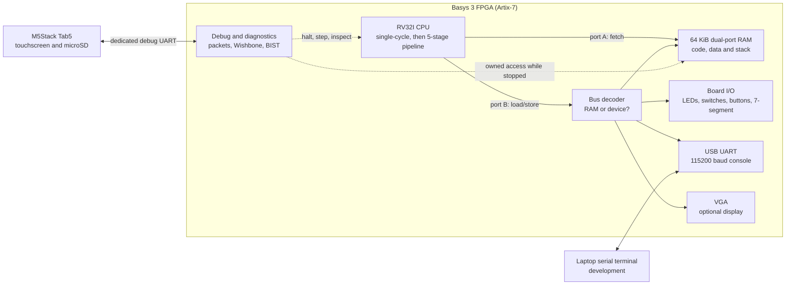
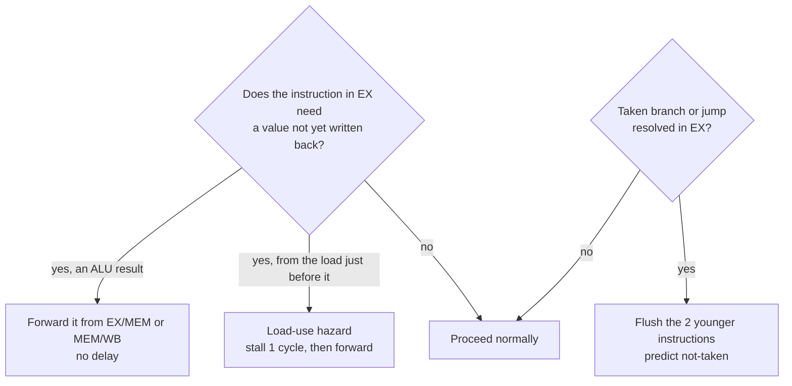
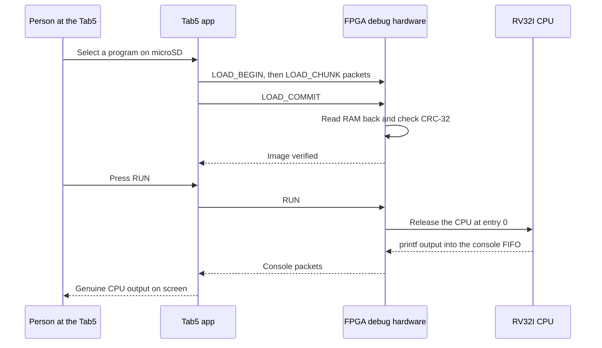
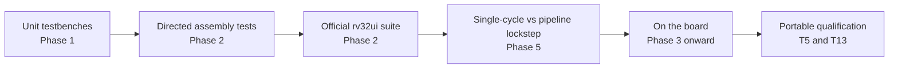
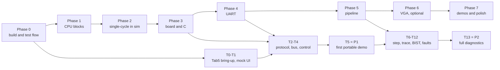

# RISC-V Computer

A computer built from scratch in SystemVerilog: a five-stage pipelined RV32I processor, its
memory and I/O, and a portable touchscreen debugger, running on a Digilent Basys 3 FPGA.

[](https://github.com/Nishant150876/risc-v-computer/actions/workflows/tests.yml)

| At a glance | |
| --- | --- |
| **Instruction set** | RV32I, the 32-bit base integer set of the open RISC-V standard |
| **Language** | SystemVerilog for all hardware and testbenches |
| **Board** | Digilent Basys 3 (Xilinx Artix-7 FPGA) |
| **Portable debugger** | M5Stack Tab5 touchscreen (ESP32-P4) |
| **Current stage** | Phase 1: all six tasks implemented; local tests pass; GitHub Actions gate pending |

> [!IMPORTANT]
> **Phase 0 is complete.** The build-and-test flow works end to end: `scripts/run_tests.py`
> passes in WSL and on GitHub Actions, and a blink design was built with `scripts/build.tcl`
> and programmed onto the board with `scripts/program.tcl`. **Phase 1's shared package and five
> CPU blocks now pass local tests.** See [interfaces and evidence](docs/PHASE1_CORE_BLOCKS.md).
> The Phase 1 gate still needs GitHub Actions for these changes. **No connected CPU exists yet:**
> CPU integration, RAM, bus, UART, C runtime and Tab5 firmware remain planned.

<details open>
<summary><b>On this page</b></summary>

1. [What this project is](#1-what-this-project-is)
2. [Project status](#2-project-status)
3. [Quick start](#3-quick-start)
4. [Architecture at a glance](#4-architecture-at-a-glance)
5. [How the CPU will run a program](#5-how-the-cpu-will-run-a-program)
6. [The portable debugging system](#6-the-portable-debugging-system)
7. [How the project is tested](#7-how-the-project-is-tested)
8. [Roadmap](#8-roadmap)
9. [Technology stack](#9-technology-stack)
10. [Repository structure](#10-repository-structure)
11. [Documentation map](#11-documentation-map)
12. [Troubleshooting](#12-troubleshooting)
13. [Contributing](#13-contributing)
14. [License, acknowledgments and glossary](#14-license-acknowledgments-and-glossary)

</details>

---

## 1. What this project is

A computer, at its heart, is a machine that reads a list of very simple instructions from
memory ("add these two numbers", "store this value there", "if this is zero, jump over
there") and carries them out one after another, millions of times a second.

This project builds that machine **from the logic up**, rather than buying one:

| Part | What it is |
| --- | --- |
| **The processor (CPU)** | Written in **SystemVerilog**, a hardware description language. Instead of listing steps for a computer to follow, it describes circuits: wires, registers and logic. |
| **The hardware** | A Digilent **Basys 3** board. Its **FPGA** (field-programmable gate array, a Xilinx Artix-7) is a chip whose internal wiring can be reconfigured, so the SystemVerilog becomes a real working circuit when it is loaded. |
| **The instruction set** | **RV32I**, the 32-bit base integer instruction set of the open RISC-V standard. Because it is a standard, ordinary C compiled with the RISC-V GCC toolchain is planned to run on the finished CPU. |
| **The portable debugger** | An **M5Stack Tab5** touchscreen (ESP32-P4). It is planned to load programs from its microSD card, show their output, and halt, step, inspect and self-test the CPU, all without a laptop. |

### Why it matters

Building a processor exercises nearly every layer of computer engineering at once:

- digital logic and computer architecture;
- verification and FPGA timing;
- embedded C and bus protocols;
- hardware/software co-design.

The project is planned as a demonstration of **processor bring-up and post-silicon-style
diagnostics**: not only "it runs programs", but "here is the hardware that lets me prove *how*
it runs them, and find out when it doesn't."

> [!IMPORTANT]
> **One rule runs through the whole design: every program shown running on "our CPU"
> genuinely executes on the FPGA.** The Tab5 controls and observes; it never quietly does the
> CPU's work, and simulated or recorded data is always labelled as such.

---

## 2. Project status

<a id="status"></a>

Every README in this repository uses the same four labels:

| Label | Meaning |
| --- | --- |
| ✅ **IMPLEMENTED** | Present in the repository now. |
| 🚧 **IN PROGRESS** | Partly implemented, with evidence in the repository. |
| 📋 **PLANNED** | Specified in a design document, not implemented. |
| ❔ **NOT VERIFIED** | Stated somewhere, but not confirmed by anything in the repository. |

### What exists today

| Area | Status | Evidence |
| --- | --- | --- |
| Folder skeleton (`rtl/`, `tb/`, `sw/`, …) | ✅ IMPLEMENTED | Directories with READMEs; empty ones keep `.gitkeep` placeholders |
| Repository rules ([AGENTS.md](AGENTS.md), `.gitignore`, `.gitattributes`) | ✅ IMPLEMENTED | Files at the repository root |
| Build plan, architecture and protocol documents | ✅ IMPLEMENTED (documents only) | [docs/](docs/README.md) |
| Phase 0 counter smoke test | ✅ IMPLEMENTED | `rtl/core/counter.sv` and `tb/counter_tb.sv` pass 25 checks; [smoke evidence](docs/PHASE0_SMOKE_TEST.md) |
| Test runner `scripts/run_tests.py` | ✅ IMPLEMENTED | All seven benches pass locally with Verilator 5.020 |
| Vivado build and program scripts | ✅ IMPLEMENTED | `scripts/build.tcl` and `scripts/program.tcl` ran in Vivado 2025.2 |
| Phase 0 blink top level and pins | ✅ IMPLEMENTED | `rtl/top/basys3_top.sv`, `fpga/basys3.xdc`; LEDs count on the board |
| Continuous integration | ✅ IMPLEMENTED | `.github/workflows/tests.yml` runs `run_tests.py` on every push and pull request; the new Phase 1 run is pending publication |
| **Phase 0 gate** | ✅ PASSED November 7, 2026 | [Phase 0](docs/BUILD_PLAN.md#phase-0-fresh-start) checkboxes |
| Shared package, ALU, register file, immediate generator, decoder, branch unit | ✅ IMPLEMENTED; local verification passed | [Phase 1 interfaces and tests](docs/PHASE1_CORE_BLOCKS.md) |
| **Phase 1 gate** | 🚧 Local pass; CI pending | Six implementation tasks complete; GitHub Actions for this snapshot has not run |
| Single-cycle CPU and pipeline | 📋 PLANNED | Phases 2 and 5 |
| RAM, bus, board I/O, UART, VGA | 📋 PLANNED | Phases 2, 3, 4 and 6 |
| C runtime (startup code, linker script, `mmio.h`, `printf`) | 📋 PLANNED | Phases 3 and 4 |
| Tab5 firmware, debug protocol, debug and diagnostic hardware | 📋 PLANNED | Milestones T0–T13 |

### What has been checked, and what has not

| Item | Status | Notes |
| --- | --- | --- |
| Ubuntu simulation tools (Verilator, g++, Make, Python) | ✅ VERIFIED | Verilator 5.020, g++ 13.3.0, Make 4.3, Python 3.12.3; [observed versions](docs/PHASE0_SMOKE_TEST.md#5-recorded-verification) |
| Vivado | ✅ VERIFIED for the blink | Vivado 2025.2: bitstream written, WNS +7.066 ns, WHS +0.268 ns, 42 registers |
| GTKWave, RISC-V GCC | ❔ NOT VERIFIED | Not checked yet |
| Tab5 model and revision, Basys 3 revision and flash part | ❔ NOT VERIFIED | Recorded as unknown in [HARDWARE_CHECKLIST.md](docs/HARDWARE_CHECKLIST.md) |
| CPU clock speed, CPI, FPGA resource use, power | ❔ none measured yet | Only measured numbers will ever be reported |

Phase-by-phase task counts are kept in the [progress dashboard](docs/BUILD_PLAN.md#2-progress-dashboard).

> [!NOTE]
> Earlier work (a Week 1 LED blink demo and the original week-by-week roadmap) is preserved in
> the Git history at commit `9341a22` and earlier. It is reference material, not current
> validated RTL.

---

## 3. Quick start

<a id="getting-started"></a>

These steps run the parts that exist today: the simulation tests and the Phase 0 blink.

### Before you begin

| Environment | Needs |
| --- | --- |
| **WSL** (Linux on Windows) | Verilator 5, g++, Make and Python 3 for simulation. Later phases add GTKWave for waveforms and RISC-V GCC (`riscv32-unknown-elf-` or a multilib `riscv64-unknown-elf-`). |
| **Windows** | Vivado, on `PATH` for batch builds; a serial terminal such as PuTTY or Tera Term (from Phase 4). |
| **Hardware** | Basys 3 and its USB cable. Later: the Tab5, a microSD card and a signal-only UART cable approved at milestone T0. |

> [!NOTE]
> Verilator 5.020, g++ 13.3.0, Make 4.3 and Python 3.12.3 were checked in the owner's
> **Ubuntu** distribution, and Vivado 2025.2 on Windows. GTKWave and RISC-V GCC remain
> **NOT VERIFIED**. Check the installation in the environment you are using before relying on it.

### Step 1: Get the code

```bash
git clone https://github.com/Nishant150876/risc-v-computer.git
cd risc-v-computer
```

### Step 2: Run every simulation test (WSL)

From WSL, in the repository root:

```bash
python3 scripts/run_tests.py
```

The runner finds every `tb/**/*_tb.sv`, builds each with Verilator, runs it, and prints a
pass/fail table. Today it ends with `7/7 passed` (five CPU-block benches and both Phase 0 benches). The exit
status is 0 only when every test passes.

<details>
<summary><b>Other ways to run the tests</b></summary>

| Option | What it does |
| --- | --- |
| `python3 scripts/run_tests.py counter` | Run only tests whose name contains `counter` |
| `python3 scripts/run_tests.py -v` | Show each test's output |
| `python3 scripts/run_tests.py --list` | List tests without running them |

In **Cursor connected to WSL: Ubuntu**, save your edits, then press **Ctrl+Shift+B**. The default
task, **Tests: run all testbenches**, compiles and runs the complete local regression.
Expected output:

```text
7/7 passed
```

**Terminal > Run Task > Smoke: build and run counter** runs just the original counter.
See [PHASE0_SMOKE_TEST.md](docs/PHASE0_SMOKE_TEST.md) for the smoke test's source files, terminal
commands, tool versions and recorded checks.

</details>

### Step 3: Build the bitstream (Windows, Vivado on `PATH`)

From the repository root:

```bash
vivado -mode batch -nojournal -nolog -source scripts/build.tcl
```

The script writes `build/vivado/basys3_top.bit` plus timing and utilization reports, and prints
`== TIMING MET`. It exits nonzero if setup or hold slack is negative.

### Step 4: Program the board (Windows)

Plug in the Basys 3 and switch it on, then run:

```bash
vivado -mode batch -nojournal -nolog -source scripts/program.tcl
```

The 16 LEDs show a binary count; the center button resets it. This loads the FPGA's volatile
configuration, so the design is lost at power-off.

> [!TIP]
> Building a bitstream and programming the board are separate steps on purpose. You can build and
> read the timing report without touching the hardware.

For the full route from a C file to the board (planned), see
[sw/README.md](sw/README.md#4-from-c-to-the-board). For the scripts' options, see
[scripts/README.md](scripts/README.md).

---

## 4. Architecture at a glance

<a id="architecture"></a>

> [!NOTE]
> System integration in this section is the **planned** design from the
> [build plan](docs/BUILD_PLAN.md) and the [integration architecture](docs/TAB5_INTEGRATION.md).
> The individual Phase 1 CPU blocks are already implemented and unit-tested.

The CPU only ever does three things with the outside world: **fetch** instructions, **load**
data and **store** data. The address alone decides where a load or store goes. That idea,
**memory-mapped I/O**, means LEDs, switches, the UART and the screen are all controlled with
ordinary load and store instructions; no special I/O instructions are needed.

The diagram shows every planned block inside the FPGA, and the two outside devices that talk to it.



| Block | Job | Planned in |
| --- | --- | --- |
| **CPU** | Fetches, decodes and executes RV32I instructions. Built single-cycle first, then as a 5-stage pipeline checked against it. | Phases 1, 2, 5 |
| **RAM** | One 64 KiB block RAM with two ports: port A fetches instructions while port B serves loads and stores. | Phase 2 |
| **Bus decoder** | Sends addresses at `0x8000_0000` and above to devices instead of RAM. | Phase 3 |
| **Board I/O** | 16 LEDs, 16 switches, 5 buttons and the 4-digit 7-segment display. | Phase 3 |
| **UART** | 115200 baud, 8 data bits, no parity, 1 stop bit, over the board's existing USB cable. | Phase 4 |
| **VGA** | 640 × 480 at 60 Hz; 80 × 30 text and a 160 × 120 pixel mode. Optional track. | Phase 6 |
| **Debug hardware** | Packet engine, debug-only Wishbone bus, halt/step/breakpoints, trace, counters, self-test, fault hooks. | T2–T12 |
| **Tab5** | Portable launcher, console, debugger and diagnostics screen. | T0–T13 |

### Memory map

RAM starts at address 0, where the CPU begins after reset. Every device lives at `0x8000_0000`
or above.

| Region | Addresses | Contents |
| --- | --- | --- |
| Main RAM | `0x0000_0000 – 0x0000_FFFF` | 64 KB of code, data and stack. Reset starts here. |
| Boot ROM (optional) | `0x0001_0000 – 0x0001_07FF` | 2 KB UART bootloader (Phase 4) |
| Devices | `0x8000_0000 – 0x8002_3FFF` | LEDs, switches, UART, counters, VGA |
| Simulation only | `0xF000_0000` | Tests write pass/fail here to end the run |

<details>
<summary><b>Full memory map, register by register</b></summary>

| Address | Size | Contents | Access |
| --- | --- | --- | --- |
| `0x0000_0000 – 0x0000_FFFF` | 64 KB | Main RAM: code, data, stack. Reset starts here. | read, write, execute |
| `0x0001_0000 – 0x0001_07FF` | 2 KB | Boot ROM for the optional UART bootloader (Phase 4) | read, execute |
| `0x8000_0000` | 4 B | LEDs (16 bits) | write |
| `0x8000_0004` | 4 B | 7-segment display: 16-bit value shown in hex | write |
| `0x8000_0008` | 4 B | Switches (16 bits) | read |
| `0x8000_000C` | 4 B | Buttons (5 bits) | read |
| `0x8000_0010` | 4 B | UART transmit byte | write |
| `0x8000_0014` | 4 B | UART status: bit 0 = transmitter busy, bit 1 = byte received | read |
| `0x8000_0018` | 4 B | UART received byte | read |
| `0x8000_0020` | 4 B | Cycle counter | read |
| `0x8000_0024` | 4 B | Instructions-retired counter | read |
| `0x8000_0028` | 4 B | VGA status: bit 0 = in vertical blank (safe to draw) | read |
| `0x8001_0000 – 0x8001_0FFF` | 4 KB | VGA text buffer, 80 × 30 characters | write |
| `0x8002_0000 – 0x8002_3FFF` | 16 KB | VGA pixel framebuffer | write |
| `0xF000_0000` | 4 B | Simulation only: tests write pass/fail here to end the run | write |

The canonical copy of this map, with its open review notes, is in the
[build plan](docs/BUILD_PLAN.md#6-memory-map).

</details>

> [!NOTE]
> The debug hardware has its own separate address space (`0x4000_0000 – 0x4000_07FF`) that the
> CPU cannot reach; see the
> [debug-only allocation](docs/TAB5_INTEGRATION.md#debug-only-address-allocation). The C header
> `sw/common/mmio.h` (planned) will name every row so programs never hard-code addresses.

---

## 5. How the CPU will run a program

<a id="walkthrough"></a>

> [!NOTE]
> A walkthrough of the **planned** design, to make the rest of the documentation easy to
> follow. No CPU exists yet to run it.

### The five steps of every instruction

Every RV32I instruction goes through the same five steps. Think of a sandwich counter: take the
order, read it, make it, fetch any extras from the back, hand it over.


| Step | Name | What happens |
| :-: | --- | --- |
| **IF** | Instruction Fetch | Read the 32-bit instruction at the address held in the **program counter (PC)**. |
| **ID** | Instruction Decode | Work out what the instruction means and read its source **registers**: the CPU's 32 small, fast storage slots `x0`–`x31` (`x0` always reads as zero). |
| **EX** | Execute | The **ALU** (arithmetic logic unit) adds, subtracts, compares or shifts. Branches decide whether to jump. |
| **MEM** | Memory | Loads read RAM or a device; stores write it. Other instructions pass straight through. |
| **WB** | Write Back | Write the result into the destination register. |

### A five-instruction example

This tiny program adds two numbers and shows the answer on the board's LEDs:

```asm
addi x1, x0, 5        # x1 = 0 + 5                  encoding 0x00500093
addi x2, x0, 7        # x2 = 0 + 7                  encoding 0x00700113
add  x3, x1, x2       # x3 = 5 + 7 = 12             encoding 0x002081B3
lui  x4, 0x80000      # x4 = 0x8000_0000, the LED register address
sw   x3, 0(x4)        # store 12 there: the LEDs show 0b1100
```

Take `add x3, x1, x2`. Its 32 bits are split into fixed fields that the decoder reads directly,
which is a large part of why RISC-V is pleasant to implement:

```text
 funct7    rs2    rs1   funct3   rd    opcode
0000000   00010  00001   000   00011  0110011      = 0x002081B3
  add      x2     x1     add     x3   register-register ALU operation
```

> [!TIP]
> The last line, `sw x3, 0(x4)`, is where memory-mapped I/O appears. It is an ordinary store,
> but because its address is `0x8000_0000`, the bus decoder sends it to the LED register
> instead of RAM.

### Single-cycle first, then a pipeline

| Version | How it works | Why |
| --- | --- | --- |
| **Single-cycle** (Phases 2–4) | Each instruction does all five steps in one long clock cycle. | Slow but simple, so it is the easiest version to get exactly right. It then becomes the **reference model**: the pipeline is checked against it instruction by instruction. |
| **Pipelined** (Phase 5) | Like an assembly line, each step works on a different instruction at the same time, so up to five instructions are in flight. | Much higher throughput. In the planned design, the example above finishes in 9 cycles with no stalls. |

| Cycle → | 1 | 2 | 3 | 4 | 5 | 6 | 7 | 8 | 9 |
| --- | :-: | :-: | :-: | :-: | :-: | :-: | :-: | :-: | :-: |
| `addi x1` | IF | ID | EX | MEM | WB | | | | |
| `addi x2` | | IF | ID | EX | MEM | WB | | | |
| `add x3` | | | IF | ID | **EX** | MEM | WB | | |
| `lui x4` | | | | IF | ID | EX | MEM | WB | |
| `sw x3` | | | | | IF | ID | **EX** | MEM | WB |

- **Cycle 5:** `add` needs `x2`, which `addi x2` has computed but not yet written back.
  **Forwarding** hands the value straight from the EX/MEM pipeline register to the ALU, so
  nothing waits.
- **Cycle 7:** `sw` gets its address register `x4` the same way, and its store data `x3` from
  MEM/WB.

The pipeline's three classic situations are handled like this:




<details>
<summary><b>Instruction-set and timing details for engineers</b></summary>

- All **40 RV32I base instructions** are recognized: 37 ordinary operations plus FENCE, ECALL
  and EBREAK. FENCE runs as a no-op. ECALL and EBREAK each retire once and then halt; this is
  the project's own execution-environment policy, not a privileged trap implementation, and
  tests and reports must label it that way.
- RV32M multiply/divide, CSRs, traps, interrupts and branch prediction are stretch goals. RV32I
  has no multiply or divide instructions, so C code links GCC's software versions with `-lgcc`.
- Misaligned loads and stores stop with a documented error rather than being emulated.
- **Single-cycle memory timing:** falling-edge block RAM reads are the initial candidate, and a
  dedicated memory/fetch/load testbench must prove the full edge schedule at 25 MHz before CPU
  integration. If it fails, the decision is revised explicitly.
- **Pipeline memory timing:** normal synchronous reads. The block RAM's output register doubles
  as the IF/ID register, so a stall must hold the RAM enable low.
- The register file has a `BYPASS` parameter: off for single-cycle (on, it would create a
  combinational loop) and on for the pipeline, covering write-back to decode.
- **Clocks:** an MMCM turns the 100 MHz board clock into 25 MHz for the single-cycle CPU and
  for VGA pixels. The pipeline will run as fast as timing allows, and that limit will be measured.

</details>

---

## 6. The portable debugging system

> [!NOTE]
> 📋 **PLANNED** (milestones T0–T13). Details: [Tab5 integration](docs/TAB5_INTEGRATION.md).

The finished system is two devices:

- the **Basys 3**, which runs the CPU plus the hardware that controls and observes it;
- the **Tab5**, which is the touchscreen interface to that hardware.

A typical planned interaction, from choosing a program to seeing its output:



### The two portable gates

| Gate | What must work | Status |
| --- | --- | --- |
| **P1** (milestone T5) | Laptop-free cold boot, a program chosen from microSD, verified load into FPGA RAM, genuine CPU output and counters, and running program A then B without rebuilding the bitstream. The single-cycle CPU is enough. | 📋 PLANNED |
| **P2** (milestone T13) | P1 plus the verified pipeline, exact instruction stepping, pre-execution breakpoints, register and memory access, coherent snapshots, retirement trace, performance counters, hardware self-test, controlled fault detection and offline reference comparison. | 📋 PLANNED |

### Key design choices

| Choice | Why |
| --- | --- |
| A **dedicated debug UART**, separate from the CPU's own console | Program text can never become a command. |
| A versioned packet protocol with **COBS framing, CRC-32 and replay-safe request IDs** | A retried command can never run twice. |
| A **debug-only Wishbone B4 Classic** bus with adapters | The CPU keeps its native memory ports. |
| **Exclusive RAM ownership** (CPU, debug or self-test, never two at once) | Both RAM ports already have CPU jobs and there is no third port. |
| HALT **drains** the pipeline instead of gating the clock; STEP means **exactly one retired instruction**, not one clock cycle | Debugging stays architecturally correct on a pipeline. |

---

## 7. How the project is tested

> [!NOTE]
> ✅ All seven local tests pass: the Phase 0 counter/blink tests and the five
> [Phase 1 block tests](docs/PHASE1_CORE_BLOCKS.md). The Phase 0 tests have passed on GitHub
> Actions; CI for the new Phase 1 changes is pending. CPU program/integration tests remain
> **PLANNED**.

The rule is to catch each bug at the cheapest layer that can catch it. Each layer below starts
in the phase shown.



- Every RTL module lands together with a **self-checking testbench**: it compares results
  against a reference model and fails by itself, rather than relying on someone reading waveforms.
- One command, `python3 scripts/run_tests.py`, runs every layer that works in simulation.
- GitHub Actions runs it on every push.

Details: [tb/README.md](tb/README.md) and the [verification matrix](docs/VERIFICATION_MATRIX.md).

---

## 8. Roadmap

<a id="roadmap"></a>

The core CPU follows phases in order, and each ends with a **gate**: a concrete test that must
pass before the next phase starts. The Tab5 milestones (T0–T13) have their own stated
dependencies. VGA (Phases 6–7) is optional and blocks neither portable gate.

The diagram shows both tracks and where they depend on each other.



| Phase | Goal | Gate | Status |
| --- | --- | --- | --- |
| **0** Fresh start | One-command tests and bitstreams | `run_tests.py` passes in WSL and on GitHub Actions; scripted blink runs on the board | ✅ passed November 7, 2026 |
| **1** Building blocks | ALU, register file, immediates, decoder, branch unit | Every Phase 1 testbench passes locally and in CI | 🚧 6/6 implemented; local pass; CI pending |
| **2** Single-cycle CPU | Every instruction in one clock, in simulation | All of rv32ui and every directed test pass | 📋 |
| **3** Board and C | Real C on real hardware | A C program shows fib(switches) on the 7-segment; fib(20) = 6765 = `0x1A6D` | 📋 |
| **4** UART | Text to a laptop | "hello, world", a live counter, and echo of typed text | 📋 |
| **5** Pipeline | Five stages with forwarding and hazards | Lockstep, hazard zoo and rv32ui pass; C runs on the board; performance table filled | 📋 |
| **6** VGA | Text and pixels on a monitor | One C program prints text and draws pixels | 📋 optional |
| **7** Demos and polish | Game of Life, prime sieve, Snake or Pong | All three run from cold power-on; rebuildable from the README alone | 📋 |

The full task lists, Tab5 milestones, risks, open questions and stretch goals (RV32M, branch
prediction, CSRs and traps, formal verification, CoreMark, Tiny Tapeout) are in the
[build plan](docs/BUILD_PLAN.md).

---

## 9. Technology stack

| Layer | Tool or standard | Used for | Status |
| --- | --- | --- | --- |
| Hardware description | SystemVerilog | All RTL and testbenches | ✅ Phase 0 and Phase 1 blocks; CPU integration planned |
| Simulation | Verilator 5, in WSL | Self-checking tests, `-Wall` clean | ✅ verified with 5.020 |
| Waveforms | GTKWave | Inspecting simulations | ❔ install NOT VERIFIED |
| FPGA build | Xilinx Vivado, non-project Tcl mode, on Windows | Synthesis, place and route, bitstreams | ✅ verified with 2025.2 |
| Software | RISC-V GCC, `-march=rv32i -mabi=ilp32`, no standard library | C and assembly programs | ❔ NOT VERIFIED; prefix may be `riscv32-` or `riscv64-unknown-elf-` |
| Scripts | Python 3 (standard library preferred) and Vivado Tcl | Test runner, builds, image conversion, host client | ✅ `run_tests.py`, `build.tcl`, `program.tcl`; others planned |
| CI | GitHub Actions | Run every test on every push | Phase 0 passed; new Phase 1 run pending |
| Tab5 firmware | ESP-IDF, FreeRTOS, LVGL | Touchscreen application | 📋 PLANNED; versions pinned after T0 |
| Hardware | Digilent Basys 3 (Artix-7), M5Stack Tab5 (ESP32-P4) | Target boards | Exact revisions ❔ NOT VERIFIED |

---

## 10. Repository structure

Every folder below exists now. Files marked ✅ are implemented; the rest of each folder holds
documentation and `.gitkeep` placeholders for the planned files.

```text
risc-v-computer/
├── .github/workflows/   ✅ tests.yml: run_tests.py on every push and pull request
├── .vscode/tasks.json   ✅ Cursor tasks: counter smoke test, run all tests
├── rtl/                 Hardware (RTL): the circuits             → rtl/README.md
│   ├── core/            ✅ counter + Phase 1 package/blocks; CPU integration planned
│   ├── mem/             Unified RAM and optional boot ROM
│   ├── io/              Bus decoder, board I/O, UART, VGA
│   ├── debug/           Packet engine, Wishbone bridge, CPU control, trace
│   ├── diag/            Memory/ALU self-test and fault hooks
│   └── top/             ✅ basys3_top.sv (Phase 0 blink); later clocks, reset, CPU
├── tb/                  ✅ seven benches; debug/ and diag/ reserved → tb/README.md
├── sw/                  Software that runs ON the CPU              → sw/README.md
│   ├── common/          Startup code, linker script, mmio.h, printf
│   ├── tests/           Directed assembly tests, hazard zoo
│   ├── riscv-tests/     Reserved for the official rv32ui submodule
│   └── programs/        C and assembly demo programs
├── scripts/             ✅ run_tests.py, build.tcl, program.tcl, synth_blocks.tcl → scripts/README.md
├── fpga/                ✅ basys3.xdc: clock, reset button, LEDs → fpga/README.md
├── firmware/tab5/       Tab5 touchscreen application             → firmware/tab5/README.md
├── host/                Python debug client and prep tools       → host/README.md
├── protocol/            Shared protocol schemas and vectors      → protocol/README.md
├── docs/                Plan, architecture, protocol, diagrams   → docs/README.md
├── AGENTS.md            Rules for people and coding agents working here
└── README.md            You are here
```

Where generated files go:

- `run_tests.py` and the Cursor smoke task write to Ubuntu's `$HOME/.cache/risc-v-computer/`
  (`tests/` and `smoke/`), keeping simulation output off the Windows/OneDrive mount.
- Vivado output goes to `build/vivado/`, which Git ignores, along with Vivado projects,
  bitstreams, logs and compiled binaries.
- Source memory images (`.mem`, `.coe`) and reviewed reports in `docs/` stay trackable.

> [!NOTE]
> Before the official test suite is added as a submodule, the `sw/riscv-tests/.gitkeep`
> placeholder must be removed.

---

## 11. Documentation map

<a id="docs-map"></a>

| Document | What it covers |
| --- | --- |
| [docs/README.md](docs/README.md) | Index of every design document and how they relate |
| [docs/BUILD_PLAN.md](docs/BUILD_PLAN.md) | **Source of truth**: phases, gates, design decisions, memory map, risks, progress checkboxes |
| [docs/PHASE0_SMOKE_TEST.md](docs/PHASE0_SMOKE_TEST.md) | The first passing simulation: Cursor task, counter checks, observed tool versions |
| [docs/PHASE1_CORE_BLOCKS.md](docs/PHASE1_CORE_BLOCKS.md) | Implemented CPU-block interfaces, behavior and local verification; CI gate status |
| [docs/TAB5_INTEGRATION.md](docs/TAB5_INTEGRATION.md) | Debug architecture, RAM ownership, halt/step/breakpoint contracts, loader, trace |
| [docs/DEBUG_PROTOCOL.md](docs/DEBUG_PROTOCOL.md) | Packet format, sessions, retries, commands and status codes |
| [docs/TAB5_FIRMWARE.md](docs/TAB5_FIRMWARE.md) | Tab5 framework choice, modules, screens, microSD layout |
| [docs/HARDWARE_CHECKLIST.md](docs/HARDWARE_CHECKLIST.md) | Board identification, wiring, power and cold-boot gates |
| [docs/VERIFICATION_MATRIX.md](docs/VERIFICATION_MATRIX.md) | Every requirement mapped to the test that will prove it |
| [docs/TAB5_REQUIREMENTS.md](docs/TAB5_REQUIREMENTS.md) | The original 35-section Tab5 specification, preserved |

### Suggested reading paths

| If you are… | Read in this order |
| --- | --- |
| **New to hardware** | This page → [the walkthrough](#5-how-the-cpu-will-run-a-program) → [rtl/README.md](rtl/README.md) → [tb/README.md](tb/README.md) |
| **Wanting to build and run it** | [Quick start](#3-quick-start) → [scripts/README.md](scripts/README.md) → [sw/README.md](sw/README.md) → [fpga/README.md](fpga/README.md) |
| **An engineer reviewing the architecture** | [BUILD_PLAN.md](docs/BUILD_PLAN.md) → [TAB5_INTEGRATION.md](docs/TAB5_INTEGRATION.md) → [DEBUG_PROTOCOL.md](docs/DEBUG_PROTOCOL.md) → [VERIFICATION_MATRIX.md](docs/VERIFICATION_MATRIX.md) |
| **A recruiter** | [What this project is](#1-what-this-project-is) → [The portable debugging system](#6-the-portable-debugging-system) → [Roadmap](#8-roadmap) |
| **Contributing** | [AGENTS.md](AGENTS.md) → [the current phase](docs/BUILD_PLAN.md#9-build-phases) → the README of the folder you are changing |

---

## 12. Troubleshooting

| Symptom | Likely cause | What to do |
| --- | --- | --- |
| `verilator not found on PATH (run this from WSL)` | `run_tests.py` was started in a Windows shell | Run it from WSL, where Verilator is installed |
| A test shows `BUILD` in the results table | Verilator could not compile the bench or the RTL | Read the first `%Error` line in the table; run with `-v` for the full log |
| A test shows `FAIL` with `exited 0 but never printed PASS` | The bench finished without its `PASS` line | Every bench must print a line starting with `PASS` when its checks succeed |
| Slow builds or Make clock-skew warnings | Generated files are on a Windows/cloud-synced mount | Keep generated files on the Linux filesystem; the runner and smoke task already use `$HOME/.cache/risc-v-computer/` |
| `== TIMING FAILED: negative slack` | The design does not meet its clock constraint | Open `build/vivado/timing_summary.rpt` and find the failing path |
| `missing …basys3_top.bit: run scripts/build.tcl first` | `program.tcl` found no bitstream | Run `build.tcl` first |
| `no xc7a35t found: is the Basys 3 connected and on?` | Vivado cannot see the board | Check the USB cable and the power switch |

<details>
<summary><b>Pitfalls the plan already anticipates for later phases</b></summary>

| Symptom | Likely cause | What to do |
| --- | --- | --- |
| `riscv32-unknown-elf-gcc: command not found` | The toolchain was installed with a `riscv64-unknown-elf-` prefix | Use that prefix with the same flags, if it was built with 32-bit (multilib) support |
| Simulation tools missing in a Windows shell | Verilator and GCC are planned for WSL; Vivado and the serial port for Windows | Run each step in its intended environment |
| Instructions off by one, or loads return the previous value | Block RAM's one-cycle read delay | Revisit the memory-timing decision; the dedicated memory testbench exists to catch this |
| Passes in simulation, fails on the board | Timing, clock or reset problem | Read the Vivado timing report first; check clock and reset; show internal values on the 7-segment display or use Vivado's ILA |

</details>

---

## 13. Contributing

The working rules are in [AGENTS.md](AGENTS.md) and apply to people and coding agents alike.
The essentials:

- Follow the phases in order, and never tick a gate whose test has not actually passed.
- One module per file with a matching `snake_case` name; `logic` with `always_ff` and
  `always_comb`; no latches; clock `clk` and active-high synchronous reset `rst`; Verilator
  `-Wall` clean.
- A module and its self-checking testbench land in the same commit, and no commit breaks the
  test run.
- Work on a task branch and open a pull request into `main`. Report exactly which checks ran
  and what they showed.

---

## 14. License, acknowledgments and glossary

No license file has been added yet, so default copyright applies until one is chosen.

The pipeline follows the textbook design in Harris & Harris, *Digital Design and Computer
Architecture*, chapter 7. The instruction set is the
[ratified RISC-V RV32I specification](https://docs.riscv.org/reference/isa/v20260120/unpriv/rv32.html).
Board facts come from Digilent's Basys 3 reference manual and master XDC, and Tab5 facts from
M5Stack's documentation, all linked in [HARDWARE_CHECKLIST.md](docs/HARDWARE_CHECKLIST.md).

<details>
<summary><b>Glossary</b></summary>

| Term | Meaning |
| --- | --- |
| **ALU** | Arithmetic logic unit: the circuit that adds, subtracts, compares and shifts. |
| **BIST** | Built-in self-test: hardware that tests other hardware, such as RAM, by itself. |
| **Block RAM (BRAM)** | Dedicated memory blocks inside the FPGA; the Basys 3 manual lists 1,800 Kbits. |
| **COBS** | Consistent Overhead Byte Stuffing: removes zero bytes from a packet so `0x00` can mark its end. |
| **CPI** | Cycles per instruction: clock cycles divided by instructions completed. |
| **CRC-32** | A checksum that detects accidental corruption of a packet or program image. |
| **FPGA** | Field-programmable gate array: a chip whose logic can be reconfigured to become a custom circuit. |
| **Forwarding** | Passing a result directly to a later instruction before it reaches the register file. |
| **Gate** | The test that must pass before the next phase starts. |
| **Hazard** | A situation where the next instruction in a pipeline cannot safely proceed yet. |
| **ILA** | Integrated logic analyzer: Vivado's on-chip tool for watching live signals. |
| **MMCM** | Mixed-mode clock manager: FPGA hardware that makes clean new clocks from the 100 MHz input. |
| **MMIO** | Memory-mapped I/O: devices controlled through ordinary loads and stores to special addresses. |
| **PC** | Program counter: the address of the instruction being executed. |
| **Retire** | An instruction retires when it has finished and its results are architecturally visible. |
| **RTL** | Register-transfer level: hardware described as registers and the logic between them. |
| **RV32I** | The 32-bit base integer instruction set of RISC-V. |
| **UART** | A simple serial link that sends bytes one bit at a time. |
| **Wishbone** | An open on-chip bus standard; used here only for the debug path. |
| **WNS / WHS** | Worst negative slack (setup) and worst hold slack from the Vivado timing report; negative means timing failed. |
| **XDC** | Xilinx design constraints: the file that maps signals to physical pins and sets timing. |

</details>

**Next step:** review the [Phase 1 record](docs/PHASE1_CORE_BLOCKS.md) and verify the updated
regression in GitHub Actions. Phase 2 starts only after that gate passes.
