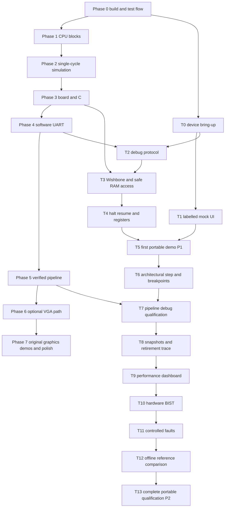
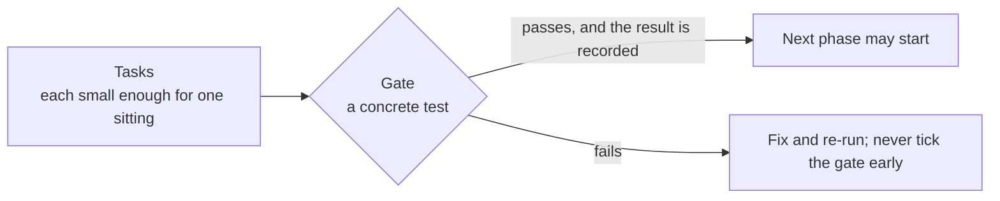
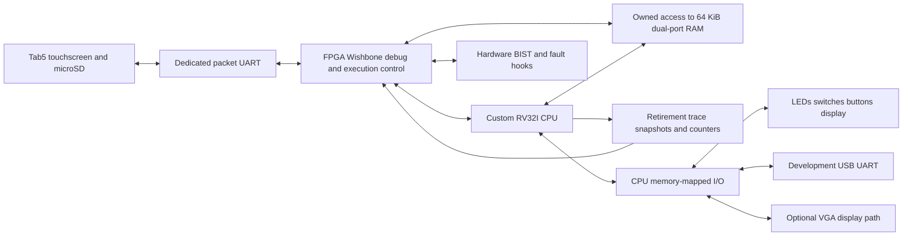
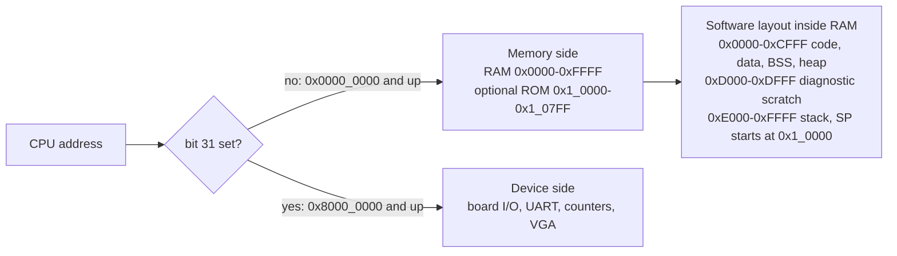
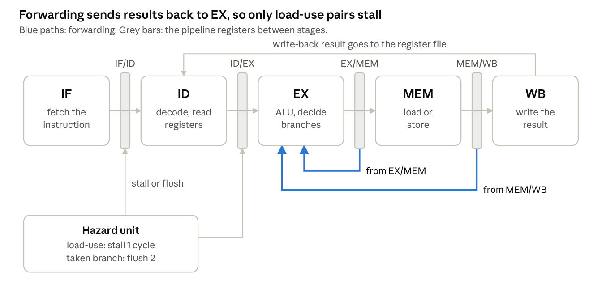
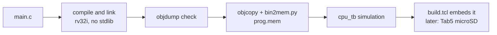

[Project README](../README.md) › [Docs index](README.md) › **Build plan**

# RISC-V computer build plan

This is the roadmap for the whole project: what gets built, in what order, and the test that
proves each step works. Read it to find the current phase, the next task, and the design
decisions every file must follow.

> [!IMPORTANT]
> **This file is the project's source of truth.** It defines the architecture decisions, memory
> map, phases, gates and progress. Its checkboxes are the only record of what is done: a box is
> ticked when its work lands, and a gate counts as passed only when its test has actually run.
> Status labels (IMPLEMENTED, IN PROGRESS, PLANNED, NOT VERIFIED) are defined in the
> [root README](../README.md#2-project-status).

| Where things stand (November 7, 2026) | |
| --- | --- |
| **Last gate passed** | ✅ Phase 0, November 7, 2026 |
| **Current phase** | Phase 1: Building blocks (0 / 6 tasks) |
| **Next task** | `rv32i_pkg.sv`; see [Smallest next implementation task](#15-smallest-next-implementation-task) |
| **Portable gates** | P1 (T5) and P2 (T13) not passed |

<details open>
<summary><b>Contents</b></summary>

1. [At a glance](#1-at-a-glance)
2. [Progress dashboard](#2-progress-dashboard)
3. [Planning package and current status](#3-planning-package-and-current-status)
4. [What we're building](#4-what-were-building)
5. [Design decisions](#5-design-decisions)
6. [Memory map](#6-memory-map)
7. [Repo layout and rules](#7-repo-layout-and-rules)
8. [How we test](#8-how-we-test)
9. [Build phases](#9-build-phases): [0](#phase-0-fresh-start) · [1](#phase-1-building-blocks) · [2](#phase-2-single-cycle-cpu-in-simulation) · [3](#phase-3-on-the-board-running-c) · [4](#phase-4-uart-text-to-your-laptop) · [5](#phase-5-the-5-stage-pipeline) · [6](#phase-6-vga-output) · [7](#phase-7-demos-and-polish)
10. [Tab5 milestones T0–T13](#10-tab5-milestones-portable-control-and-diagnostics)
11. [Software flow: from C to the board](#11-software-flow-from-c-to-the-board)
12. [Risks](#12-risks)
13. [The finish line](#13-the-finish-line)
14. [Open questions](#14-open-questions)
15. [Smallest next implementation task](#15-smallest-next-implementation-task)

</details>

We're building a 5-stage pipelined RV32I CPU from scratch in SystemVerilog on the Basys 3,
running C compiled with GCC.

- The **M5Stack Tab5** is the primary portable program launcher, console, hardware debugger and
  diagnostics interface.
- The **FPGA** executes the programs and implements the debug/test hardware; Tab5 operates and
  observes it.
- RAM, board I/O, the USB UART and the planned VGA output remain part of the design.

The November 6, 2026 restart now has a repository skeleton, planning documents and a **passed
Phase 0** (November 7): a counter smoke test, the `run_tests.py` runner, scripted Vivado build
and programming, a blink running on the board, and CI on GitHub Actions. CPU/debug RTL,
firmware and their tests remain pending. Ubuntu's Verilator/g++/Make/Python setup and Vivado
2025.2 have been checked; verify other tools before use.

Follow core Phases 0–5 in order. The Tab5 milestones below have explicit dependencies; the
retained VGA/demo path (Phases 6–7) does not block a portable demonstration.

> [!TIP]
> Tick the checkboxes in this file as tasks land, and update the
> [progress dashboard](#2-progress-dashboard) in the same change.

---

## 1. At a glance

The diagram shows the core CPU track (C0–C7) and the Tab5 track (T0–T13), with every
dependency between them. An arrow means "must pass first".



How to read it:

- **The CPU order remains deliberate:** correctness, board execution, UART, then pipeline.
- **Tab5-only work can start early.** Tab5-only bring-up and explicitly labelled mock UI can
  proceed after the Phase 0 flow exists.
- **Pipeline-specific debugging waits** for the pipeline gate.
- **T5 can demonstrate the single-cycle CPU** without waiting for VGA.

> [!NOTE]
> The older `images/roadmap.png` and `images/architecture.png` remain initial-plan artwork; the
> diagrams and dependencies in these documents supersede them.

---

## 2. Progress dashboard

Counted from the checkboxes in this file (November 7, 2026). Update this table whenever boxes
are ticked.

| Track | Tasks done | Gate | Status |
| --- | :-: | --- | --- |
| Planning package | 7 / 7 | Documents complete; not a hardware gate | ✅ IMPLEMENTED (documents) |
| Phase 0: Fresh start | 6 / 6 | ✅ Passed | ✅ DONE |
| Phase 1: Building blocks | 0 / 6 | Not passed | 📋 PLANNED |
| Phase 2: Single-cycle CPU in simulation | 0 / 10 | Not passed | 📋 PLANNED |
| Phase 3: On the board, running C | 0 / 9 | Not passed | 📋 PLANNED |
| Phase 4: UART text to your laptop | 0 / 6 | Not passed | 📋 PLANNED |
| Phase 5: The 5-stage pipeline | 0 / 10 | Not passed | 📋 PLANNED |
| Phase 6: VGA output (optional) | 0 / 6 | Not passed | 📋 PLANNED |
| Phase 7: Demos and polish | 0 / 6 | Not passed | 📋 PLANNED |
| Tab5 T0–T13 | 0 / 44 | None passed; P1 and P2 not passed | 📋 PLANNED |
| Open questions | 0 / 6 resolved | n/a | ❔ open |

### How to read a phase



| Term | Meaning |
| --- | --- |
| **Task** | A checkbox. |
| **Gate** | The test at the end of a phase or milestone that proves the phase works as a whole. |

> [!WARNING]
> Ticking every task does not by itself pass the gate. The gate's test must run and its evidence
> must be recorded (see the
> [gate evidence record](VERIFICATION_MATRIX.md#4-gate-evidence-record)).

---

## 3. Planning package and current status

- [x] Re-audit the November 6 planning baseline: skeleton and documents only; no working CPU, RAM, bus, UART, top-level or test infrastructure to assume. Current Phase 0 progress is recorded below.
- [x] Preserve the complete user proposal in [TAB5_REQUIREMENTS.md](TAB5_REQUIREMENTS.md), covering all 35 sections.
- [x] Define FPGA/debug architecture, CPU contracts, memory ownership and resource targets in [TAB5_INTEGRATION.md](TAB5_INTEGRATION.md).
- [x] Define the bounded, versioned protocol and retry/load rules in [DEBUG_PROTOCOL.md](DEBUG_PROTOCOL.md).
- [x] Select the firmware direction, modules, screens, offline storage and build/recovery approach in [TAB5_FIRMWARE.md](TAB5_FIRMWARE.md).
- [x] Review primary manufacturer sources and record electrical, revision, power and flash-boot gates in [HARDWARE_CHECKLIST.md](HARDWARE_CHECKLIST.md).
- [x] Map every proposal section to milestones and proof in [VERIFICATION_MATRIX.md](VERIFICATION_MATRIX.md), and align README/agent guidance/layout.

> [!NOTE]
> These are completed planning activities, not hardware gates. The owner's Tab5 SKU,
> board/display revision, battery and power arrangement remain unknown. That information is
> required at T0 before wiring/flashing, not to start the Phase 0 simulator smoke test. No Tab5
> milestone below is passed.

---

## 4. What we're building

The diagram shows the planned system: the Tab5 debug path on one side, the CPU's own
memory-mapped I/O on the other, and the RAM they share under an ownership rule.



- **The CPU only ever does loads, stores and instruction fetches.** The address alone decides
  whether a load or store reaches RAM, the board's LEDs and switches, the UART or the screen.
- **Debug access is a separate hardware control path.** It does not magically gain a third RAM
  port, bypass CPU side-effect rules, or run the CPU's programs on Tab5.

The detailed ownership, retirement, breakpoint and snapshot contracts are in the
[integration document](TAB5_INTEGRATION.md).

---

## 5. Design decisions

These are settled now so we never have to undo them mid-build. Each one can be changed, but
only on purpose.

### Core CPU

| Decision | Choice | Why |
| --- | --- | --- |
| Instruction set | Recognize all 40 RV32I base instructions: 37 ordinary operations plus FENCE, ECALL and EBREAK. FENCE runs as a no-op; ECALL and EBREAK each retire once then halt in this project's execution environment. | An RV32I compiler target with an explicitly limited halt environment, not a privileged trap implementation. Multiply/divide and CSRs are stretch goals. |
| Build order | Single-cycle CPU first, then the 5-stage pipeline | A working single-cycle CPU becomes the reference the pipeline is checked against, instruction by instruction. |
| Memory | One 64 KB dual-port block RAM holds code and data | C puts constants (strings, tables) right next to the code. With one memory, loads can read them. Port A fetches instructions while port B serves loads and stores. |
| Memory timing, single-cycle | Falling-edge RAM reads are the initial candidate; prove the complete fetch/PC/load schedule before integration | Simultaneously clocking two ports does not prove that a newly fetched instruction can generate its dependent load address in time. Keep block RAM inference and test the exact edge schedule at the initial 25 MHz target; revise this decision explicitly if it fails. |
| Memory timing, pipeline | Normal synchronous block RAM reads | The fetch fills the IF stage; a load's address goes out in MEM and its data comes back in WB. |
| Hazards | Full forwarding, a 1-cycle stall for load-use, branches resolved in EX with a 2-instruction flush (predict not-taken) | The textbook design from Harris & Harris ch. 7. It's easy to explain in an interview, and branch prediction can be added later as a measurable upgrade. |
| I/O | Memory-mapped at 0x8000_0000 and up | Software talks to every device with plain loads and stores, so no special instructions are needed. |
| Clocks | 100 MHz board clock into an MMCM: 25 MHz for the single-cycle CPU, as fast as timing allows for the pipeline, 25 MHz for VGA pixels | One clock source, generated cleanly; never divide clocks with counters. |

### Tools and software

| Decision | Choice | Why |
| --- | --- | --- |
| Simulation | Verilator 5 for every test; GTKWave for waveforms | Fast enough to run hundreds of programs per test run, free, and widely used in industry. |
| FPGA builds | Vivado in non-project (Tcl script) mode | Every bitstream can be rebuilt with one command, and no Vivado project clutter ends up in git. |
| Software | GCC with `-march=rv32i -mabi=ilp32`, no standard library; our own startup code, linker script and tiny printf | Small binaries we fully understand, with nothing hidden. |

### Portable debug and diagnostics

| Decision | Choice | Why |
| --- | --- | --- |
| Primary demonstration | Tab5 Demo Mode and Engineering Mode, fully offline | Portable program loading, actual CPU console/control/trace and diagnostics; no laptop or external monitor in normal operation. |
| Debug transport | Separate UART endpoint initially, 115200 8N1; COBS, CRC, session/request IDs and bounded chunks | Program text cannot become commands; retries cannot duplicate a hardware mutation. SPI is a later transport option. |
| Debug bus | Wishbone B4 Classic, 32-bit single-outstanding debug master; adapters to native CPU memory | Adds real bus engineering without requiring the CPU datapath to become Wishbone. Detailed profile and draft allocation are documented separately. |
| RAM ownership | CPU, DEBUG or BIST exclusive owner; debug RAM access only stopped/reset-held initially | Both RAM ports already have CPU jobs. Arbitration and fetch disable prevent races and unsupported extra ports. |
| CPU observation/control | Retirement record, drain-and-stop, one-instruction step token, pre-execution breakpoints | Clock pulses and retirement-only breakpoint matches do not provide correct pipeline debugging. |
| Tab5 firmware | ESP-IDF + FreeRTOS + LVGL with revision-compatible board support | Modular asynchronous firmware; dependency/driver versions are pinned after T0 on the actual device. |
| Hardware provenance | LIVE, CAPTURED, HISTORICAL and MOCK are distinct | No generated animation, reference result or cached number can be presented as current FPGA behavior. |

> [!NOTE]
> The instruction count follows the
> [ratified RV32I specification](https://docs.riscv.org/reference/isa/v20260120/unpriv/rv32.html);
> the earlier wording counted the 37 ordinary operations without its three fence/environment
> instructions. The chosen ECALL/EBREAK halt convention and unsupported trap behavior must be
> labelled as project policy in tests and reports.

---

## 6. Memory map

RAM starts at address 0, where the CPU begins running after reset. Every device lives at
0x8000_0000 or above, so the bus decoder can tell memory from devices by the top address bit
alone.

| Address | Size | What's there | Access |
| --- | --- | --- | --- |
| 0x0000_0000 – 0x0000_FFFF | 64 KB | Main RAM: code, data, stack. Reset starts here. | read, write, execute |
| 0x0001_0000 – 0x0001_07FF | 2 KB | Boot ROM for the optional UART bootloader (phase 4) | read, execute |
| 0x8000_0000 | 4 B | LEDs (16 bits) | write |
| 0x8000_0004 | 4 B | 7-segment display: 16-bit value shown in hex | write |
| 0x8000_0008 | 4 B | Switches (16 bits) | read |
| 0x8000_000C | 4 B | Buttons (5 bits) | read |
| 0x8000_0010 | 4 B | UART transmit byte | write |
| 0x8000_0014 | 4 B | UART status: bit 0 = transmitter busy, bit 1 = byte received | read |
| 0x8000_0018 | 4 B | UART received byte | read |
| 0x8000_0020 | 4 B | Cycle counter | read |
| 0x8000_0024 | 4 B | Instructions-retired counter | read |
| 0x8000_0028 | 4 B | VGA status: bit 0 = in vertical blank (safe to draw) | read |
| 0x8001_0000 – 0x8001_0FFF | 4 KB | VGA text buffer: 80 × 30 characters | write |
| 0x8002_0000 – 0x8002_3FFF | 16 KB | VGA pixel framebuffer | write |
| 0xF000_0000 | 4 B | Simulation only: tests write pass/fail here to end the run | write |

The C header `sw/common/mmio.h` will define one name per row, so programs never hard-code
addresses.

### How an address is decoded

The diagram shows the single decision the bus decoder makes, and the software layout planned
inside RAM.



### Debug address space

The CPU map above is unchanged. A separate debug-master space reserves
`0x4000_0000–0x4000_07FF` for debug windows; it is not exposed as CPU MMIO. RAM debug accesses
use the existing low addresses through the ownership adapter, and generic dumps cannot access
peripherals. See the [debug allocation](TAB5_INTEGRATION.md#debug-only-address-allocation).

### Software layout inside RAM (to be proven in Phase 3)

| Range | Size | Use |
| --- | --- | --- |
| `0x0000`–`0xCFFF` | up to 52 KiB | Code, data, BSS and heap |
| `0xD000`–`0xDFFF` | 4 KiB | Diagnostic scratch |
| `0xE000`–`0xFFFF` | 8 KiB | Stack, with initial SP `0x10000` |

Linker assertions, manifest checks, loader bounds and BIST ranges must agree before this policy
is frozen. No linker or memory controller exists yet.

> [!NOTE]
> **Documentation review notes (unresolved, not decisions).** Recorded so they are settled on
> purpose when `bus.sv` and `board_io.sv` are designed:
>
> - The top address bit separates memory from devices, but the memory side also contains the
>   optional ROM and the unmapped range `0x0001_0800 – 0x7FFF_FFFF`. The decoder's behavior for
>   unmapped addresses (error, ignore, or alias) is not specified yet.
> - The plan does not yet say whether reading the UART received byte (`0x8000_0018`) clears
>   status bit 1, or what happens when a second byte arrives before the first is read.
> - The 32-bit cycle counter wraps after about 172 seconds at 25 MHz (2³² cycles). Milestone T9
>   plans 64-bit counters; until then, measurements must be wrap-aware.

---

## 7. Repo layout and rules

The fresh repo gets this shape in phase 0, and every later file has an obvious home.

```text
risc-v-computer/
├── README.md
├── rtl/
│   ├── core/       CPU: rv32i_pkg, alu, regfile, imm_gen, decoder,
│   │               branch_unit, lsu, cpu_single, cpu_pipe, hazard, forward
│   ├── mem/        unified RAM, boot ROM
│   ├── io/         bus decoder, LEDs / 7-seg / switches, UART, VGA
│   ├── debug/      packet engine, Wishbone bridge, execution control, trace
│   ├── diag/       memory/ALU BIST and controlled fault hooks
│   └── top/        basys3_top.sv (the board's top level)
├── tb/             self-checking module and CPU benches; debug/ and diag/
├── sw/
│   ├── common/     crt0.S, link.ld, mmio.h, printf
│   ├── tests/      hand-written assembly tests, hazard zoo
│   ├── riscv-tests/ official rv32ui suite (git submodule) + our env header
│   └── programs/   fib, sieve, life, snake
├── scripts/        run_tests.py, build.tcl, program.tcl, bin2mem.py, upload.py
├── firmware/tab5/  ESP-IDF/LVGL touchscreen application
├── host/           Python protocol client, image preparation, reference tools
├── protocol/       versioned schemas and shared golden vectors
├── fpga/           basys3.xdc pin constraints
└── docs/           this plan, diagrams, timing and utilization reports, photos
```

Rules every file follows:

| Rule | Detail |
| --- | --- |
| Files | One module per file; the file is named after the module, in snake_case. |
| Style | `logic` everywhere, `always_ff` for flip-flops, `always_comb` for logic. No latches, and Verilator `-Wall` stays clean. |
| Names | Clock is `clk`, reset is `rst` (active high, synchronous). Shared types and constants live in `rv32i_pkg.sv`. |
| Commits | A module and its testbench land in the same commit, and no commit ever breaks the test run. |
| Git | Follow `AGENTS.md` for task branches and authorized Git delivery. When commits/tags are requested, keep completed tasks reviewable and tag only gates actually passed (`phase-1`, `phase-2`, … or `tab5-tN`). A local planning/edit request is not permission to push or merge. |

---

## 8. How we test

Every bug should be caught at the cheapest layer it can be. A wrong ALU result found by a unit
test takes minutes to fix; the same bug found on the board can take a day.

### Core CPU layers

| Layer | What it catches | How | Starts in |
| --- | --- | --- | --- |
| Unit testbenches | Wrong logic inside one block | Self-checking Verilator testbench: edge cases plus random inputs, compared against a reference model | Phase 1 |
| Directed assembly tests | An instruction behaving wrong in the full CPU | Small assembly programs that write pass/fail to 0xF000_0000; `cpu_tb` runs them | Phase 2 |
| Official riscv-tests (rv32ui) | Corner cases of the spec we didn't think of | About 40 programs, one per instruction, from the RISC-V project | Phase 2 |
| Instruction trace | Where exactly a program went wrong | `cpu_tb` prints PC, instruction, destination register and value for every instruction | Phase 2 |
| Lockstep compare | Pipeline bugs: missed forwarding, bad stalls and flushes | Run single-cycle and pipeline side by side and compare every register write | Phase 5 |
| On the board | Timing, pins, clocks, real I/O | Vivado timing report (no negative slack), the board's LEDs and display, the serial terminal, Vivado's ILA logic analyzer if needed | Phase 3 |
| Continuous integration | Old features breaking | GitHub Actions runs every test on every push | Phase 0 |

### Portable debug and diagnostics layers

| Layer | What it catches | How | Starts in |
| --- | --- | --- | --- |
| Debug protocol and bus | Corrupt frames, duplicate commands, wrong lanes/acknowledgments, unsafe ownership | Independent host/RTL vectors, ACK/ERR/watchdog tests, reset and retry injection | T2–T3 |
| Architectural debug | Lost stores, extra retirement, wrong-path stops, changed results with debug idle | Halt/step/breakpoint invariants and original CPU regression | T4, T6–T7 |
| Observation and diagnostics | Torn captures, lost trace, wrong counts, false BIST/fault/reference claims | Atomic snapshots, known event programs, real hardware tests and independent expected results | T8–T12 |
| Portable qualification | Laptop dependency, boot order, power/SD/link failure | Repeated cold boots and measured portable operation | T5, T13 |

> [!TIP]
> `python3 scripts/run_tests.py` runs every testbench that works in simulation and prints a
> pass/fail summary; GitHub Actions runs the same command on every push. The counter smoke test
> also runs through Cursor's default Ctrl+Shift+B task; see
> [PHASE0_SMOKE_TEST.md](PHASE0_SMOKE_TEST.md).

---

## 9. Build phases

Each phase is a list of tasks small enough to finish in one sitting, ending in a gate: a
concrete test that must pass before the next phase starts.

- That sequential rule applies to the core track through Phase 5 and each stated dependency in
  the Tab5 track.
- Phases 6–7 retain the original VGA/graphics route; neither is a prerequisite for P1 or P2.

| Phase | Goal | Tasks | Gate status |
| --- | --- | :-: | --- |
| [0](#phase-0-fresh-start) | One-command tests and bitstreams | 6 / 6 | ✅ Passed |
| [1](#phase-1-building-blocks) | Reusable CPU blocks, each proven alone | 0 / 6 | ⬜ Next |
| [2](#phase-2-single-cycle-cpu-in-simulation) | Single-cycle CPU in simulation | 0 / 10 | ⬜ |
| [3](#phase-3-on-the-board-running-c) | Real C on real hardware | 0 / 9 | ⬜ |
| [4](#phase-4-uart-text-to-your-laptop) | Text to a laptop | 0 / 6 | ⬜ |
| [5](#phase-5-the-5-stage-pipeline) | Five-stage pipeline | 0 / 10 | ⬜ |
| [6](#phase-6-vga-output) | VGA output (optional) | 0 / 6 | ⬜ |
| [7](#phase-7-demos-and-polish) | Demos and polish | 0 / 6 | ⬜ |

### Phase 0: Fresh start

**Goal:** a clean repo where every test and every bitstream can be rebuilt with one command.
**Status:** ✅ 6 / 6, gate passed.

- [x] Repo skeleton: README, `.gitignore` for Vivado output, `.gitattributes` for consistent line endings, and the folders above.
- [x] Verilator smoke test in WSL: `counter.sv` and `counter_tb.sv` pass 25 checks through the default Cursor build task; intentional failure is detected. [Evidence and run instructions](PHASE0_SMOKE_TEST.md).
- [x] `scripts/run_tests.py`: finds every testbench, builds and runs each with Verilator, and prints a pass/fail table.
  - Verified with Verilator 5.020 (Ubuntu 24.04): `counter_tb` and `basys3_top_tb` pass.
  - A wrong result, a build error and a bench that never prints `PASS` are each reported as failures with exit status 1.
- [x] `scripts/build.tcl`: a Vivado non-project build that reads `rtl/` and `fpga/basys3.xdc` and writes the bitstream plus timing and utilization reports.
  - Ran in Vivado 2025.2 (November 7, 2026): bitstream written, WNS +7.066 ns, WHS +0.268 ns, 42 registers.
- [x] Blink rebuilt through `build.tcl` and programmed onto the board, proving the scripted flow works end to end.
  - Programmed with `scripts/program.tcl` on November 7, 2026; LEDs count on the board.
  - `tb/basys3_top_tb.sv` passes in simulation.
- [x] GitHub Actions workflow that installs Verilator and runs `run_tests.py` on every push, with a status badge in the README.
  - Passing on GitHub Actions since November 7, 2026 (push and PR runs, and `main` after PR #4).

> **Gate:** `run_tests.py` passes in WSL and on GitHub Actions, and the scripted blink runs on the
> board. ✅ **Passed November 7, 2026.**

### Phase 1: Building blocks

**Goal:** the parts every later version of the CPU reuses, each proven on its own.
**Status:** 📋 0 / 6. **This is the current phase.**

- [ ] `rv32i_pkg.sv`: opcodes, the ALU operation list, and the control-signal struct, shared by every module.
- [ ] `alu.sv`: ADD, SUB, AND, OR, XOR, SLL, SRL, SRA, SLT, SLTU.
  - Test: tricky values (0, -1, the largest and smallest numbers, shifts of 31 and 32) plus 1,000 random inputs per operation against a reference model.
- [ ] `regfile.sv`: 32 registers of 32 bits, 2 read ports, 1 write port, x0 always 0. It has a `BYPASS` switch: off for single-cycle (on, it would create a loop), on for the pipeline so a register being written back can be read in the same cycle.
  - Test: every register written and read back, writes to x0 ignored, random sequences against a model.
- [ ] `imm_gen.sv`: the I, S, B, U and J immediates, sign-extended.
  - Test: hand-encoded instructions for each format, including negative and maximum values.
- [ ] `decoder.sv`: turns opcode, funct3 and funct7 into control signals (ALU op, operand sources, register write, load/store size, branch type, jump, write-back source, illegal).
  - Test: representative encodings of all 40 recognized base instructions check every control signal, including the documented FENCE/ECALL/EBREAK policy; unknown/reserved encodings raise illegal.
- [ ] `branch_unit.sv`: BEQ, BNE, BLT, BGE, BLTU, BGEU.
  - Test: signed and unsigned edge cases, such as -1 vs 1, where the two disagree.

> **Gate:** every Phase 1 testbench passes locally and in CI.

### Phase 2: Single-cycle CPU in simulation

**Goal:** every instruction finishes in one clock cycle. It's slow, but simple enough to get
exactly right, and it becomes the reference for everything after.
**Status:** 📋 0 / 10.

- [ ] Next-PC logic: PC + 4, branch and JAL targets (PC + immediate), and JALR ((rs1 + immediate) with bit 0 cleared). Reset sends the PC to 0x0000_0000.
- [ ] `lsu.sv` load/store unit: byte, halfword and word accesses; byte-enables for stores; sign or zero extension for loads. Misaligned accesses stop with a documented error; test that alignment contract rather than assuming every possible C program obeys it.
- [ ] `ram.sv`: the 64 KB dual-port memory with byte-write enables, loaded from a `.mem` file with `$readmemh`.
- [ ] `cpu_single.sv`: everything wired together. ECALL or EBREAK halts the simulation and prints the registers.
- [ ] Prove the synchronous RAM edge schedule in a dedicated memory/fetch/load test before CPU integration; document PC/data alignment and any deliberate timing-decision revision.
- [ ] Define a real retirement/terminal event and next-PC contract, including stores and instructions without register writes, so tests, counters and future debugging share one architectural boundary.
- [ ] `tb/cpu_tb.sv`: loads any program, runs until it halts or times out, checks the pass/fail word, and can print an instruction trace and dump waveforms for GTKWave.
- [ ] Directed assembly tests in `sw/tests/`, one per group: register ALU, immediate ALU, loads and stores, branches, jumps, LUI/AUIPC.
- [ ] The official rv32ui suite from riscv-tests, with a small custom environment header (the stock one uses CSR instructions we don't implement).
- [ ] Fibonacci in assembly: fib(1) to fib(20) written to memory and checked by the testbench.

> **Gate:** all of rv32ui and every directed test pass in simulation.

### Phase 3: On the board, running C

**Goal:** the CPU leaves simulation and runs real C code on real hardware. This is where it
stops feeling like a toy.
**Status:** 📋 0 / 9.

- [ ] `fpga/basys3.xdc`: clock, the center button as reset, 16 LEDs, 16 switches, 5 buttons, the 7-segment display and the UART pins, copied from the Digilent Basys 3 master XDC.
  - *A Phase 0 subset (clock, center button and 16 LEDs, for the blink) already exists.*
- [ ] Clocking: an MMCM turns the 100 MHz board clock into the 25 MHz CPU clock. Reset goes through a synchronizer, and buttons through a debouncer.
- [ ] `bus.sv`: sends addresses at 0x8000_0000 and above to devices instead of RAM.
- [ ] `board_io.sv`: LEDs, switches, buttons, and a 7-segment driver that shows a 16-bit value in hex by cycling through the 4 digits about 1,000 times a second.
- [ ] Cycle and instructions-retired counters, so programs can time themselves from day one.
- [ ] Software basics: `crt0.S` (sets the stack pointer, clears .bss, calls `main`), `link.ld` (places code and data in the 64 KB RAM), `mmio.h`, and `scripts/bin2mem.py` (compiled binary into a `.mem` file).
- [ ] Prove linker bounds/reservations, image/BSS/stack metadata, reset-held memory ownership, and separate CPU/debug reset behavior needed for later safe loading; keep the original board program working.
- [ ] Every C program runs in `cpu_tb` before it goes near the board.
- [ ] Timing: Vivado's report shows no negative slack at 25 MHz.

> **Gate:** a C program reads a number from the switches, computes that Fibonacci number, and
> shows it on the 7-segment display (fib(20) = 6765 = 0x1A6D).

### Phase 4: UART text to your laptop

**Goal:** the CPU gets a voice.
**Status:** 📋 0 / 6.

> [!NOTE]
> This comes before the pipeline on purpose: printed output and timing numbers make the pipeline
> far easier to debug and measure on the board.

- [ ] `uart_tx.sv`: 115200 baud, 8 data bits, no parity, 1 stop bit. At 25 MHz that's 217 clocks per bit.
  - Test: the testbench decodes the serial line and checks every byte.
- [ ] `uart_rx.sv`: a 2-flip-flop synchronizer on the input, then sampling in the middle of each bit.
  - Test: a loopback testbench wires TX into RX and sends all 256 byte values.
- [ ] UART registers on the bus (transmit, status, receive), per the memory map.
- [ ] Software: `putc`, `puts`, `getc` and a small `printf` that handles %d, %u, %x, %s and %c.
- [ ] Laptop side: the Basys 3's USB cable already carries the UART, so no extra wiring. Open its COM port in PuTTY or Tera Term on Windows.
- [ ] Optional recovery path: a UART bootloader in the 2 KB boot ROM, with an explicit reset-vector/boot-selector design because the normal reset PC is 0. The primary Tab5 loader will use hardware debug access to RAM; this ROM path must not be its prerequisite.

The tested UART blocks will also be reused by T2's dedicated packet endpoint. CPU console and
debug traffic stay distinct; adding the Tab5 does not remove the USB console gate.

> **Gate:** the board prints "hello, world" and a live counter in the terminal, and echoes back
> what you type.

### Phase 5: The 5-stage pipeline

**Goal:** the hardest and most impressive phase. Five instructions are in flight at once, one in
each stage: fetch (IF), decode (ID), execute (EX), memory (MEM) and write-back (WB). The
single-cycle CPU stays in the repo as the reference model.
**Status:** 📋 0 / 10.



A result is usually needed by the very next instruction before it has been written back, so
forwarding hands it straight to EX. The one case forwarding can't fix is a load followed by its
user, because the loaded value only arrives in WB.

<details>
<summary><b>Walkthrough: the two cases that cost cycles</b> (planned behavior)</summary>

**Load-use stall.** `lw x5, 0(x6)` is followed directly by `add x7, x5, x5`. The add cannot
execute until the loaded value exists, so the hazard unit holds it in ID for one cycle (a
**bubble** enters EX) and then forwards the value from MEM/WB:

| Cycle → | 1 | 2 | 3 | 4 | 5 | 6 |
| --- | :-: | :-: | :-: | :-: | :-: | :-: |
| `lw x5, 0(x6)` | IF | ID | EX | MEM | **WB** | |
| `add x7, x5, x5` | | IF | ID | ID *(stall)* | **EX** | MEM |

**Taken-branch flush.** Branches resolve in EX and the pipeline predicts not-taken, so by the
time `beq` is known to be taken, the two instructions after it have already been fetched. They
are flushed (turned into bubbles that never retire) and fetch restarts at the target:

| Cycle → | 1 | 2 | 3 | 4 | 5 |
| --- | :-: | :-: | :-: | :-: | :-: |
| `beq x1, x2, target` (taken) | IF | ID | **EX** | MEM | WB |
| next instruction | | IF | ID ✗ | | |
| the one after | | | IF ✗ | | |
| `target:` first instruction | | | | IF | ID |

✗ = flushed. A taken branch therefore costs two cycles; a not-taken branch costs none.

</details>

- [ ] Split `cpu_pipe.sv` into the 5 stages, with a packed struct for each pipeline register and a valid bit that travels with every instruction.
- [ ] Switch memory to normal synchronous reads. The block RAM's own output register doubles as the IF/ID register, so a stall must hold the RAM's enable low to keep the instruction steady.
- [ ] First pass with no hazard handling: tests with 3 NOPs between dependent instructions must pass.
- [ ] `forward.sv`: EX/MEM to EX and MEM/WB to EX, for both source registers and for store data. The register file bypass covers WB to ID. A write to x0 must never be forwarded.
- [ ] `hazard.sv`: a load followed by an instruction that uses its result stalls 1 cycle. A taken branch, JAL or JALR flushes the 2 younger instructions.
- [ ] Hazard zoo test: dependencies at distances 1, 2 and 3; load-use; load then store of the same register; a branch on a just-computed value; JAL/JALR with the return address used right away; x0 as a destination.
- [ ] Lockstep testbench: single-cycle and pipeline run the same program; compare ordered retirement PC/instruction, register writes and memory side effects. Include instructions that do not write a register. The first architectural mismatch points at the failing event.
- [ ] rv32ui, the hazard zoo and every C program pass on the pipeline, in simulation and then on the board.
- [ ] Push the clock: try 50 MHz, then higher, until timing fails. Record the top speed (Fmax) and the LUT, flip-flop and block RAM use.
- [ ] Measure CPI (clock cycles per instruction) for each program with the hardware counters, and fill a single-cycle vs pipeline table for the README.

> **Gate:** lockstep, hazard zoo and rv32ui all pass, the C programs run on the board, and the
> performance table is filled in.

### Phase 6: VGA output

**Goal:** the computer draws on a monitor, starting with text because it's cheap in memory and
immediately useful.
**Status:** 📋 0 / 6, optional.

> [!NOTE]
> This retained display track follows the pipeline when selected. It is not on the critical path
> to the primary Tab5 demonstrations; its original tasks and gate remain available.

- [ ] `vga_timing.sv`: 640 × 480 at 60 Hz (800 × 525 clocks per frame, both syncs active low). The spec pixel clock is 25.175 MHz; 25 MHz from the MMCM works on almost every monitor.
  - Test: simulation checks every porch and sync width.
- [ ] Color bars on the monitor first, to prove timing and the 12-bit color pins (4 bits each of red, green and blue) before involving the CPU.
- [ ] Text mode: 80 × 30 characters with an 8 × 16 font in block RAM (a public-domain font converted with a script). The character buffer is dual-port RAM: the CPU writes on its clock, the screen reads on the pixel clock, so the two clocks never touch the same logic.
- [ ] Pixel mode: a 160 × 120 framebuffer with each pixel drawn as a 4 × 4 block, 4 bits per pixel (9.6 KB).
- [ ] A vertical-blank status bit, passed safely into the CPU's clock domain, so software can draw between frames without tearing.
- [ ] Software: `vga_putc` and `vga_printf` for text, `set_pixel` and `clear` for graphics.

> **Gate:** one C program prints text and draws pixels on a monitor.

### Phase 7: Demos and polish

**Goal:** turn a working computer into something you can show in 60 seconds and explain for 30
minutes.
**Status:** 📋 0 / 6.

- [ ] Conway's Game of Life on the VGA framebuffer: switches pick the starting pattern, a button restarts it.
- [ ] Prime sieve that prints primes over UART and reports how many cycles it took.
- [ ] One playable game, Snake or Pong, using the board's buttons.
- [ ] README: what it is, block and pipeline diagrams, memory map, how to build and run, test results, the performance table (Fmax, CPI, resource use) and photos.
- [ ] Timing and utilization reports saved in `docs/`.
- [ ] A 60-second demo video, a one-page architecture sheet, and a short write-up of the hardest bug.

> **Gate:** all three demos run from a cold power-on, and someone else could rebuild everything
> from the README alone.

This is the retained original graphics/portfolio gate. Tab5's first portable and complete
diagnostics gates are T5/P1 and T13/P2 below. Its portable program set uses UART/packet output
and does not wait for these VGA games. Keep any later Tab5-rendered game state computed by the
FPGA CPU.

---

## 10. Tab5 milestones: portable control and diagnostics

Every checkbox in this track is pending implementation. Dependencies identify gates that must
pass, not merely files that must exist. See [VERIFICATION_MATRIX.md](VERIFICATION_MATRIX.md) for
REQ-01 through REQ-35 and the tests that prove them.

> [!IMPORTANT]
> Keep original CPU regression passing at every integration step.

| Milestone | Delivers | Depends on | Status |
| --- | --- | --- | --- |
| [**T0**](#t0-identify-and-bring-up-the-actual-tab5) | Identify the actual Tab5; display, touch, microSD and UART checks; approved wiring and power | Phase 0 | 📋 |
| [**T1**](#t1-responsive-ui-foundation-with-labelled-mock-data) | Responsive UI framework with clearly labelled MOCK data | T0 | 📋 |
| [**T2**](#t2-reliable-framed-debug-communication) | Framed, CRC-checked, replay-safe debug link | Phase 4 UART blocks, T0 | 📋 |
| [**T3**](#t3-wishbone-bridge-and-controlled-ram-access) | Debug-only Wishbone bridge and owned RAM access | Phase 3, T2 | 📋 |
| [**T4**](#t4-safe-cpu-execution-control-and-architectural-state) | HALT, RESUME, reset, registers and memory while stopped | T3, Phase 2 retirement contract | 📋 |
| [**T5 = P1**](#t5-first-complete-offline-portable-demonstration-p1) | First laptop-free demo: microSD load, verified run, real console and counters | Phases 0–4, T0–T4 | 📋 |
| [**T6**](#t6-true-instruction-stepping-and-hardware-breakpoints) | Exact single-instruction STEP and pre-execution breakpoints | T5 | 📋 |
| [**T7**](#t7-requalify-execution-control-on-the-pipeline) | The same control requalified on the pipeline | Phase 5, T6 | 📋 |
| [**T8**](#t8-coherent-pipeline-snapshots-and-retirement-trace) | Coherent pipeline snapshots and a 256-entry retirement trace | T7 | 📋 |
| [**T9**](#t9-measured-performance-and-benchmark-records) | 64-bit performance counters and benchmark records | T8 | 📋 |
| [**T10**](#t10-dedicated-hardware-memory-and-alu-self-test) | Hardware memory March test and actual-ALU self-test | T9 | 📋 |
| [**T11**](#t11-controlled-hardware-fault-injection-and-detection) | Controlled, bounded fault injection and detection | T10 | 📋 |
| [**T12**](#t12-offline-architectural-reference-comparison) | Offline comparison against an independent RV32I reference | T8, T11 | 📋 |
| [**T13 = P2**](#t13-complete-portable-diagnostics-and-presentation-p2) | Complete portable diagnostics, enclosure, evidence bundle | Phase 5, T0–T12 | 📋 |

**Part A, the road to the first portable demo (T0–T5).** These milestones need only the
single-cycle CPU.

### T0: Identify and bring up the actual Tab5

**Depends on:** Phase 0 build/test foundation; no completed CPU required.

- [ ] Identify SKU, PCB/display/touch revision, installed battery and matching schematic; fill the hardware checklist rather than guessing from the product name.
- [ ] Validate ESP-IDF/LVGL board support: display, touch, microSD read/write and UART known-byte/loopback operation; pin tested dependency versions and recovery instructions.
- [ ] Complete electrical/pin/power checks before connecting FPGA signals; document the approved signal-only cable and independent supplies.

> **Gate:** the actual Tab5 passes all four peripheral checks with a reproducible build/recovery
> record and an approved pin/voltage/power table. Unknown device revision does not pass this gate.

### T1: Responsive UI foundation with labelled mock data

**Depends on:** T0.

- [ ] Implement board/transport/protocol/device/storage/state/UI boundaries and bounded task queues; do not block LVGL callbacks on serial or files.
- [ ] Create Home, Programs, Terminal and System shells plus navigation for all planned screens; show unavailable capabilities clearly.
- [ ] Use persistent MOCK labels, simulate connection/error states, and prove Demo/Engineering navigation preserves application state. Store all assets locally.

> **Gate:** display/touch remain responsive during simulated transfers/disconnects; no mock
> reading or action is presented as live FPGA behavior. Record responsiveness and memory use.

### T2: Reliable framed debug communication

**Depends on:** Phase 4's tested UART blocks and T0; host-only codec work may begin after Phase 0.

- [ ] Freeze the shared header, opcode/status/capability schemas and golden vectors; implement independent Python and FPGA packet codecs using the documented bounds/CRC/COBS rules.
- [ ] Implement HELLO, PING, STATUS, sessions, safe identical retries, bounded queues/timeouts, and capability discovery on a dedicated debug UART instance.
- [ ] Simulate malformed/corrupt/truncated packets, reset, lost replies, duplicates, ID conflicts and recovery; then connect the verified Tab5 link without changing the CPU USB console.

> **Gate:** protocol vectors and failure cases pass; the real Tab5 reads correct FPGA
> identity/status after reset and reconnect, with no duplicate side effect and no text/command
> mixing.

### T3: Wishbone bridge and controlled RAM access

**Depends on:** Phase 3 memory/top-level contracts and T2.

- [ ] Implement the B4 Classic debug master, explicit CSR slave definitions, word-address conversion, byte selects, ACK/ERR, address rejection and watchdog.
- [ ] Add native RAM adapters and CPU/DEBUG/BIST ownership. Initially use RESET_HELD or acknowledged HALTED; disable instruction fetch while lending RAM.
- [ ] Verify safe test-register and scratch-RAM reads/writes at byte/halfword/word sizes, wait states, invalid addresses, reset and uncertain write completion.

> **Gate:** self-checking bus/ownership tests pass and Tab5 reads back actual scratch/test-register
> values on the board; CPU ports never contend with debug. No assumed third RAM port.

### T4: Safe CPU execution control and architectural state

**Depends on:** T3 and the Phase 2 retirement contract; first use the verified single-cycle CPU.

- [ ] Implement HALT/RESUME, separate CPU_RESET/RESTART behavior, running/requested/drained status and defined last-retired/next PC fields.
- [ ] Provide committed register read/write access with x0 rejection, stable snapshot generation and memory editing while stopped.
- [ ] Prove reset/link independence, no lost/duplicated side effects, no uncontrolled clock gating, and debug-idle equivalence.

> **Gate:** simulation and board tests halt/resume correctly and inspect/edit real state; a
> program with no intentional edits has the same architectural results as without debug.

### T5: First complete offline portable demonstration (P1)

**Depends on:** Phases 0–4 and T0–T4. Phase 5 pipeline and Phase 6 VGA are not prerequisites.

- [ ] Define/generated-check program manifests and the linker reservations; implement microSD launcher, BEGIN/CHUNK/COMMIT loader, actual RAM readback CRC and verified-image-only RUN.
- [ ] Implement the packet console backend while preserving the development USB UART; show genuine CPU output/input and baseline atomic counters on Tab5.
- [ ] Add reproducible FPGA configuration-flash programming and Tab5 auto-start/recovery; verify the actual flash part and portable supplies.
- [ ] Test corrupt/interrupted loads, invalid bounds/ISA/entry, missing SD, disconnect and both boot orders. Load program A, run it, then load/run B without changing the bitstream.

> [!IMPORTANT]
> **Gate P1:** ten successful laptop-free cold boots, a working SD program launcher, verified
> A-to-B execution on the custom FPGA CPU, real console output and counters, and recovery from a
> link interruption. No external monitor or network is required. Save hashes, trial counts and
> observations.

**Part B, the road to complete diagnostics (T6–T13).** From T7 on, these milestones need the
verified pipeline.

### T6: True instruction stepping and hardware breakpoints

**Depends on:** T5, including T4 control and a working portable loader; use the single-cycle
implementation first.

- [ ] STEP admits one instruction token and returns to drained HALTED after exactly one retirement or defined terminal/error event, including stores and x0/NOP instructions.
- [ ] Add two pre-execution PC breakpoints with enable/list/clear and a one-instruction resume bypass; show actual changed registers and correct next PC.
- [ ] Test loads/stores, jumps/branches, termination, repeated PCs and reset; verify actual board behavior, not just a UI button.

> **Gate:** each successful step has exactly one intended architectural completion, and a
> breakpoint stops before its instruction changes state, then resumes with progress.

### T7: Requalify execution control on the pipeline

**Depends on:** Phase 5 gate and T6.

- [ ] Implement drain/stop and single-instruction admission with stage valid bits, safe memory/console completion and no younger architectural side effects.
- [ ] Reject wrong-path breakpoint candidates after older branch/jump redirects; consume bypass only for real instruction progress.
- [ ] Run hazard zoo, rv32ui, retirement/store lockstep, debug-idle equivalence and halt/step tests at every relevant stage/stall boundary.

> **Gate:** the original pipeline gate still passes; pipeline HALT/STEP/breakpoint invariants
> hold in simulation and on the board, with timing/resource reports for debug overhead.

### T8: Coherent pipeline snapshots and retirement trace

**Depends on:** T7.

- [ ] Add atomic stage/counter snapshot latches with valid/stall/flush data, cycle/generation metadata and capture-age UI labels.
- [ ] Add an initially 256-entry circular retirement buffer with an 8 KiB compact-record target; freeze/read descriptors prevent races and identify overflow/wrap.
- [ ] Implement RV32I trace disassembly and event display; verify order, store data, excluded flushed instructions, whole-record freeze and bandwidth limits.

> **Gate:** real captured state/history matches controlled test programs and simulation; trace
> wrap and stale captures are identified, with no claim of full-speed UART cycle streaming.

### T9: Measured performance and benchmark records

**Depends on:** T8; Phase 3 baseline counters remain usable at P1.

- [ ] Add 64-bit event counters, precise active/wall/halted definitions and atomic multiword snapshots, preserving documented low-word CPU MMIO views.
- [ ] Display interval/cumulative cycles, retirements, defined stalls/flushes/taken branches and CPI with zero-count handling; show configured clock separately from measured Fmax.
- [ ] Run repeatable programs and export versioned benchmark reports to SD; label stored single-cycle/pipeline comparisons as historical.

> **Gate:** exact event-count programs, rollover and atomic-read tests pass; dashboard/export
> values match actual hardware intervals and identify program/build/clock.

### T10: Dedicated hardware memory and ALU self-test

**Depends on:** T9, verified ownership/control, and the actual Phase 1 ALU.

- [ ] Implement a memory March controller over reserved scratch RAM; add an explicitly destructive full-RAM option with confirmation, image invalidation and required reload.
- [ ] Exercise the actual CPU ALU via an owned hardware test path and independent known-answer vectors; label CPU software self-tests separately.
- [ ] Report test/range, cases, PASS/FAIL/ERROR, failure count, first address/op/operands, expected and observed data; test abort/cleanup.

> **Gate:** real RAM and ALU tests pass fault-free and detect deliberately modelled testbench
> faults; hardware results are retrievable through Tab5. Tests never silently overwrite an active
> program/stack.

### T11: Controlled hardware fault injection and detection

**Depends on:** T10.

- [ ] Add a reset-disarmed, one-use arm/fire path with supported scratch/register target, mask, trigger/duration and exclusive ownership; restrict all other targets.
- [ ] Record original/requested/resulting state, detection and restoration; distinguish ordinary debug writes from read-path/stuck-at fault models.
- [ ] Demonstrate a fault that remains observable during the diagnostic. A pre-test bit flip that March writes overwrite is not a valid detection demonstration.

> **Gate:** tests prove only the selected bit/address/event changes, the diagnostic detects it,
> and normal operation returns after explicit cleanup, including abort/reset cases.

### T12: Offline architectural reference comparison

**Depends on:** T8 complete trace/control and T11 controlled-fault evidence; retain original
CPU reference regressions.

- [ ] Prepare deterministic programs with equivalent PC/register/RAM/input state and independently computed expected retirements, stores and next-PC behavior.
- [ ] Compare offline on Tab5, using a bounded model or SD expected records as measured resources allow. Use stepwise/bounded complete capture, not an unbounded trace stream over UART.
- [ ] Report the earliest proven mismatch and expected/actual context. Missing records or nondeterministic inputs produce an explicit inconclusive result, not an invented root cause.

> **Gate:** known-correct runs compare cleanly; controlled divergences are located correctly;
> gaps/unsupported behavior are handled honestly; no laptop/reference service is needed at
> runtime.

### T13: Complete portable diagnostics and presentation (P2)

**Depends on:** Phase 5 and T0–T12. The optional VGA path may be added independently.

- [ ] Finish all capability-backed screens, Demo/Engineering navigation, local About/architecture material, readable state labels and benchmark/diagnostic report export.
- [ ] Build the retained-cable stand/enclosure, verify current/thermal/low-power behavior, measure runtime, and document exact hardware/firmware recovery steps.
- [ ] Rehearse a short presentation (identify -> SD load -> real output -> counters -> halt/step/trace) and a deeper sequence (breakpoint -> BIST -> fault detection -> reference report).
- [ ] Complete the evidence bundle, reproducible builds for FPGA/Tab5/programs, resource/timing reports, photos, architecture sheet, demo video and verified portfolio claims.

> [!IMPORTANT]
> **Gate P2:** twenty consecutive offline cold boots and the full real-hardware sequence pass;
> thirty-minute reliability and disconnect/SD/reset tests pass; power/runtime and responsiveness
> are measured; another person can reproduce the system from the documentation. Do not mark
> complete from UI-only or simulated results.

---

## 11. Software flow: from C to the board

A C program reaches the CPU in six steps. Compiling and simulating happen in WSL; Vivado and the
serial terminal run on Windows.



1. Write `main.c` in `sw/programs/<name>/`, using the names in `mmio.h` for devices.
2. Compile and link for RV32I with no standard library. RV32I has no multiply or divide
   instructions, so `-lgcc` pulls in GCC's software versions:

   ```bash
   riscv32-unknown-elf-gcc -march=rv32i -mabi=ilp32 -O2 -ffreestanding -nostdlib \
       -T sw/common/link.ld sw/common/crt0.S main.c sw/common/printf.c -lgcc -o prog.elf
   ```

3. Check the output with `riscv32-unknown-elf-objdump -d prog.elf`: the code should start at
   address 0 and use only RV32I instructions.
4. Convert it: `riscv32-unknown-elf-objcopy -O binary prog.elf prog.bin`, then
   `python3 scripts/bin2mem.py prog.bin prog.mem`.
5. Simulate it: `cpu_tb` loads `prog.mem` and runs it. Bugs get caught here, where you can see
   every signal.
6. Initially embed `prog.mem` in RAM through `build.tcl`. At T5, package the binary and checked
   manifest for microSD, then select, transfer, verify and run it from Tab5 without a bitstream
   rebuild. The optional ROM recovery loader may later use `scripts/upload.py`; it is separate
   from the primary hardware debug loader. Timing claims require measurement.

> [!TIP]
> If your toolchain was installed as `riscv64-unknown-elf-*` instead, the same flags work with
> that prefix as long as it was built with 32-bit (multilib) support.

---

## 12. Risks

Pipeline correctness and precise debug control are the main logical risks. Physical
integration, UART bandwidth and FPGA resources introduce separate gates.

### Core CPU risks

| Risk | Early warning sign | What we do |
| --- | --- | --- |
| Pipeline hazards eat weeks | Wrong values that appear only in the pipelined CPU | Lockstep compare against the single-cycle CPU, the hazard zoo test, and keeping single-cycle working so there's always a reference |
| Block RAM's one-cycle read delay | Instructions off by one; loads returning the previous value | Memory timing decided up front (see [Design decisions](#5-design-decisions)) and a dedicated memory testbench before wiring it in |
| Passes in simulation, fails on the board | Garbage on the LEDs; negative slack in the timing report | Read the timing report every build; check clock and reset first; show internal values on the 7-segment; use Vivado's ILA to watch live signals |
| Slow edit-build-run loop | Minutes of Vivado per C change | The UART bootloader in phase 4 |
| Tool friction between WSL and Windows | Time spent on setup instead of design | One script per job; WSL for simulation and GCC, Windows for Vivado and the serial port |
| Scope creep | Starting VGA before UART works | Gates: no phase starts before the previous one passes |
| Class workload | Long gaps between sessions | Tasks small enough for one sitting; the checkboxes show exactly where to pick up |

### Portable debug risks

| Risk | Early warning sign | What we do |
| --- | --- | --- |
| Debug steals a nonexistent third RAM port | Corrupted program/state during inspection | Exclusive CPU/DEBUG/BIST ownership, disabled fetch, ACK/ERR and pending-transfer tests |
| Clock pulse mistaken for instruction step | Extra stores/retirements or incomplete execution | One-instruction admission and retirement/terminal-event assertions, then pipeline requalification |
| UART saturated by console/trace | Frozen UI, missing records, delayed HALT | Bounded packets/queues, control priority, coarse snapshots and frozen trace retrieval |
| Tab5 revision or power assumption is wrong | No display/touch, voltage conflict, brownout | Exact SKU/driver/board identification and measured electrical/power gate; currently unknown |
| Trace/debug/VGA exceed resources or timing | BRAM fragmentation, worse critical path | Incremental synthesis, payload/physical-resource distinction, bounded buffers and optional VGA path |
| Unsafe retry or interrupted load | Duplicate mutation, partially executed image | Session/ID replay rules, operation IDs, independent RAM readback, invalid-image interlock |
| BIST overwrites the injected fault | A misleading PASS after corruption disappears | Inject during a defined read phase or verify a seeded baseline; prove actual detection |
| Reference comparison loses evidence | False claim of first divergence | Complete deterministic step/capture intervals; explicit loss/inconclusive status |

---

## 13. The finish line

The primary project finish line is **P2/T13 with the verified Phase 5 pipeline**. P1/T5 is the
first independent portable demonstration. The retained Phase 6–7 VGA/graphics path remains a
separate supported goal.

What "finished" looks like:

- A Basys 3 and Tab5 that boot from portable power, load multiple programs from microSD, execute
  them on the custom FPGA CPU and show genuine output without a laptop or external monitor.
- Actual hardware halt/resume/step/breakpoints, register/memory access, captured
  pipeline/retirement history, performance counters, BIST, controlled fault detection and offline
  comparison, all backed by the verification matrix.
- A public repo with all the RTL, a test for every module, a CI badge showing the tests pass, and
  a README with diagrams and numbers.
- A single-cycle vs pipeline table: top clock speed, CPI per program, and LUT, flip-flop and
  block RAM use.
- A 60-second video, a one-page architecture sheet, and a write-up of the hardest bug.
- A resume bullet backed by every claim in it:

> *Designed and verified a 5-stage pipelined RV32I processor in SystemVerilog with full
> forwarding and hazard detection; integrated UART and VGA over a memory-mapped bus; ran
> self-compiled C programs on a Xilinx Artix-7 at [X] MHz; verified against the official RISC-V
> test suite with continuous integration.*

### Stretch goals

After the core portable gates; prioritize by measured benefit rather than adding unverified
scope:

| Goal | What it adds |
| --- | --- |
| **RV32M** | Hardware multiply (using the FPGA's DSP blocks) and a multi-cycle divider. Measure the speedup on C programs. |
| **Branch prediction** | A 2-bit predictor with a branch target buffer; measure the CPI drop against predict-not-taken. |
| **CSRs and traps** | The `rdcycle` and `rdinstret` counters, ECALL into a handler, and timer or UART interrupts. |
| **Formal verification** | Add the RVFI trace port and run riscv-formal checks. Rare at the student level and strong with recruiters. |
| **CoreMark** | Run the standard embedded benchmark and quote a CoreMark/MHz score. |
| **Faster transport** | SPI reusing the logical command protocol, if measured UART limits justify it. |
| **Richer debugging** | More breakpoints, data watchpoints, triggered traces, symbols/source correlation and ELF loading. |
| **Broader diagnostics** | Additional event counters/fault models and expanded reference coverage, with explicit resource and proof budgets. |
| **Tiny Tapeout** | Put a small block, like the ALU, on a real chip. |

---

## 14. Open questions

- [ ] Does the class set a deadline, or require a particular design (for example single-cycle only, or a fixed instruction list)?
- [ ] Establish any standing authorization for commits/pushes/PRs if desired; until then follow the existing local-edit and task-branch rules in `AGENTS.md`.
- [ ] Is the toolchain in WSL named `riscv32-unknown-elf-gcc` or `riscv64-unknown-elf-gcc`? `ls /opt/riscv/bin` answers it.
- [ ] Confirm the owner's Tab5 SKU, board/display/touch revision, battery and power source; the owner currently does not know. Record evidence at T0 before pin/driver/power approval.
- [ ] Confirm the actual Basys 3 revision/flash part, available power outputs and the final verified cable/stand design.
- [ ] Freeze exact ESP-IDF/BSP/LVGL versions after actual-device bring-up; validate the B4 profile and CSR offsets at T3, linker/manifest reservations at Phase 3/T5, and measured trace/resource budgets at T8.

---

## 15. Smallest next implementation task

Phase 0 has passed: `run_tests.py`, `build.tcl`, the programmed blink and the GitHub Actions run
are all recorded above. CPU/debug RTL and Tab5 firmware remain pending.

**Next:** the first [Phase 1](#phase-1-building-blocks) task.

1. Write `rtl/core/rv32i_pkg.sv`: opcodes, the ALU operation list and the control-signal struct.
2. Then write `alu.sv` together with its self-checking testbench, in the same commit.
3. Run `python3 scripts/run_tests.py` in WSL and let GitHub Actions run it on the push.
4. Tick each box only when its work lands, and update the [progress dashboard](#2-progress-dashboard).

---

**Related:** [Integration architecture](TAB5_INTEGRATION.md) · [Debug protocol](DEBUG_PROTOCOL.md) · [Tab5 firmware](TAB5_FIRMWARE.md) · [Hardware checklist](HARDWARE_CHECKLIST.md) · [Verification matrix](VERIFICATION_MATRIX.md) · [Original Tab5 requirements](TAB5_REQUIREMENTS.md) · [Docs index](README.md)
