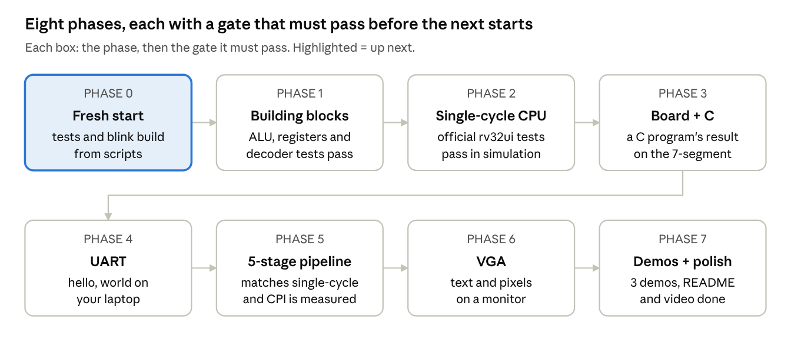
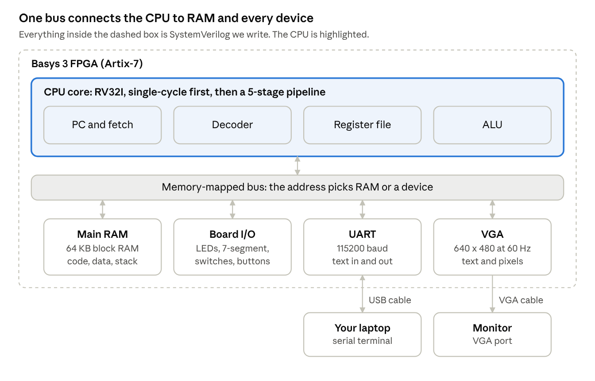

# RISC-V computer build plan

We're building a 5-stage pipelined RV32I CPU from scratch in SystemVerilog, putting it on the Basys 3 with RAM, UART and VGA, and running C programs compiled with GCC on it. The repo was wiped on Nov 6, 2026, so everything below starts from zero; the tools (Vivado, Verilator, GTKWave, RISC-V GCC) are already installed. We go one tested piece at a time, and no phase starts until the one before it passes its gate.

Tick the checkboxes in this file as tasks land.

## At a glance



The order is deliberate: get a simple CPU exactly right, put it on the board, give it a voice over UART, and only then make it fast with the pipeline.

## What we're building



The CPU only ever does loads, stores and instruction fetches; the address alone decides whether a load or store reaches RAM, the board's LEDs and switches, the UART or the screen.

## Design decisions

These are settled now so we never have to undo them mid-build. Each one can be changed, but only on purpose.

| Decision | Choice | Why |
| --- | --- | --- |
| Instruction set | RV32I: all 37 base instructions. FENCE runs as a no-op; ECALL and EBREAK halt the CPU. | The smallest complete target GCC can compile C for. Multiply/divide and CSRs are stretch goals. |
| Build order | Single-cycle CPU first, then the 5-stage pipeline | A working single-cycle CPU becomes the reference the pipeline is checked against, instruction by instruction. |
| Memory | One 64 KB dual-port block RAM holds code and data | C puts constants (strings, tables) right next to the code. With one memory, loads can read them. Port A fetches instructions while port B serves loads and stores. |
| Memory timing, single-cycle | RAM reads happen on the falling clock edge | Block RAM always takes a clock edge to read. Using the falling edge lets a fetch and a load each finish within one cycle, at the cost of a slower clock (target 25 MHz). |
| Memory timing, pipeline | Normal synchronous block RAM reads | The fetch fills the IF stage; a load's address goes out in MEM and its data comes back in WB. |
| Hazards | Full forwarding, a 1-cycle stall for load-use, branches resolved in EX with a 2-instruction flush (predict not-taken) | The textbook design from Harris & Harris ch. 7. It's easy to explain in an interview, and branch prediction can be added later as a measurable upgrade. |
| I/O | Memory-mapped at 0x8000_0000 and up | Software talks to every device with plain loads and stores, so no special instructions are needed. |
| Clocks | 100 MHz board clock into an MMCM: 25 MHz for the single-cycle CPU, as fast as timing allows for the pipeline, 25 MHz for VGA pixels | One clock source, generated cleanly; never divide clocks with counters. |
| Simulation | Verilator 5 for every test; GTKWave for waveforms | Fast enough to run hundreds of programs per test run, free, and widely used in industry. |
| FPGA builds | Vivado in non-project (Tcl script) mode | Every bitstream can be rebuilt with one command, and no Vivado project clutter ends up in git. |
| Software | GCC with `-march=rv32i -mabi=ilp32`, no standard library; our own startup code, linker script and tiny printf | Small binaries we fully understand, with nothing hidden. |

## Memory map

RAM starts at address 0, where the CPU begins running after reset. Every device lives at 0x8000_0000 or above, so the bus decoder can tell memory from devices by the top address bit alone.

| Address | Size | What's there | Access |
| --- | --- | --- | --- |
| 0x0000_0000 – 0x0000_FFFF | 64 KB | Main RAM: code, data, stack. Reset starts here. | read, write, execute |
| 0x0001_0000 – 0x0001_07FF | 2 KB | Boot ROM for the optional UART bootloader (phase 4) | read, execute |
| 0x8000_0000 | 4 B | LEDs (16 bits) | write |
| 0x8000_0004 | 4 B | 7-segment display: 16-bit value shown in hex | write |
| 0x8000_0008 | 4 B | Switches (16 bits) | read |
| 0x8000_000C | 4 B | Buttons (5 bits) | read |
| 0x8000_0010 | 4 B | UART transmit byte | write |
| 0x8000_0014 | 4 B | UART status: bit 0 = transmitter busy, bit 1 = byte received | read |
| 0x8000_0018 | 4 B | UART received byte | read |
| 0x8000_0020 | 4 B | Cycle counter | read |
| 0x8000_0024 | 4 B | Instructions-retired counter | read |
| 0x8000_0028 | 4 B | VGA status: bit 0 = in vertical blank (safe to draw) | read |
| 0x8001_0000 – 0x8001_0FFF | 4 KB | VGA text buffer: 80 × 30 characters | write |
| 0x8002_0000 – 0x8002_3FFF | 16 KB | VGA pixel framebuffer | write |
| 0xF000_0000 | 4 B | Simulation only: tests write pass/fail here to end the run | write |

The C header `sw/common/mmio.h` will define one name per row, so programs never hard-code addresses.

## Repo layout and rules

The fresh repo gets this shape in phase 0, and every later file has an obvious home.

```
risc-v-computer/
├── README.md
├── rtl/
│   ├── core/       CPU: rv32i_pkg, alu, regfile, imm_gen, decoder,
│   │               branch_unit, lsu, cpu_single, cpu_pipe, hazard, forward
│   ├── mem/        unified RAM, boot ROM
│   ├── io/         bus decoder, LEDs / 7-seg / switches, UART, VGA
│   └── top/        basys3_top.sv (the board's top level)
├── tb/             one self-checking testbench per module, plus cpu_tb
├── sw/
│   ├── common/     crt0.S, link.ld, mmio.h, printf
│   ├── tests/      hand-written assembly tests, hazard zoo
│   ├── riscv-tests/ official rv32ui suite (git submodule) + our env header
│   └── programs/   fib, sieve, life, snake
├── scripts/        run_tests.py, build.tcl, bin2mem.py, upload.py
├── fpga/           basys3.xdc pin constraints
└── docs/           this plan, diagrams, timing and utilization reports, photos
```

Rules every file follows:

- One module per file; the file is named after the module, in snake_case.
- `logic` everywhere, `always_ff` for flip-flops, `always_comb` for logic. No latches, and Verilator `-Wall` stays clean.
- Clock is `clk`, reset is `rst` (active high, synchronous). Shared types and constants live in `rv32i_pkg.sv`.
- A module and its testbench land in the same commit, and no commit ever breaks the test run.
- Commit after every finished task; tag each passed gate (`phase-1`, `phase-2`, …) so there is always a known-good version to go back to.

## How we test

Every bug should be caught at the cheapest layer it can be. A wrong ALU result found by a unit test takes minutes to fix; the same bug found on the board can take a day.

| Layer | What it catches | How | Starts in |
| --- | --- | --- | --- |
| Unit testbenches | Wrong logic inside one block | Self-checking Verilator testbench: edge cases plus random inputs, compared against a reference model | Phase 1 |
| Directed assembly tests | An instruction behaving wrong in the full CPU | Small assembly programs that write pass/fail to 0xF000_0000; `cpu_tb` runs them | Phase 2 |
| Official riscv-tests (rv32ui) | Corner cases of the spec we didn't think of | About 40 programs, one per instruction, from the RISC-V project | Phase 2 |
| Instruction trace | Where exactly a program went wrong | `cpu_tb` prints PC, instruction, destination register and value for every instruction | Phase 2 |
| Lockstep compare | Pipeline bugs: missed forwarding, bad stalls and flushes | Run single-cycle and pipeline side by side and compare every register write | Phase 5 |
| On the board | Timing, pins, clocks, real I/O | Vivado timing report (no negative slack), the board's LEDs and display, the serial terminal, Vivado's ILA logic analyzer if needed | Phase 3 |
| Continuous integration | Old features breaking | GitHub Actions runs every test on every push | Phase 0 |

One command, `python3 scripts/run_tests.py`, runs every layer that works in simulation and prints a pass/fail summary.

## Build phases

Each phase is a list of tasks small enough to finish in one sitting, ending in a gate: a concrete test that must pass before the next phase starts.

### Phase 0: Fresh start

A clean repo where every test and every bitstream can be rebuilt with one command.

- [ ] Repo skeleton: README, `.gitignore` for Vivado output, `.gitattributes` for consistent line endings, and the folders above.
- [ ] Verilator smoke test in WSL: a tiny counter module and its testbench, run with one command.
- [ ] `scripts/run_tests.py`: finds every testbench, builds and runs each with Verilator, and prints a pass/fail table.
- [ ] `scripts/build.tcl`: a Vivado non-project build that reads `rtl/` and `fpga/basys3.xdc` and writes the bitstream plus timing and utilization reports.
- [ ] Blink rebuilt through `build.tcl` and programmed onto the board, proving the scripted flow works end to end.
- [ ] GitHub Actions workflow that installs Verilator and runs `run_tests.py` on every push, with a status badge in the README.

**Gate:** `run_tests.py` passes in WSL and on GitHub Actions, and the scripted blink runs on the board.

### Phase 1: Building blocks

The parts every later version of the CPU reuses, each proven on its own.

- [ ] `rv32i_pkg.sv`: opcodes, the ALU operation list, and the control-signal struct, shared by every module.
- [ ] `alu.sv`: ADD, SUB, AND, OR, XOR, SLL, SRL, SRA, SLT, SLTU. Test: tricky values (0, -1, the largest and smallest numbers, shifts of 31 and 32) plus 1,000 random inputs per operation against a reference model.
- [ ] `regfile.sv`: 32 registers of 32 bits, 2 read ports, 1 write port, x0 always 0. It has a `BYPASS` switch: off for single-cycle (on, it would create a loop), on for the pipeline so a register being written back can be read in the same cycle. Test: every register written and read back, writes to x0 ignored, random sequences against a model.
- [ ] `imm_gen.sv`: the I, S, B, U and J immediates, sign-extended. Test: hand-encoded instructions for each format, including negative and maximum values.
- [ ] `decoder.sv`: turns opcode, funct3 and funct7 into control signals (ALU op, operand sources, register write, load/store size, branch type, jump, write-back source, illegal). Test: one encoding of each of the 37 instructions checks every control signal; unknown encodings raise illegal.
- [ ] `branch_unit.sv`: BEQ, BNE, BLT, BGE, BLTU, BGEU. Test: signed and unsigned edge cases, such as -1 vs 1, where the two disagree.

**Gate:** every Phase 1 testbench passes locally and in CI.

### Phase 2: Single-cycle CPU in simulation

Every instruction finishes in one clock cycle. It's slow, but simple enough to get exactly right, and it becomes the reference for everything after.

- [ ] Next-PC logic: PC + 4, branch and JAL targets (PC + immediate), and JALR ((rs1 + immediate) with bit 0 cleared). Reset sends the PC to 0x0000_0000.
- [ ] `lsu.sv` load/store unit: byte, halfword and word accesses; byte-enables for stores; sign or zero extension for loads. Misaligned accesses stop the simulation with an error, since GCC never emits them.
- [ ] `ram.sv`: the 64 KB dual-port memory with byte-write enables, loaded from a `.mem` file with `$readmemh`.
- [ ] `cpu_single.sv`: everything wired together. ECALL or EBREAK halts the simulation and prints the registers.
- [ ] `tb/cpu_tb.sv`: loads any program, runs until it halts or times out, checks the pass/fail word, and can print an instruction trace and dump waveforms for GTKWave.
- [ ] Directed assembly tests in `sw/tests/`, one per group: register ALU, immediate ALU, loads and stores, branches, jumps, LUI/AUIPC.
- [ ] The official rv32ui suite from riscv-tests, with a small custom environment header (the stock one uses CSR instructions we don't implement).
- [ ] Fibonacci in assembly: fib(1) to fib(20) written to memory and checked by the testbench.

**Gate:** all of rv32ui and every directed test pass in simulation.

### Phase 3: On the board, running C

The CPU leaves simulation and runs real C code on real hardware. This is where it stops feeling like a toy.

- [ ] `fpga/basys3.xdc`: clock, the center button as reset, 16 LEDs, 16 switches, 5 buttons, the 7-segment display and the UART pins, copied from the Digilent Basys 3 master XDC.
- [ ] Clocking: an MMCM turns the 100 MHz board clock into the 25 MHz CPU clock. Reset goes through a synchronizer, and buttons through a debouncer.
- [ ] `bus.sv`: sends addresses at 0x8000_0000 and above to devices instead of RAM.
- [ ] `board_io.sv`: LEDs, switches, buttons, and a 7-segment driver that shows a 16-bit value in hex by cycling through the 4 digits about 1,000 times a second.
- [ ] Cycle and instructions-retired counters, so programs can time themselves from day one.
- [ ] Software basics: `crt0.S` (sets the stack pointer, clears .bss, calls `main`), `link.ld` (places code and data in the 64 KB RAM), `mmio.h`, and `scripts/bin2mem.py` (compiled binary into a `.mem` file).
- [ ] Every C program runs in `cpu_tb` before it goes near the board.
- [ ] Timing: Vivado's report shows no negative slack at 25 MHz.

**Gate:** a C program reads a number from the switches, computes that Fibonacci number, and shows it on the 7-segment display (fib(20) = 6765 = 0x1A6D).

### Phase 4: UART text to your laptop

The CPU gets a voice. This comes before the pipeline on purpose: printed output and timing numbers make the pipeline far easier to debug and measure on the board.

- [ ] `uart_tx.sv`: 115200 baud, 8 data bits, no parity, 1 stop bit. At 25 MHz that's 217 clocks per bit. Test: the testbench decodes the serial line and checks every byte.
- [ ] `uart_rx.sv`: a 2-flip-flop synchronizer on the input, then sampling in the middle of each bit. Test: a loopback testbench wires TX into RX and sends all 256 byte values.
- [ ] UART registers on the bus (transmit, status, receive), per the memory map.
- [ ] Software: `putc`, `puts`, `getc` and a small `printf` that handles %d, %u, %x, %s and %c.
- [ ] Laptop side: the Basys 3's USB cable already carries the UART, so no extra wiring. Open its COM port in PuTTY or Tera Term on Windows.
- [ ] Optional, but worth it: a UART bootloader in the 2 KB boot ROM. On reset it waits for a program from `scripts/upload.py`, copies it into RAM and jumps to it. After that, a C change takes seconds to try instead of a full Vivado rebuild.

**Gate:** the board prints "hello, world" and a live counter in the terminal, and echoes back what you type.

### Phase 5: The 5-stage pipeline

The hardest and most impressive phase. Five instructions are in flight at once, one in each stage: fetch (IF), decode (ID), execute (EX), memory (MEM) and write-back (WB). The single-cycle CPU stays in the repo as the reference model.


A result is usually needed by the very next instruction before it has been written back, so forwarding hands it straight to EX. The one case forwarding can't fix is a load followed by its user, because the loaded value only arrives in WB.

- [ ] Split `cpu_pipe.sv` into the 5 stages, with a packed struct for each pipeline register and a valid bit that travels with every instruction.
- [ ] Switch memory to normal synchronous reads. The block RAM's own output register doubles as the IF/ID register, so a stall must hold the RAM's enable low to keep the instruction steady.
- [ ] First pass with no hazard handling: tests with 3 NOPs between dependent instructions must pass.
- [ ] `forward.sv`: EX/MEM to EX and MEM/WB to EX, for both source registers and for store data. The register file bypass covers WB to ID. A write to x0 must never be forwarded.
- [ ] `hazard.sv`: a load followed by an instruction that uses its result stalls 1 cycle. A taken branch, JAL or JALR flushes the 2 younger instructions.
- [ ] Hazard zoo test: dependencies at distances 1, 2 and 3; load-use; load then store of the same register; a branch on a just-computed value; JAL/JALR with the return address used right away; x0 as a destination.
- [ ] Lockstep testbench: single-cycle and pipeline run the same program, and every register write must match in order. The first mismatch points straight at the bug.
- [ ] rv32ui, the hazard zoo and every C program pass on the pipeline, in simulation and then on the board.
- [ ] Push the clock: try 50 MHz, then higher, until timing fails. Record the top speed (Fmax) and the LUT, flip-flop and block RAM use.
- [ ] Measure CPI (clock cycles per instruction) for each program with the hardware counters, and fill a single-cycle vs pipeline table for the README.

**Gate:** lockstep, hazard zoo and rv32ui all pass, the C programs run on the board, and the performance table is filled in.

### Phase 6: VGA output

The computer draws on a monitor, starting with text because it's cheap in memory and immediately useful.

- [ ] `vga_timing.sv`: 640 × 480 at 60 Hz (800 × 525 clocks per frame, both syncs active low). The spec pixel clock is 25.175 MHz; 25 MHz from the MMCM works on almost every monitor. Test: simulation checks every porch and sync width.
- [ ] Color bars on the monitor first, to prove timing and the 12-bit color pins (4 bits each of red, green and blue) before involving the CPU.
- [ ] Text mode: 80 × 30 characters with an 8 × 16 font in block RAM (a public-domain font converted with a script). The character buffer is dual-port RAM: the CPU writes on its clock, the screen reads on the pixel clock, so the two clocks never touch the same logic.
- [ ] Pixel mode: a 160 × 120 framebuffer with each pixel drawn as a 4 × 4 block, 4 bits per pixel (9.6 KB).
- [ ] A vertical-blank status bit, passed safely into the CPU's clock domain, so software can draw between frames without tearing.
- [ ] Software: `vga_putc` and `vga_printf` for text, `set_pixel` and `clear` for graphics.

**Gate:** one C program prints text and draws pixels on a monitor.

### Phase 7: Demos and polish

Turn a working computer into something you can show in 60 seconds and explain for 30 minutes.

- [ ] Conway's Game of Life on the VGA framebuffer: switches pick the starting pattern, a button restarts it.
- [ ] Prime sieve that prints primes over UART and reports how many cycles it took.
- [ ] One playable game, Snake or Pong, using the board's buttons.
- [ ] README: what it is, block and pipeline diagrams, memory map, how to build and run, test results, the performance table (Fmax, CPI, resource use) and photos.
- [ ] Timing and utilization reports saved in `docs/`.
- [ ] A 60-second demo video, a one-page architecture sheet, and a short write-up of the hardest bug.

**Gate:** all three demos run from a cold power-on, and someone else could rebuild everything from the README alone.

## Software flow: from C to the board

A C program reaches the CPU in six steps. Compiling and simulating happen in WSL; Vivado and the serial terminal run on Windows.

1. Write `main.c` in `sw/programs/<name>/`, using the names in `mmio.h` for devices.
2. Compile and link for RV32I with no standard library. RV32I has no multiply or divide instructions, so `-lgcc` pulls in GCC's software versions:

   ```bash
   riscv32-unknown-elf-gcc -march=rv32i -mabi=ilp32 -O2 -ffreestanding -nostdlib \
       -T sw/common/link.ld sw/common/crt0.S main.c sw/common/printf.c -lgcc -o prog.elf
   ```

3. Check the output with `riscv32-unknown-elf-objdump -d prog.elf`: the code should start at address 0 and use only RV32I instructions.
4. Convert it: `riscv32-unknown-elf-objcopy -O binary prog.elf prog.bin`, then `python3 scripts/bin2mem.py prog.bin prog.mem`.
5. Simulate it: `cpu_tb` loads `prog.mem` and runs it. Bugs get caught here, where you can see every signal.
6. Run it on the board, either by baking `prog.mem` into the RAM with `build.tcl` (a full Vivado rebuild) or, once the bootloader exists, with `python3 scripts/upload.py COM5 prog.bin` in a few seconds.

If your toolchain was installed as `riscv64-unknown-elf-*` instead, the same flags work with that prefix as long as it was built with 32-bit (multilib) support.

## Risks

The pipeline is the biggest risk by far; most of the plan's testing exists to tame it.

| Risk | Early warning sign | What we do |
| --- | --- | --- |
| Pipeline hazards eat weeks | Wrong values that appear only in the pipelined CPU | Lockstep compare against the single-cycle CPU, the hazard zoo test, and keeping single-cycle working so there's always a reference |
| Block RAM's one-cycle read delay | Instructions off by one; loads returning the previous value | Memory timing decided up front (see Design decisions) and a dedicated memory testbench before wiring it in |
| Passes in simulation, fails on the board | Garbage on the LEDs; negative slack in the timing report | Read the timing report every build; check clock and reset first; show internal values on the 7-segment; use Vivado's ILA to watch live signals |
| Slow edit-build-run loop | Minutes of Vivado per C change | The UART bootloader in phase 4 |
| Tool friction between WSL and Windows | Time spent on setup instead of design | One script per job; WSL for simulation and GCC, Windows for Vivado and the serial port |
| Scope creep | Starting VGA before UART works | Gates: no phase starts before the previous one passes |
| Class workload | Long gaps between sessions | Tasks small enough for one sitting; the checkboxes show exactly where to pick up |

## The finish line

When phase 7's gate passes, you'll have:

- A Basys 3 running three demos from power-on, with a laptop and a monitor attached.
- A public repo with all the RTL, a test for every module, a CI badge showing the tests pass, and a README with diagrams and numbers.
- A single-cycle vs pipeline table: top clock speed, CPI per program, and LUT, flip-flop and block RAM use.
- A 60-second video, a one-page architecture sheet, and a write-up of the hardest bug.
- A resume bullet backed by every claim in it: *Designed and verified a 5-stage pipelined RV32I processor in SystemVerilog with full forwarding and hazard detection; integrated UART and VGA over a memory-mapped bus; ran self-compiled C programs on a Xilinx Artix-7 at [X] MHz; verified against the official RISC-V test suite with continuous integration.*

### Stretch goals

Only after the finish line, roughly in order of value for the effort:

- **RV32M:** hardware multiply (using the FPGA's DSP blocks) and a multi-cycle divider. Measure the speedup on C programs.
- **Branch prediction:** a 2-bit predictor with a branch target buffer; measure the CPI drop against predict-not-taken.
- **CSRs and traps:** the `rdcycle` and `rdinstret` counters, ECALL into a handler, and timer or UART interrupts.
- **Formal verification:** add the RVFI trace port and run riscv-formal checks. Rare at the student level and strong with recruiters.
- **CoreMark:** run the standard embedded benchmark and quote a CoreMark/MHz score.
- **M5Stack Tab5:** a portable terminal and screen over UART, for booths without a monitor.
- **Tiny Tapeout:** put a small block, like the ALU, on a real chip.

## Open questions

- [ ] Does the class set a deadline, or require a particular design (for example single-cycle only, or a fixed instruction list)?
- [ ] Should Claude commit and push each finished task itself (on a branch, through a pull request), or leave Git to Nishant?
- [ ] Is the toolchain in WSL named `riscv32-unknown-elf-gcc` or `riscv64-unknown-elf-gcc`? `ls /opt/riscv/bin` answers it.
- [ ] Keep the Tab5 as a stretch goal, or drop it?
