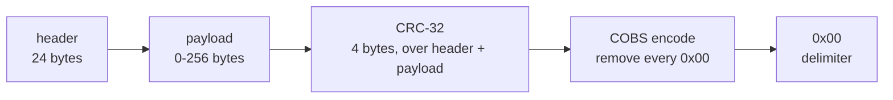
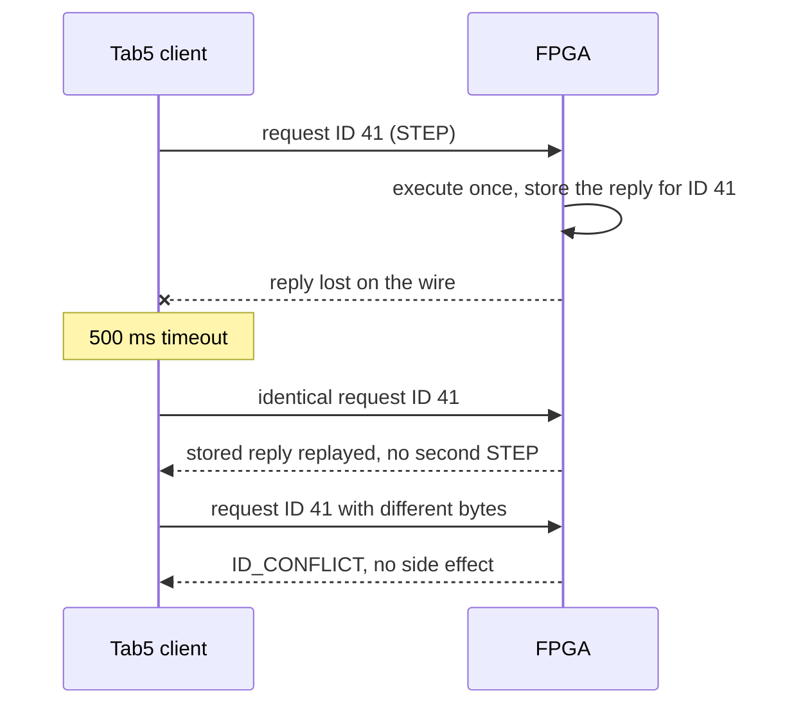
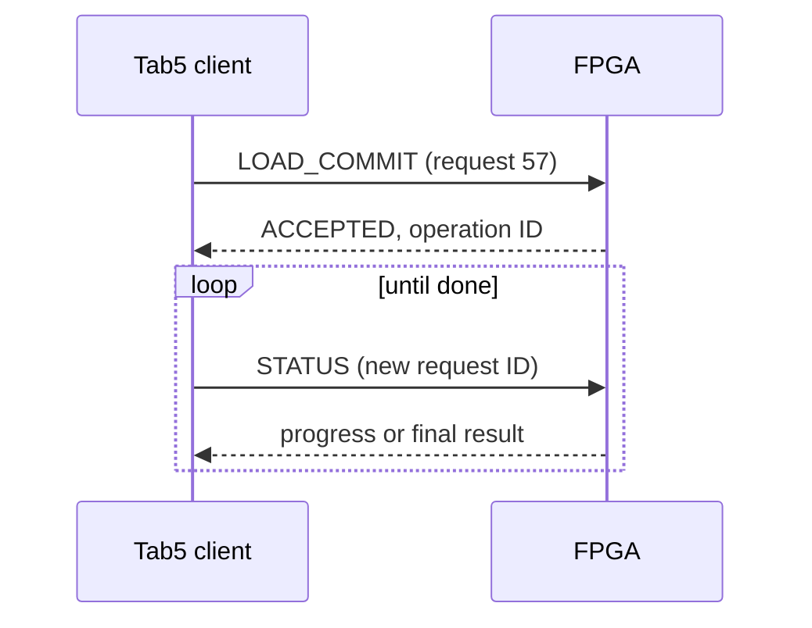
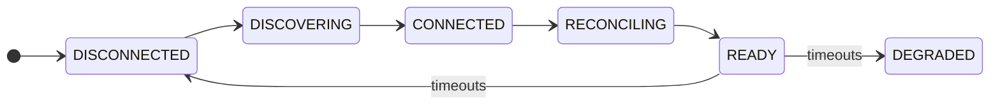

# 📡 FPGA debug protocol: version 1 design contract

[Project README](../README.md) · [Docs index](README.md) · [Integration architecture](TAB5_INTEGRATION.md) · [Tab5 firmware](TAB5_FIRMWARE.md) · [protocol/ folder](../protocol/README.md)

> [!NOTE]
> **Status: 📋 PLANNED, proposed wire format.** No codec exists on any side yet. Frozen at T2
> once independent host and RTL implementations pass the same golden vectors.

<details open>
<summary><b>Contents</b></summary>

- [In plain terms](#in-plain-terms) · [Transport and bounded framing](#transport-and-bounded-framing) · [Sessions, retries, and operations](#sessions-retries-and-operations)
- [Status values](#status-values) · [Commands and state permissions](#commands-and-state-permissions) · [Typed payload conventions](#typed-payload-conventions)
- [Capabilities and state machines](#capabilities-and-state-machines) · [Minimum protocol qualification](#minimum-protocol-qualification-at-t2t3)

</details>

## In plain terms

A UART only moves a stream of bytes; it has no idea where one message ends and the next
begins, and a noisy wire can flip bits. A **protocol** adds the missing structure:

1. **Framing:** where does each packet start and stop? Here, every packet ends with a `0x00`
   byte, and **COBS** encoding guarantees no other `0x00` appears inside it.
2. **Integrity:** did it arrive intact? A **CRC-32** over the packet catches corruption, and a
   damaged packet is simply dropped.
3. **Meaning:** what is being asked? A fixed **header** names the command, its request ID and
   the session.
4. **Safety:** what if a reply is lost? Requests carry IDs, so resending the *identical*
   request replays the stored answer instead of performing the action twice.

**COBS worked example.** The bytes `11 22 00 33` contain a zero. COBS replaces each zero with a
count telling the decoder how far away the next zero was:

```text
original:          11 22 00 33
COBS encoded:   03 11 22 02 33
on the wire:    03 11 22 02 33 00      <- 00 now only ever means "end of packet"
```

`03` means "the next 2 bytes are data, then a zero", and `02` means "1 data byte, then the end
of the block".


Status: proposed wire format, not an implemented protocol. Freeze version 1 at
T2 after independent host/RTL codec tests; freeze CSR adapters at T3. Features
arrive incrementally and must be advertised through capabilities. This file
defines the shared contract for FPGA RTL, Tab5 firmware, and the Python host.
The future `protocol/` directory holds generated schemas and golden vectors;
do not maintain conflicting command tables in multiple implementations.

## Transport and bounded framing

Initial physical transport: dedicated full-duplex UART, 115200 baud, 8N1,
idle high, no hardware flow control. Voltage and pins require the
[hardware gate](HARDWARE_CHECKLIST.md). Software console bytes never share
an unframed command parser. Future SPI can carry the same logical messages.



Wire packet: `COBS(header || payload || crc32) || 0x00`. COBS removes zero
bytes from the encoded portion; zero is the delimiter. All multibyte integers
are little-endian and packed without compiler padding. CRC is CRC-32/ISO-HDLC
(reflected polynomial `0xEDB88320`, initial and final XOR `0xFFFFFFFF`,
check value for ASCII `123456789` = `0xCBF43926`), serialized little-endian.
It covers the decoded header and payload, excluding the CRC and delimiter.

| Offset | Bytes | Field |
| --- | ---: | --- |
| 0 | 1 | Protocol version, initially 1. |
| 1 | 1 | Channel: 0 control, 1 console, 2 observation/event. |
| 2 | 1 | Kind: 0 request, 1 response, 2 event. |
| 3 | 1 | Flags, zero in version 1. |
| 4 | 2 | Opcode. |
| 6 | 2 | Status: zero in requests; response/event status below. |
| 8 | 4 | Request ID; copied into responses, zero for unsolicited events. |
| 12 | 8 | Session ID; zero only for read-only discovery. |
| 20 | 2 | Payload byte count, 0 through 256. |
| 22 | 2 | Reserved, must be zero. |
| 24 | N | Payload. |
| 24+N | 4 | CRC. |

Maximum decoded frame is 284 bytes; bounded COBS storage is 286 bytes plus
one delimiter (287 wire bytes). Reject an oversized length before allocating
or copying data. Allow 100 ms inter-byte timeout while assembling a frame;
then discard through the next delimiter and increment a diagnostic count.
Truncated frames, decoding errors, bad CRC, unknown version, bad reserved
fields, and inconsistent lengths must not reach the dispatcher.

Drop a corrupt frame without replying to an untrusted request ID. A CRC-valid,
well-formed unsupported command gets a typed error. After garbage or a reset,
a delimiter and valid HELLO restore framing. UART overruns and rejected frames
are visible counters; they must never be silently interpreted as another command.

## Sessions, retries, and operations

- There is one controlling session and one outstanding request per client.
  Console/events are independent messages with bounded queues. An event is
  not a command acknowledgment.
- `HELLO` with session 0 and request 0 is read-only discovery. It returns
  protocol/build identity, capabilities, current session/operation summary,
  and supported size limits. It never resets or resumes the CPU.
- To claim control, send HELLO with a fresh nonzero 64-bit client-selected
  session ID. Repeating the same HELLO is harmless. A different session is
  rejected as BUSY while the existing two-second lease is active. Valid
  requests/PING renew the lease; expired ownership is safely reconciled before
  rebinding. The nonce is stale-traffic separation, not authentication.
- Within a session, use strictly increasing nonzero 32-bit request IDs; start
  a fresh session before wrap. Accept new IDs only after the prior request's
  reply. Retain the exact last accepted request and its terminal response
  (bounded to the frame size). Identical duplicates replay the response;
  different bytes with the same ID return ID_CONFLICT without a side effect.
  Earlier IDs outside the replay slot return STALE_REQUEST, never reexecute.
- A request returning ACCEPTED has started exactly one long operation and
  returns a 64-bit operation ID. Poll STATUS for progress/result using new
  request IDs. Only the defined cancellation command can request cleanup.
  Retain the most recent operation result until replaced or board reset.
- A lost reply may be retried with the *identical* session, ID and payload.
  Never allocate a new ID and repeat a timed-out write, STEP, RUN, BIST, or
  injection blindly. An expired session/board reset invalidates replay state;
  rediscover and inspect status or readback. Report an unresolved outcome
  instead of claiming exactly-once execution across a power loss.
- A bus watchdog terminates a wedged cycle. If a write could have reached its
  target before timeout, return OUTCOME_UNKNOWN and reconcile; do not retry
  it automatically. ACK and ERR cannot both assert for the same transaction.
- If a lease expires during loading, abort the load, retain stopped/reset-held
  CPU state, and mark the partial image invalid. Running verified software may
  continue on ordinary disconnect; no auto-resume is issued on reconnect.
  BIST/injection aborts must finish their documented cleanup before ownership
  is released. Every reset disarms fault hooks before CPU release; CPU-only
  reset preserves the link, while debug/board reset also clears sessions.



Long operations return immediately and are polled:



Initial client timing: 500 ms response timeout for a short request, at most
three identical retry attempts, and keepalive at least every 500 ms while an
operation runs. Long requests return ACCEPTED promptly, then progress is
polled; they do not require a multi-second blocked touchscreen thread. These
are initial engineering settings to measure at T2, not observed latency.

## Status values

| Value | Meaning |
| --- | --- |
| `0x0000` | OK, completed successfully. |
| `0x0001` | ACCEPTED, operation ID follows; not completed yet. |
| `0x0100` | UNSUPPORTED opcode, version, or capability. |
| `0x0101` | BAD_ARGUMENT / malformed typed payload. |
| `0x0102` | BAD_ADDRESS / out-of-range region. |
| `0x0103` | ALIGNMENT or unsupported access size. |
| `0x0104` | BAD_STATE, including register access while running. |
| `0x0105` | BUSY / owner or operation unavailable. |
| `0x0106` | BAD_SESSION / expired control session. |
| `0x0107` | ID_CONFLICT or stale request content mismatch. |
| `0x0108` | STALE_REQUEST outside retained replay slot. |
| `0x0109` | BUS_ERROR / target ERR. |
| `0x010A` | OUTCOME_UNKNOWN after uncertain completion. |
| `0x010B` | IMAGE_INVALID / unverified or incomplete load. |
| `0x010C` | VERIFY_FAILED / CRC or readback mismatch. |
| `0x010D` | ABORTED, with cleanup/result detail. |
| `0x010E` | NOT_FOUND operation, load, or capture generation. |

Typed validation errors have no state-changing effect. Lengths and integer
addition must be checked before access. UI text is a local translation of
codes; firmware must not decide behavior by parsing English error strings.

## Commands and state permissions

Numeric allocations below are planned. Unimplemented commands return
UNSUPPORTED even if their UI screen exists. Response headers echo the opcode.

| Opcode | Command | Core contract / permission |
| --- | --- | --- |
| `0x0001` | HELLO | Discovery/session negotiation and capability descriptor. |
| `0x0002` | PING | Bounded link health/lease renewal. |
| `0x0003` | STATUS | CPU state, image generation, operation progress/results and errors; read-only. |
| `0x0010` | HALT | Request drain; ACCEPTED until safely HALTED. |
| `0x0011` | RESUME | HALTED, valid current image/state, CPU RAM ownership restored. |
| `0x0012` | STEP | Drained HALTED; exactly one retirement or defined terminal event. |
| `0x0013` | CPU_RESET | Controlled core reset; preserve debug link, stay RESET_HELD. |
| `0x0014` | RESTART | Verified image; reset architectural/prefetch state and entry, stay HALTED unless RUN follows. |
| `0x0020` | REG_READ | HALTED; index or bounded register range, committed values. |
| `0x0021` | REG_WRITE | HALTED; one register plus value; x0 is rejected. |
| `0x0030` | MEM_READ | HALTED/RESET_HELD, RAM only; address, size and bounded element count. |
| `0x0031` | MEM_WRITE | Same state/range rules; complete byte enables and optional verified readback. |
| `0x0040` | LOAD_BEGIN | Approved manifest fields, invalidate old image, return load ID. |
| `0x0041` | LOAD_CHUNK | Matching load ID and next byte offset; at most 192 data bytes. |
| `0x0042` | LOAD_COMMIT | Read back FPGA RAM and verify image CRC; ACCEPTED then verified/not-runnable result. |
| `0x0043` | LOAD_ABORT | Invalidate partial image, close writer after in-flight transfer. |
| `0x0044` | RUN | Verified image only; initialize entry if needed, release CPU. |
| `0x0050` | BREAK_SET | HALTED; slot, enable, aligned PC. |
| `0x0051` | BREAK_LIST | Configured slots and triggered slot/PC. |
| `0x0052` | BREAK_CLEAR | HALTED; clear selected slot. |
| `0x0060` | SNAP_CAPTURE | Atomic observation generation; permitted while running. |
| `0x0061` | SNAP_READ | Read a specific frozen generation and byte range. |
| `0x0062` | TRACE_FREEZE | Finish current complete retirement record, freeze trace. |
| `0x0063` | TRACE_READ | Frozen generation, bounded record range; no implicit unfreeze. |
| `0x0064` | TRACE_ARM | Re-arm/clear according to explicit flags; report overwritten records. |
| `0x0070` | COUNTERS_LATCH | Capture all counters and execution-state interval atomically. |
| `0x0071` | COUNTERS_READ | Frozen generation; 64-bit values and event-definition version. |
| `0x0080` | CONSOLE_READ | Channel 1, bounded drain of CPU TX FIFO; replay-safe. |
| `0x0081` | CONSOLE_WRITE | Channel 1, bounded CPU input bytes with accepted-byte count. |
| `0x0082` | CONSOLE_STATUS | FIFO capacity/overflow/backend; no drain side effect. |
| `0x0090` | BIST_START | HALTED; owned range/test ID plus one-use destructive confirmation if needed. |
| `0x0091` | BIST_ABORT | Controlled cleanup, no premature CPU resume. |
| `0x0092` | DIAG_RESULT | Test ID, status, counts, first failure and expected/observed detail. |
| `0x00A0` | INJECT_ARM | HALTED, allowed scratch/register target, explicit type/mask/trigger/duration. |
| `0x00A1` | INJECT_FIRE | Matching one-use arm ID; accepted once, report actual change. |
| `0x00A2` | INJECT_CLEAR | Disarm and restore supported state, report cleanup outcome. |
| `0x00A3` | INJECT_RESULT | Original/requested/observed state and linked detection result. |

Console commands use channel 1; the remaining requests use channel 0.
Unsolicited notifications use channel 2, kind event, request ID 0. They carry
sequence/generation and loss counters. Control responses cannot be starved by
events; explicit polling is always available and is sufficient for version 1.

## Typed payload conventions

Use unsigned `u8/u16/u32/u64`; all bounds below include overflow checks.
Zero-length requests are allowed only where explicitly specified. Strings
are length-prefixed UTF-8, not NUL-terminated, with no filesystem interpretation
on the FPGA. Reserve fields are zero. Exact optional-field schemas and golden
vectors become source-controlled in `protocol/` before codec implementation.

- **HELLO:** descriptor includes protocol/schema version, FPGA build ID,
  CPU implementation/ISA flags, configured clock Hz, max payload/chunk,
  capabilities bitmap, breakpoint count, trace format/depth, and supported
  operation states. An absent CPU advertises no live-CPU capability.
- **STATUS:** state enum, halt reason, last-retired-PC valid/value, next PC,
  active operation ID/kind/state, load/image ID, validity and modified-state
  flags, error counters,
  plus snapshot generation. With BASE_COUNTERS at P1, include a coherently
  latched cycle/retirement pair, actual counter width and capture generation.
  State-specific data has explicit validity bits; baseline counters do not
  imply PERF64 or a full pipeline snapshot capability.
- **MEM_READ/WRITE:** `u32 address`, `u8 size` (1/2/4), `u8 flags=0`,
  `u16 count`; a write then carries exactly `size*count` bytes. Version 1
  caps total RAM data at 192 bytes/request. Alignment is natural for size;
  no access crosses RAM end, wraps address space, or reaches MMIO.
  A write returns OK only after intended bytes are read back and compared.
  Multi-element writes are not atomic: a runtime failure reports completed
  elements and any final uncertain address, leaves the CPU halted, and never
  authorizes a blind replay with a new ID. Complete intentional edits carry
  MODIFIED state; a partial image edit requires reload before execution.
- **REG_READ:** `u8 start`, `u8 count`, `u16 reserved=0`; response includes
  capture generation and count contiguous `u32` values. Chunk all 32 registers
  within response limits. REG_WRITE is `u8 index`, three zero bytes, `u32 value`.
- **LOAD_BEGIN:** eight `u32` fields in order: load address, entry, image bytes,
  expected CRC, BSS address, BSS bytes, stack bottom, stack top; then four `u16`
  fields: ISA code (RV32I=1), ABI code (ILP32=1), flags=0, name length;
  then at most 48 UTF-8 name bytes. Metadata is checked against linker policy.
- **LOAD_CHUNK:** `u32 load_id`, `u32 byte_offset`, `u16 byte_count`,
  `u16 reserved=0`, then 1–192 data bytes. Require the expected next offset;
  retransmissions use the same request ID, rather than guessing whether an
  earlier chunk executed. Progress is total verified written bytes.
- **LOAD_COMMIT/ABORT:** `u32 load_id`. COMMIT returns an operation ID; final
  result includes actual FPGA readback CRC and image validity. RUN/RESTART
  name the verified image ID, never an arbitrary unverified memory range.
- **Capture reads:** `u32 generation`, `u32 byte_or_record_offset`,
  `u16 count`, `u16 reserved=0`; bounds and record size are in the descriptor.
- **Long tests/injection:** schemas must include test/range/target, expected
  operation state, bounded trigger/duration, and returned operation/arm ID.
  Raw arbitrary Wishbone CSR writes are not a public version-1 command.

### Capabilities and state machines

Assign named capability bits in the T2 schema for BASE_STATUS, RAM_ACCESS,
LOADER, CONSOLE, HALT_RESUME, REG_ACCESS, STEP, BREAKPOINTS, PIPE_SNAPSHOT,
RETIRE_TRACE, BASE_COUNTERS, PERF64, MEM_BIST, ALU_BIST, FAULT_INJECT, and REFERENCE_CAPTURE.
Build descriptor fields, not guessed firmware versions, control UI availability.

Link states: DISCONNECTED -> DISCOVERING -> CONNECTED -> RECONCILING -> READY;
timeouts move to DEGRADED/DISCONNECTED without blocking touch handling.
CPU states: RESET_HELD, HALTED, RUNNING, HALT_REQUESTED, STEPPING, BREAKPOINT,
TERMINATED, ERROR. Operation state is separate: IDLE, LOADING, VERIFYING,
BIST, INJECTING, ABORTING, DONE, FAILED. Do not combine connection, CPU, and
operation state into one ambiguous enum or let a screen transition change CPU state.



The link state machine above follows the sequence given in this section; recovery transitions
out of DEGRADED are specified at T2. The CPU state machine is drawn in the
[integration architecture](TAB5_INTEGRATION.md#cpu-architectural-debug-contract).

## Minimum protocol qualification at T2/T3

Golden vectors must include empty/max payloads, all 256 byte values, embedded
zeros/delimiters, CRC check vector, little-endian fields, oversize/invalid
headers, partial frames, garbage recovery, invalid commands, duplicate IDs,
same-ID/different-body rejection, lost ACK, stale replies, ID wrap/session
renewal, reset during a command, BUSY, ACK/ERR wait states, watchdog, and an
uncertain write outcome. Use one Python implementation and independently
written RTL tests against the same vectors. Do not generate both expected
and observed values through the same codec under test.

Loading qualification adds missing/reordered/duplicate chunks, bad image CRC,
invalid manifests/paths/ISA/bounds/entry, half-written images, CPU reset versus
debug reset, instruction-buffer invalidation, and program A-to-B execution
without bitstream replacement. See [VERIFICATION_MATRIX.md](VERIFICATION_MATRIX.md).

---

<sub>Related: [Integration architecture](TAB5_INTEGRATION.md) · [Tab5 firmware](TAB5_FIRMWARE.md) · [Build plan T2–T3](BUILD_PLAN.md#t2-reliable-framed-debug-communication) · [Verification matrix](VERIFICATION_MATRIX.md) · [Docs index](README.md)</sub>
