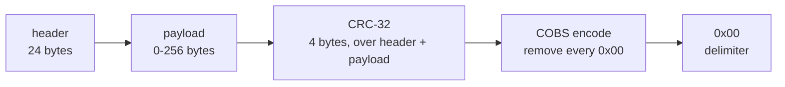
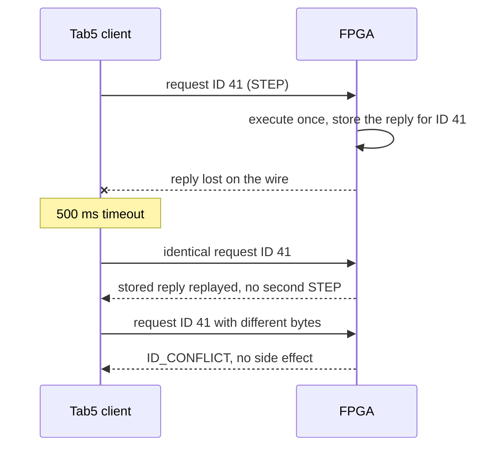
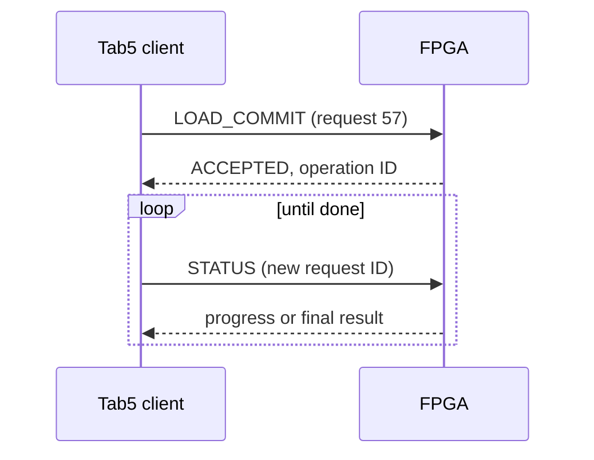
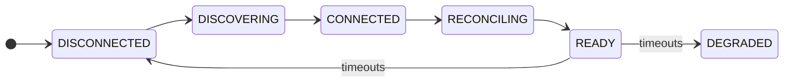

[Project README](../README.md) › [Docs index](README.md) › **Debug protocol**

# FPGA debug protocol: version 1 design contract

This is the wire format the Tab5, the FPGA and the Python host client use to talk over the
dedicated debug UART: how packets are framed, how retries stay safe, and what every command
means. It is the shared contract for FPGA RTL, Tab5 firmware, and the Python host.

> [!NOTE]
> **Status: 📋 PLANNED, proposed wire format.** No codec exists on any side yet. Version 1 is
> frozen at T2 once independent host and RTL implementations pass the same golden vectors; CSR
> adapters are frozen at T3.

| Quick facts | Version 1 |
| --- | --- |
| Link | Dedicated UART, 115200 baud, 8N1, no flow control |
| Framing | `COBS(header ‖ payload ‖ crc32) ‖ 0x00` |
| Header / payload / CRC | 24 bytes / 0–256 bytes / 4 bytes |
| Largest frame | 284 bytes decoded, 287 bytes on the wire |
| Integrity | CRC-32/ISO-HDLC, check value `0xCBF43926` |
| Safe retries | One session, increasing request IDs, identical retries replay the stored reply |

<details open>
<summary><b>Contents</b></summary>

1. [In plain terms](#1-in-plain-terms)
2. [Transport and bounded framing](#2-transport-and-bounded-framing)
3. [Sessions, retries, and operations](#3-sessions-retries-and-operations)
4. [Status values](#4-status-values)
5. [Commands and state permissions](#5-commands-and-state-permissions)
6. [Typed payload conventions](#6-typed-payload-conventions) · [Capabilities and state machines](#capabilities-and-state-machines)
7. [Minimum protocol qualification at T2/T3](#7-minimum-protocol-qualification-at-t2t3)

</details>

**How this document is maintained.** Features arrive incrementally and must be advertised
through capabilities. The future `protocol/` directory holds generated schemas and golden
vectors; do not maintain conflicting command tables in multiple implementations.

---

## 1. In plain terms

A UART only moves a stream of bytes; it has no idea where one message ends and the next begins,
and a noisy wire can flip bits. A **protocol** adds the missing structure:

| Need | Question | Answer in this protocol |
| --- | --- | --- |
| 1. **Framing** | Where does each packet start and stop? | Every packet ends with a `0x00` byte, and **COBS** encoding guarantees no other `0x00` appears inside it. |
| 2. **Integrity** | Did it arrive intact? | A **CRC-32** over the packet catches corruption, and a damaged packet is simply dropped. |
| 3. **Meaning** | What is being asked? | A fixed **header** names the command, its request ID and the session. |
| 4. **Safety** | What if a reply is lost? | Requests carry IDs, so resending the *identical* request replays the stored answer instead of performing the action twice. |

> **COBS worked example.** The bytes `11 22 00 33` contain a zero. COBS replaces each zero with a
> count telling the decoder how far away the next zero was:
>
> ```text
> original:          11 22 00 33
> COBS encoded:   03 11 22 02 33
> on the wire:    03 11 22 02 33 00      <- 00 now only ever means "end of packet"
> ```
>
> `03` means "the next 2 bytes are data, then a zero", and `02` means "1 data byte, then the end
> of the block".

---

## 2. Transport and bounded framing

**Initial physical transport:** dedicated full-duplex UART, 115200 baud, 8N1, idle high, no
hardware flow control.

- Voltage and pins require the [hardware gate](HARDWARE_CHECKLIST.md).
- Software console bytes never share an unframed command parser.
- Future SPI can carry the same logical messages.

### Building a packet

The diagram shows the order in which a sender assembles a packet.



Wire packet: `COBS(header || payload || crc32) || 0x00`.

- COBS removes zero bytes from the encoded portion; zero is the delimiter.
- All multibyte integers are little-endian and packed without compiler padding.

| CRC parameter | Value |
| --- | --- |
| Algorithm | CRC-32/ISO-HDLC |
| Polynomial | Reflected `0xEDB88320` |
| Initial and final XOR | `0xFFFFFFFF` |
| Check value for ASCII `123456789` | `0xCBF43926` |
| Serialization | Little-endian |
| Coverage | The decoded header and payload, excluding the CRC and delimiter |

### Header layout

```text
byte  0      1        2      3      4-5      6-7      8-11        12-19        20-21     22-23     24 ...      24+N
    +------+--------+------+------+--------+--------+-----------+------------+---------+---------+-----------+--------+
    | ver  | channel| kind | flags| opcode | status | requestID | session ID | length  | reserved| payload   | CRC-32 |
    +------+--------+------+------+--------+--------+-----------+------------+---------+---------+-----------+--------+
```

| Offset | Bytes | Field |
| --- | ---: | --- |
| 0 | 1 | Protocol version, initially 1. |
| 1 | 1 | Channel: 0 control, 1 console, 2 observation/event. |
| 2 | 1 | Kind: 0 request, 1 response, 2 event. |
| 3 | 1 | Flags, zero in version 1. |
| 4 | 2 | Opcode. |
| 6 | 2 | Status: zero in requests; response/event status below. |
| 8 | 4 | Request ID; copied into responses, zero for unsolicited events. |
| 12 | 8 | Session ID; zero only for read-only discovery. |
| 20 | 2 | Payload byte count, 0 through 256. |
| 22 | 2 | Reserved, must be zero. |
| 24 | N | Payload. |
| 24+N | 4 | CRC. |

### Size limits and receive rules

| Limit | Value |
| --- | --- |
| Maximum decoded frame | 284 bytes |
| Bounded COBS storage | 286 bytes plus one delimiter (287 wire bytes) |
| Inter-byte timeout while assembling a frame | 100 ms; then discard through the next delimiter and increment a diagnostic count |

- Reject an oversized length before allocating or copying data.
- Truncated frames, decoding errors, bad CRC, unknown version, bad reserved fields, and
  inconsistent lengths must not reach the dispatcher.

**Error handling:**

- Drop a corrupt frame without replying to an untrusted request ID.
- A CRC-valid, well-formed unsupported command gets a typed error.
- After garbage or a reset, a delimiter and valid HELLO restore framing.
- UART overruns and rejected frames are visible counters; they must never be silently
  interpreted as another command.

---

## 3. Sessions, retries, and operations

### Sessions

- There is one controlling session and one outstanding request per client.
- Console/events are independent messages with bounded queues. An event is not a command
  acknowledgment.
- **Discovery:** `HELLO` with session 0 and request 0 is read-only discovery. It returns
  protocol/build identity, capabilities, current session/operation summary, and supported size
  limits. It never resets or resumes the CPU.
- **Claiming control:** send HELLO with a fresh nonzero 64-bit client-selected session ID.
  - Repeating the same HELLO is harmless.
  - A different session is rejected as BUSY while the existing two-second lease is active.
  - Valid requests/PING renew the lease; expired ownership is safely reconciled before rebinding.
  - The nonce is stale-traffic separation, not authentication.

### Request IDs and replay

- Within a session, use strictly increasing nonzero 32-bit request IDs; start a fresh session
  before wrap.
- Accept new IDs only after the prior request's reply.
- Retain the exact last accepted request and its terminal response (bounded to the frame size).

| Incoming request | FPGA response |
| --- | --- |
| Identical duplicate of the last request | Replay the stored response |
| Same ID, different bytes | ID_CONFLICT, without a side effect |
| Earlier ID outside the replay slot | STALE_REQUEST, never reexecute |

The sequence diagram shows a lost reply being retried safely, then a conflicting retry being
rejected.



> [!CAUTION]
> A lost reply may be retried with the *identical* session, ID and payload. **Never allocate a new
> ID and repeat a timed-out write, STEP, RUN, BIST, or injection blindly.** An expired
> session/board reset invalidates replay state; rediscover and inspect status or readback. Report
> an unresolved outcome instead of claiming exactly-once execution across a power loss.

### Long operations

- A request returning ACCEPTED has started exactly one long operation and returns a 64-bit
  operation ID.
- Poll STATUS for progress/result using new request IDs.
- Only the defined cancellation command can request cleanup.
- Retain the most recent operation result until replaced or board reset.

Long operations return immediately and are polled:



### Bus timeouts, disconnects and resets

- A bus watchdog terminates a wedged cycle. If a write could have reached its target before
  timeout, return OUTCOME_UNKNOWN and reconcile; do not retry it automatically.
- ACK and ERR cannot both assert for the same transaction.
- If a lease expires during loading, abort the load, retain stopped/reset-held CPU state, and mark
  the partial image invalid.
- Running verified software may continue on ordinary disconnect; no auto-resume is issued on
  reconnect.
- BIST/injection aborts must finish their documented cleanup before ownership is released.
- Every reset disarms fault hooks before CPU release; CPU-only reset preserves the link, while
  debug/board reset also clears sessions.

### Initial client timing

| Setting | Initial value |
| --- | --- |
| Response timeout, short request | 500 ms |
| Identical retry attempts | At most three |
| Keepalive while an operation runs | At least every 500 ms |

Long requests return ACCEPTED promptly, then progress is polled; they do not require a
multi-second blocked touchscreen thread.

> [!NOTE]
> These are initial engineering settings to measure at T2, not observed latency.

---

## 4. Status values

| Value | Meaning |
| --- | --- |
| `0x0000` | OK, completed successfully. |
| `0x0001` | ACCEPTED, operation ID follows; not completed yet. |
| `0x0100` | UNSUPPORTED opcode, version, or capability. |
| `0x0101` | BAD_ARGUMENT / malformed typed payload. |
| `0x0102` | BAD_ADDRESS / out-of-range region. |
| `0x0103` | ALIGNMENT or unsupported access size. |
| `0x0104` | BAD_STATE, including register access while running. |
| `0x0105` | BUSY / owner or operation unavailable. |
| `0x0106` | BAD_SESSION / expired control session. |
| `0x0107` | ID_CONFLICT or stale request content mismatch. |
| `0x0108` | STALE_REQUEST outside retained replay slot. |
| `0x0109` | BUS_ERROR / target ERR. |
| `0x010A` | OUTCOME_UNKNOWN after uncertain completion. |
| `0x010B` | IMAGE_INVALID / unverified or incomplete load. |
| `0x010C` | VERIFY_FAILED / CRC or readback mismatch. |
| `0x010D` | ABORTED, with cleanup/result detail. |
| `0x010E` | NOT_FOUND operation, load, or capture generation. |

- Typed validation errors have no state-changing effect.
- Lengths and integer addition must be checked before access.
- UI text is a local translation of codes; firmware must not decide behavior by parsing English
  error strings.

---

## 5. Commands and state permissions

Numeric allocations below are planned. Unimplemented commands return UNSUPPORTED even if their
UI screen exists. Response headers echo the opcode.

**Channels:** console commands use channel 1; the remaining requests use channel 0. Unsolicited
notifications use channel 2, kind event, request ID 0.

### Discovery and link health

| Opcode | Command | Core contract / permission |
| --- | --- | --- |
| `0x0001` | HELLO | Discovery/session negotiation and capability descriptor. |
| `0x0002` | PING | Bounded link health/lease renewal. |
| `0x0003` | STATUS | CPU state, image generation, operation progress/results and errors; read-only. |

### Execution control

| Opcode | Command | Core contract / permission |
| --- | --- | --- |
| `0x0010` | HALT | Request drain; ACCEPTED until safely HALTED. |
| `0x0011` | RESUME | HALTED, valid current image/state, CPU RAM ownership restored. |
| `0x0012` | STEP | Drained HALTED; exactly one retirement or defined terminal event. |
| `0x0013` | CPU_RESET | Controlled core reset; preserve debug link, stay RESET_HELD. |
| `0x0014` | RESTART | Verified image; reset architectural/prefetch state and entry, stay HALTED unless RUN follows. |

### Registers and memory

| Opcode | Command | Core contract / permission |
| --- | --- | --- |
| `0x0020` | REG_READ | HALTED; index or bounded register range, committed values. |
| `0x0021` | REG_WRITE | HALTED; one register plus value; x0 is rejected. |
| `0x0030` | MEM_READ | HALTED/RESET_HELD, RAM only; address, size and bounded element count. |
| `0x0031` | MEM_WRITE | Same state/range rules; complete byte enables and optional verified readback. |

### Program loading

| Opcode | Command | Core contract / permission |
| --- | --- | --- |
| `0x0040` | LOAD_BEGIN | Approved manifest fields, invalidate old image, return load ID. |
| `0x0041` | LOAD_CHUNK | Matching load ID and next byte offset; at most 192 data bytes. |
| `0x0042` | LOAD_COMMIT | Read back FPGA RAM and verify image CRC; ACCEPTED then verified/not-runnable result. |
| `0x0043` | LOAD_ABORT | Invalidate partial image, close writer after in-flight transfer. |
| `0x0044` | RUN | Verified image only; initialize entry if needed, release CPU. |

### Breakpoints

| Opcode | Command | Core contract / permission |
| --- | --- | --- |
| `0x0050` | BREAK_SET | HALTED; slot, enable, aligned PC. |
| `0x0051` | BREAK_LIST | Configured slots and triggered slot/PC. |
| `0x0052` | BREAK_CLEAR | HALTED; clear selected slot. |

### Snapshots and trace

| Opcode | Command | Core contract / permission |
| --- | --- | --- |
| `0x0060` | SNAP_CAPTURE | Atomic observation generation; permitted while running. |
| `0x0061` | SNAP_READ | Read a specific frozen generation and byte range. |
| `0x0062` | TRACE_FREEZE | Finish current complete retirement record, freeze trace. |
| `0x0063` | TRACE_READ | Frozen generation, bounded record range; no implicit unfreeze. |
| `0x0064` | TRACE_ARM | Re-arm/clear according to explicit flags; report overwritten records. |

### Counters

| Opcode | Command | Core contract / permission |
| --- | --- | --- |
| `0x0070` | COUNTERS_LATCH | Capture all counters and execution-state interval atomically. |
| `0x0071` | COUNTERS_READ | Frozen generation; 64-bit values and event-definition version. |

### Console (channel 1)

| Opcode | Command | Core contract / permission |
| --- | --- | --- |
| `0x0080` | CONSOLE_READ | Channel 1, bounded drain of CPU TX FIFO; replay-safe. |
| `0x0081` | CONSOLE_WRITE | Channel 1, bounded CPU input bytes with accepted-byte count. |
| `0x0082` | CONSOLE_STATUS | FIFO capacity/overflow/backend; no drain side effect. |

### Self-test

| Opcode | Command | Core contract / permission |
| --- | --- | --- |
| `0x0090` | BIST_START | HALTED; owned range/test ID plus one-use destructive confirmation if needed. |
| `0x0091` | BIST_ABORT | Controlled cleanup, no premature CPU resume. |
| `0x0092` | DIAG_RESULT | Test ID, status, counts, first failure and expected/observed detail. |

### Fault injection

| Opcode | Command | Core contract / permission |
| --- | --- | --- |
| `0x00A0` | INJECT_ARM | HALTED, allowed scratch/register target, explicit type/mask/trigger/duration. |
| `0x00A1` | INJECT_FIRE | Matching one-use arm ID; accepted once, report actual change. |
| `0x00A2` | INJECT_CLEAR | Disarm and restore supported state, report cleanup outcome. |
| `0x00A3` | INJECT_RESULT | Original/requested/observed state and linked detection result. |

### Events (channel 2)

Unsolicited notifications use channel 2, kind event, request ID 0.

- They carry sequence/generation and loss counters.
- Control responses cannot be starved by events.
- Explicit polling is always available and is sufficient for version 1.

---

## 6. Typed payload conventions

General rules for every payload:

- Use unsigned `u8/u16/u32/u64`; all bounds below include overflow checks.
- Zero-length requests are allowed only where explicitly specified.
- Strings are length-prefixed UTF-8, not NUL-terminated, with no filesystem interpretation on the
  FPGA.
- Reserve fields are zero.
- Exact optional-field schemas and golden vectors become source-controlled in `protocol/` before
  codec implementation.

### Discovery and status

**HELLO** descriptor includes:

- protocol/schema version, FPGA build ID;
- CPU implementation/ISA flags, configured clock Hz;
- max payload/chunk, capabilities bitmap, breakpoint count;
- trace format/depth, and supported operation states.

An absent CPU advertises no live-CPU capability.

**STATUS** includes:

- state enum, halt reason, last-retired-PC valid/value, next PC;
- active operation ID/kind/state, load/image ID, validity and modified-state flags;
- error counters, plus snapshot generation.

With BASE_COUNTERS at P1, include a coherently latched cycle/retirement pair, actual counter
width and capture generation. State-specific data has explicit validity bits; baseline counters
do not imply PERF64 or a full pipeline snapshot capability.

### Memory and registers

**MEM_READ/WRITE:**

```text
u32 address | u8 size (1/2/4) | u8 flags=0 | u16 count | [write: exactly size*count bytes]
```

- Version 1 caps total RAM data at 192 bytes/request.
- Alignment is natural for size; no access crosses RAM end, wraps address space, or reaches MMIO.
- A write returns OK only after intended bytes are read back and compared.
- Multi-element writes are not atomic: a runtime failure reports completed elements and any final
  uncertain address, leaves the CPU halted, and never authorizes a blind replay with a new ID.
- Complete intentional edits carry MODIFIED state; a partial image edit requires reload before
  execution.

**REG_READ:**

```text
u8 start | u8 count | u16 reserved=0
```

The response includes capture generation and count contiguous `u32` values. Chunk all 32
registers within response limits.

**REG_WRITE:**

```text
u8 index | three zero bytes | u32 value
```

### Program loading

**LOAD_BEGIN:** eight `u32` fields in order, then four `u16` fields, then the name.

| Order | Field | Type |
| ---: | --- | --- |
| 1 | Load address | `u32` |
| 2 | Entry | `u32` |
| 3 | Image bytes | `u32` |
| 4 | Expected CRC | `u32` |
| 5 | BSS address | `u32` |
| 6 | BSS bytes | `u32` |
| 7 | Stack bottom | `u32` |
| 8 | Stack top | `u32` |
| 9 | ISA code (RV32I=1) | `u16` |
| 10 | ABI code (ILP32=1) | `u16` |
| 11 | Flags=0 | `u16` |
| 12 | Name length | `u16` |
| 13 | Name: at most 48 UTF-8 bytes | bytes |

Metadata is checked against linker policy.

**LOAD_CHUNK:**

```text
u32 load_id | u32 byte_offset | u16 byte_count | u16 reserved=0 | 1–192 data bytes
```

- Require the expected next offset.
- Retransmissions use the same request ID, rather than guessing whether an earlier chunk
  executed.
- Progress is total verified written bytes.

**LOAD_COMMIT/ABORT:** `u32 load_id`.

- COMMIT returns an operation ID; final result includes actual FPGA readback CRC and image
  validity.
- RUN/RESTART name the verified image ID, never an arbitrary unverified memory range.

### Captures and long tests

**Capture reads:**

```text
u32 generation | u32 byte_or_record_offset | u16 count | u16 reserved=0
```

Bounds and record size are in the descriptor.

**Long tests/injection:** schemas must include test/range/target, expected operation state,
bounded trigger/duration, and returned operation/arm ID.

> [!WARNING]
> Raw arbitrary Wishbone CSR writes are not a public version-1 command.

### Capabilities and state machines

**Capability bits.** Assign named capability bits in the T2 schema for:

| Group | Capabilities |
| --- | --- |
| Base | BASE_STATUS, RAM_ACCESS, LOADER, CONSOLE |
| Control | HALT_RESUME, REG_ACCESS, STEP, BREAKPOINTS |
| Observation | PIPE_SNAPSHOT, RETIRE_TRACE, BASE_COUNTERS, PERF64 |
| Diagnostics | MEM_BIST, ALU_BIST, FAULT_INJECT, REFERENCE_CAPTURE |

Build descriptor fields, not guessed firmware versions, control UI availability.

**Three separate state machines:**

| Machine | States |
| --- | --- |
| Link | DISCONNECTED -> DISCOVERING -> CONNECTED -> RECONCILING -> READY; timeouts move to DEGRADED/DISCONNECTED without blocking touch handling. |
| CPU | RESET_HELD, HALTED, RUNNING, HALT_REQUESTED, STEPPING, BREAKPOINT, TERMINATED, ERROR |
| Operation | IDLE, LOADING, VERIFYING, BIST, INJECTING, ABORTING, DONE, FAILED |

> [!IMPORTANT]
> Do not combine connection, CPU, and operation state into one ambiguous enum or let a screen
> transition change CPU state.

The link state machine follows the sequence given above:



Recovery transitions out of DEGRADED are specified at T2. The CPU state machine is drawn in the
[integration architecture](TAB5_INTEGRATION.md#6-cpu-architectural-debug-contract).

---

## 7. Minimum protocol qualification at T2/T3

### Golden vectors

Golden vectors must include:

| Area | Cases |
| --- | --- |
| Framing | Empty/max payloads, all 256 byte values, embedded zeros/delimiters, CRC check vector, little-endian fields |
| Malformed input | Oversize/invalid headers, partial frames, garbage recovery, invalid commands |
| Retries and sessions | Duplicate IDs, same-ID/different-body rejection, lost ACK, stale replies, ID wrap/session renewal, reset during a command, BUSY |
| Bus | ACK/ERR wait states, watchdog, and an uncertain write outcome |

> [!IMPORTANT]
> Use one Python implementation and independently written RTL tests against the same vectors. Do
> not generate both expected and observed values through the same codec under test.

### Loading qualification

Loading qualification adds:

- missing/reordered/duplicate chunks;
- bad image CRC;
- invalid manifests/paths/ISA/bounds/entry;
- half-written images;
- CPU reset versus debug reset;
- instruction-buffer invalidation;
- program A-to-B execution without bitstream replacement.

See [VERIFICATION_MATRIX.md](VERIFICATION_MATRIX.md).

---

**Related:** [Integration architecture](TAB5_INTEGRATION.md) · [Tab5 firmware](TAB5_FIRMWARE.md) · [protocol/ folder](../protocol/README.md) · [Build plan T2–T3](BUILD_PLAN.md#t2-reliable-framed-debug-communication) · [Verification matrix](VERIFICATION_MATRIX.md) · [Docs index](README.md)
