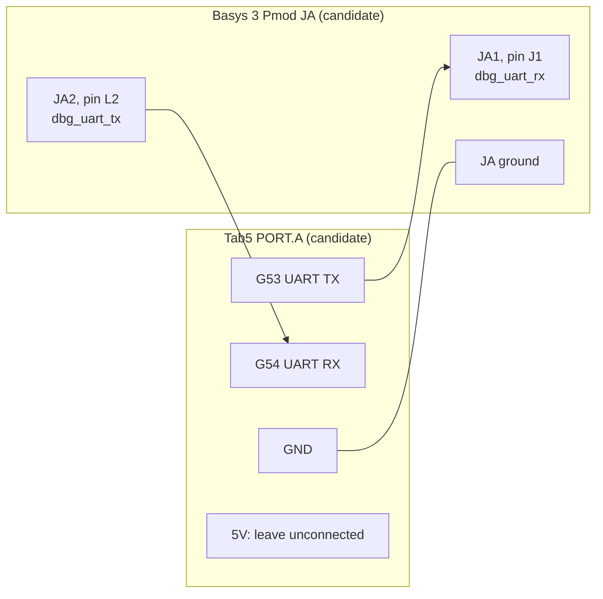
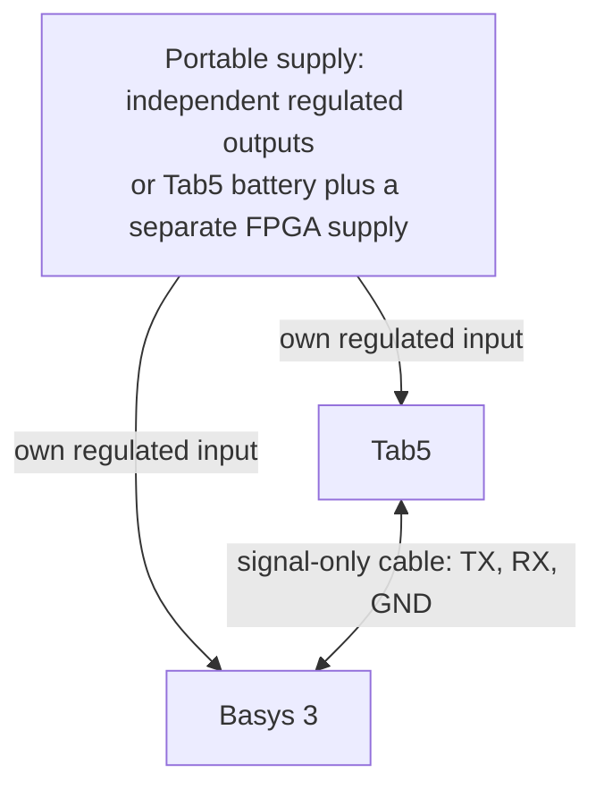
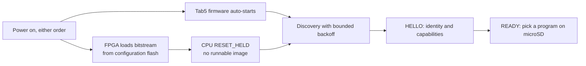

# 🔧 Hardware identification, wiring, power, and cold boot

[Project README](../README.md) · [Docs index](README.md) · [Build plan T0](BUILD_PLAN.md#t0-identify-and-bring-up-the-actual-tab5) · [fpga/ folder](../fpga/README.md)

> [!WARNING]
> **Nothing on this page has been physically checked.** The board revisions, flash part,
> cable and power arrangement are ❔ NOT VERIFIED. Do not wire the Tab5 to the Basys 3 from
> the candidate table below until every T0 electrical check is ticked.

<b>Contents</b>

- [Primary references](#primary-references-reviewed) · [T0 identification record](#t0-identification-record) · [Candidate UART cable](#candidate-uart-cable-not-an-approved-wiring-instruction)
- [Portable power design](#portable-power-design) · [FPGA configuration and offline startup](#fpga-configuration-and-offline-startup) · [Physical assembly and qualification](#physical-assembly-and-final-qualification)

Status: planning completed; physical checks below are NOT performed. On
November 6, 2026 the owner reported being **not sure** which Tab5 variant or
revision they own. That is recorded as unknown, not replaced with an assumed
SKU. These checks gate Tab5 hardware milestones, not the Phase 0 simulator test.

## Primary references reviewed

- [M5Stack Tab5 product documentation](https://docs.m5stack.com/en/core/Tab5)
  lists C145/K145, a 5-inch 1280×720 display, 16 MB flash, 32 MB PSRAM,
  microSD, and expansion connections. C145 is the standalone unit; K145 adds
  an NP-F550 battery. Its revision history lists original ILI9881C/GT911,
  ST7123 from October 2025, and ST7121 from April 2026. The rear label can
  identify the display driver. These facts do not identify the owner's device.
- [Tab5 schematic linked by M5Stack](https://m5stack-doc.oss-cn-shenzhen.aliyuncs.com/1132/Tab5_Schematics_PDF.pdf)
  provides the connector and power-path design reference. Match its revision
  and net names against the physical unit before using a pin allocation.
- [Digilent Basys 3 reference manual, rev. C](https://digilent.com/reference/_media/reference/programmable-logic/basys-3/basys3_rm.pdf)
  documents 100 MHz input, 1,800 Kbits BRAM, power options, USB-UART, and
  configuration flash boot. Its external-supply guidance is 4.5–5.5 V and
  at least 1 A; this is not a measured combined system power requirement.
- [Digilent Basys 3 master XDC](https://github.com/Digilent/digilent-xdc/blob/master/Basys-3-Master.xdc)
  maps JA1/JA2 to J1/L2 with LVCMOS33. The file describes rev. B; reconcile
  against the actual board and its manual rather than treating the revision
  labels as interchangeable.

Only manufacturer documentation and official source repositories support the
hardware choices here. The final assembly still needs measurements and an
actual board test; a fetched schematic is not a continuity or voltage test.

## T0 identification record

| Item | Current value | Evidence required before hardware use |
| --- | --- | --- |
| Tab5 SKU / included kit | Unknown | Product label/order record: C145 or K145. |
| Tab5 board revision | Unknown | PCB/product marking and matching schematic. |
| Display/touch controller | Unknown | Rear label and verified driver detection. |
| Installed battery / condition | Unknown | Actual installed pack and supported power path. |
| Tab5 UART GPIO pair / connector | Proposed below, unapproved | Pinmux and occupancy review for exact revision. |
| Basys 3 revision | Unknown | Board silkscreen against official documents. |
| Basys configuration flash part | Unknown | Installed flash identification and supported Vivado part. |
| Power-bank outputs / cables | Unknown | Regulated voltage, current capability, connector orientation. |
| Combined current / runtime | Not measured | Startup, display-active, CPU-running, BIST and low-battery tests. |

Record confirmed values, source revision, test date, and evidence path here
when T0 runs. Do not mark these fields complete from general product specs.

## Candidate UART cable, not an approved wiring instruction

The product documentation lists PORT.A as GND/5V/G53/G54. Proposed signal-only
assignment, subject to the T0 review and voltage checks:

| Direction | Tab5 candidate | Basys 3 candidate |
| --- | --- | --- |
| Tab5 -> FPGA | PORT.A G53 configured UART TX | JA1, FPGA J1, `dbg_uart_rx` |
| FPGA -> Tab5 | PORT.A G54 configured UART RX | JA2, FPGA L2, `dbg_uart_tx` |
| Reference | PORT.A GND | Verified JA ground contact |
| Power | PORT.A 5V | Leave unconnected for this signal cable. |

Each board's transmitter drives the other's receiver, and the grounds are shared. No power
line crosses the cable.

Use actual connector pin numbers and orientation, not wire colors alone.
UART is raw compatible logic-level TX/RX; the Tab5 RS485 A/B connector is a
different electrical interface and is not a direct FPGA UART connection.
USB connectors also do not expose the raw GPIO UART simply by sharing a cable.

T0 electrical gate, before connecting both boards:

- [ ] Identify both revisions; inspect the correct schematic and pinout.
- [ ] Confirm G53/G54 can be assigned to the chosen UART without conflicts
  with active BSP/I2C functions or other attached modules.
- [ ] Verify both selected pins' logic voltage, bank supply, input ratings,
  reset/boot behavior, and output idle level. The design target is compatible
  3.3 V signaling; insert an appropriate interface if actual levels differ.
- [ ] Confirm TX goes to RX in each direction, common ground is correct, and
  no device output is connected to another output or a supply rail.
- [ ] Verify cable continuity and orientation with power removed; use a short,
  retained cable. Evaluate series protection and an adapter if needed.
- [ ] Check behavior when either board is unpowered; prevent back-powering
  through signal pins. Disconnect or isolate signals if that cannot be proven.
- [ ] Record the approved pin table and then add matching XDC/top-level ports.

Bring up receive/transmit with bounded loopback/known-byte tests before the
packet engine. Keep the existing USB-UART development path independent.

## Portable power design

Preferred starting arrangement: separately regulated, supported inputs for
each board from independent outputs of a suitable power bank, or Tab5's
verified battery plus a separate regulated FPGA supply. Share signal ground;
do not infer that Tab5 can power the FPGA. Do not connect both 5 V rails
together through the debug cable.

Review the Basys board's actual power-selection jumper and silkscreen. The
manual uses inconsistent jumper labels in different power passages, so this
document deliberately does not prescribe an unchecked JP2/JP3 selection.
The Tab5 power input/battery path must follow its own revision documentation.

- [ ] List connector, regulated voltage, continuous/peak current and protection
  for each input. Verify polarities and power-bank port negotiation behavior.
- [ ] Measure idle, boot, full-brightness UI, CPU benchmark, transfer and BIST
  current; confirm adequate simultaneous margin without brownouts.
- [ ] Test bank auto-shutoff at low load, shared-output limits, cable drop,
  hot unplug/reconnect and both startup orders.
- [ ] Confirm neither board sources current into the other's unpowered input.
- [ ] Where available, display actual battery/voltage status; otherwise report
  power status unavailable, rather than estimating a battery percentage.
- [ ] Define a low-power response: avoid starting destructive operations when
  unstable, finish/abort owned bus work, preserve report integrity, and leave
  unverified program memory not runnable after interrupted loading.
- [ ] Record a measured operating runtime with brightness/workload settings.
  No runtime or battery-life claim is currently available.

## FPGA configuration and offline startup

Configuration flash stores the FPGA hardware image, not the currently selected
RV32I software. Program binaries stay on microSD and are loaded into RAM after
the debug endpoint starts. A CPU should come up RESET_HELD/not-runnable until
the portable loader commits a valid image; ordinary development builds may
instead use a separately documented initialized RAM program.

- [ ] Identify the actual Basys flash component and configure Vivado's matching
  configuration-memory target; do not guess the flash part from board name.
- [ ] Add reproducible configuration-memory image generation/programming
  instructions and recovery through USB/JTAG. Test on the actual installed part.
- [ ] Program the verified bitstream to nonvolatile configuration flash and
  set the documented mode selection for flash boot.
- [ ] Remove laptop/JTAG dependence, power-cycle, and verify configuration and
  debug identity. A successful JTAG download alone does not pass this gate.
- [ ] Tab5 firmware, fonts, UI assets and protocol tables reside locally and
  start automatically. microSD holds manifests/programs/expected results/reports.
- [ ] If SD is missing/corrupt, or the FPGA boots slowly, the UI stays usable
  with an explicit state. Retry discovery with bounded backoff.
- [ ] Test FPGA-first, Tab5-first, simultaneous boot, and reset of either board.
  Reconcile operation/image state; do not auto-replay a previous destructive
  command or auto-resume from an unknown halt.

## Physical assembly and final qualification

Use a stable stand/enclosure with visible FPGA hardware, accessible Tab5 touch
surface, retained short cable, protected electrical contacts, nonconductive
standoffs, strain relief, ventilation, and access to reset/power/JTAG/USB/SD.
Do not permanently obstruct development or recovery connectors.

P1/T5 acceptance: ten consecutive cold boots with the laptop and external
monitor disconnected, covering both startup orders; load and execute two
different programs through microSD, view genuine output, and recover from
one link disconnect without freezing or executing a partial image.

P2/T13 qualification: twenty consecutive cold boots, the full short and deep
demo sequences, at least thirty minutes of continuous operation, repeated
link/reset/SD-removal failure cases, and a recorded portable runtime/power
measurement. These are acceptance targets, not test results. Save test date,
bitstream/firmware hashes, exact hardware revisions, supply, trial counts,
failures, and recovery observations in the final evidence report.

---

Related: [Build plan T0, T5, T13](BUILD_PLAN.md#tab5-milestones-portable-control-and-diagnostics) · [Integration architecture](TAB5_INTEGRATION.md) · [Tab5 firmware](TAB5_FIRMWARE.md) · [fpga/ pins](../fpga/README.md) · [Verification matrix](VERIFICATION_MATRIX.md) · [Docs index](README.md)
