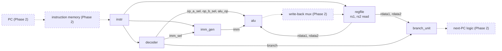

[Project README](../README.md) › [Docs index](README.md) › **Phase 1 CPU blocks**

# Phase 1 CPU blocks: interfaces and verification

This page records the six Phase 1 building blocks: what each one does, its exact interface, the
behavior later phases rely on, and the evidence that it works. Use it as the reference when
Phase 2 connects the blocks into a CPU.

> [!NOTE]
> **Status: 🚧 IMPLEMENTED; local verification passed (November 7, 2026).** All six tasks are
> done and all seven benches pass in Ubuntu with Verilator 5.020. **The Phase 1 gate is not
> passed yet:** it also needs GitHub Actions to pass on these changes, and they have not been
> pushed. The blocks are not yet a connected CPU; that is Phase 2. Status labels are defined in
> the [root README](../README.md#2-project-status).

<details open>
<summary><b>On this page</b></summary>

1. [Run every test](#1-run-every-test)
2. [Files and interfaces](#2-files-and-interfaces)
3. [Shared control contract](#3-shared-control-contract)
4. [Behavioral details](#4-behavioral-details)
5. [Recorded verification (November 7, 2026)](#5-recorded-verification-november-7-2026)
6. [Synthesis evidence](#6-synthesis-evidence)
7. [Known limitations and recommendations](#7-known-limitations-and-recommendations)
8. [Gate and next step](#8-gate-and-next-step)

</details>

---

## 1. Run every test

In Cursor connected to **WSL: Ubuntu**, save your edits and press **Ctrl+Shift+B**.
The default build task is **Tests: run all testbenches**. Expected final line:

```text
7/7 passed
```

The same command from the repository root in Ubuntu is:

```bash
python3 scripts/run_tests.py --verbose
```

Run one bench with a name filter, for example `python3 scripts/run_tests.py decoder`.
**Terminal > Run Task > Smoke: build and run counter** still runs only the original
counter. Both tasks use Ubuntu's local cache for generated output.

---

## 2. Files and interfaces

| Source | Interface and responsibility | Test |
| --- | --- | --- |
| [rv32i_pkg.sv](../rtl/core/rv32i_pkg.sv) | Opcode/funct enums, ALU and selector enums, `control_t`, and safe control constructors. No state. | Used by all five unit benches; decoder vectors use numeric ISA encodings independently of the package opcode constants. |
| [alu.sv](../rtl/core/alu.sv) | `a`, `b`: 32-bit operands; `op`: `alu_op_t`; `result`: 32-bit combinational result. | [alu_tb.sv](../tb/alu_tb.sv) |
| [regfile.sv](../rtl/core/regfile.sv) | `clk`, synchronous active-high `rst`; one `we/waddr/wdata` write port; two asynchronous `raddr1/rdata1` and `raddr2/rdata2` read ports. Addresses are 5 bits, data 32 bits. | [regfile_tb.sv](../tb/regfile_tb.sv) |
| [imm_gen.sv](../rtl/core/imm_gen.sv) | Full `instr` plus explicit `imm_sel` -> 32-bit immediate. The decoder selects the format. | [imm_gen_tb.sv](../tb/imm_gen_tb.sv) |
| [decoder.sv](../rtl/core/decoder.sv) | Full `instr` -> packed `control_t`. No register or memory access occurs here. | [decoder_tb.sv](../tb/decoder_tb.sv) |
| [branch_unit.sv](../rtl/core/branch_unit.sv) | 32-bit `a/b`, `branch_t` condition -> combinational `taken`. | [branch_unit_tb.sv](../tb/branch_unit_tb.sv) |

The runner and Vivado script already collect all RTL with packages first. No manual
source registration or new dependency is required. All implementation RTL uses
`logic`, `always_comb` or `always_ff`, with no new clock domain or gated clock.

The diagram shows how Phase 2 is expected to connect the blocks. Only the blocks exist today;
the PC, next-PC logic, memory and write-back muxes (dashed) are Phase 2 work.



---

## 3. Shared control contract

The [package](../rtl/core/rv32i_pkg.sv) defines these fields:

| Fields | Meaning |
| --- | --- |
| `alu_op` | ADD, SUB, AND, OR, XOR, SLL, SRL, SRA, SLT or SLTU. |
| `op_a_sel`, `op_b_sel` | ALU A selects rs1, PC or zero; ALU B selects rs2 or the immediate. |
| `imm_sel` | NONE, I, S, B, U or J format. |
| `branch`, `jump` | Conditional predicate or JAL/JALR target kind. NONE is explicit. |
| `wb_sel`, `reg_write` | Write-back source (ALU, memory or PC+4) and register-write intent. |
| `uses_rs1`, `uses_rs2` | Which source fields are actual dependencies; later hazards must also account for x0. |
| `mem_size`, `mem_read`, `mem_write`, `mem_unsigned` | Byte/halfword/word operation and signed/unsigned load choice. Phase 2's LSU implements it. |
| `halt`, `illegal` | Distinct ECALL/EBREAK halt requests and invalid-instruction status. |

- `nop_control()` returns zero bits: ADD/rs1/rs2 selectors and no side effects.
- `illegal_control()` adds only `illegal=1`. Unsupported instructions are replaced with that
  entire safe record. They cannot leave behind register writes, loads, stores, branches, jumps
  or a halt request from a partial decode.
- `reg_write` describes the instruction even when rd is x0. The register file rejects x0
  writes; later forwarding logic must reject x0 destinations too.
- `control_t` does not mean an admitted, valid or retired instruction. Those are separate
  Phase 2/pipeline contracts.

---

## 4. Behavioral details

### ALU and immediate generation

- Arithmetic wraps to 32 bits. SLT and SRA use signed operands; SLTU and SRL use
  unsigned operands.
- Shift operations use `b[4:0]`; a register shift count of 32 therefore shifts by
  zero. Shift-immediate instructions use the same low bits of the I immediate.
- I/S/B/J values are sign-extended; U fills the low twelve bits with zero.
  B/J outputs are byte offsets with bit 0 zero, already suitable for target addition.
- Reserved ALU operations, NONE/reserved immediate selectors and NONE/reserved
  branch selectors produce zero/false. Decode remains responsible for rejecting
  invalid instruction encodings.

These instruction-format and shift rules follow the
[ratified RV32I specification](https://docs.riscv.org/reference/isa/v20260120/unpriv/rv32.html).

### Register file

- Reset clears all registers on a rising edge; it has priority over a write.
- x0 always reads zero and ignores every write.
- `BYPASS=0` is the default: before a rising edge, a matching read sees the stored
  value. Use this setting for the single-cycle CPU to avoid a feedback loop.
- `BYPASS=1` forwards an enabled, nonzero destination's prospective write to either
  matching read port. Bypass is suppressed while reset is asserted. After the edge,
  both configurations see the committed value.
- There is one sequential writer. Future debug/BIST ownership must select that
  port's inputs rather than write the array from a second process.

### Decoder

| Family | Instructions | Key controls |
| --- | :-: | --- |
| LUI, AUIPC | 2 | Zero+U or PC+U -> register. |
| JAL, JALR | 2 | Target addition plus PC+4 write-back. JALR uses rs1+I. |
| Conditional branches | 6 | PC+B target addition; separate branch unit compares rs1/rs2. |
| Loads | 5 | rs1+I address; memory write-back; LB/LH/LW/LBU/LHU. |
| Stores | 3 | rs1+S address and rs2 data; SB/SH/SW. |
| Immediate ALU | 9 | I operand, including legal five-bit shift encodings. |
| Register ALU | 10 | Both source registers; strict funct7 checks. |
| FENCE | 1 | No side effect in the project's ordered execution environment. |
| ECALL, EBREAK | 2 | Distinct halt reasons under the project's execution policy. |
| **Total** | **40** | |

> [!IMPORTANT]
> **Phase 2 must handle these; the decoder does not:** JALR bit-zero clearing, target
> alignment, actual loads/stores, PC updates and ECALL/EBREAK retirement/halt sequencing.

- This decoder does not implement traps, CSRs, RV32M, FENCE.I or compressed instructions.
- FENCE with funct3=000 ignores its reserved rd/rs1/mode/mask fields, as required for base
  FENCE; other MISC-MEM funct3 values are rejected.
- The halt policy is the project's limited environment, not a privileged-trap compliance claim.

---

## 5. Recorded verification (November 7, 2026)

Source snapshot: local changes on `codex/feature/phase-1-core-blocks`, based on
`6123ccba8038b6de2192c03590b4dcd370504d73`, plus the same-day audit changes below.
Simulation used Verilator 5.020 in Ubuntu with `--binary --timing --assert -Wall`.

| Bench | Checks | Coverage |
| --- | ---: | --- |
| `alu_tb` | 11,709 | Literal signed/wrap/overflow/shift answers, every pair of 13 edge values per operation, 1,000 deterministic random pairs per operation, reserved operation defaults. Seed `13a12026`. |
| `regfile_tb` | 6,140 | Both BYPASS modes simultaneously; checks before/after rising edges, all 1,024 read-address pairs, all registers, x0, disabled writes, reset priority, back-to-back writes to one register, alternating writes, and 2,000 modelled random cycles. Seed `32f12026`. |
| `imm_gen_tb` | 10,343 | Hand-encoded instructions, signed extremes, one-hot bit wiring, 1,000 generated values per format, opcode variation and reserved selectors. Seed `1a1d2026`. |
| `decoder_tb` | 133,700 | Full control records for 40 instructions across 64 operand/immediate variations; all 131,072 opcode/funct3/funct7 combinations at fixed register fields; SYSTEM bit mutations and explicit extension rejections. Seed `dec02026`. |
| `branch_unit_tb` | 8,522 | Every condition, equality, signed-vs-unsigned extremes, subtraction-overflow cases, single-bit differences, edge pairs, random pairs and disabled/reserved selectors. Seed `b2a12026`. |
| `counter_tb` | 25 | Unchanged Phase 0 reset/count/wrap test. |
| `basys3_top_tb` | 65,555 | Unchanged Phase 0 blink, full LED-count wrap and reset. |

**Observed:** all seven compiled with no Verilator warnings, passed their assertions and exited
zero. Each bench has a timeout and a fixed seed, so every run is identical.

### How the expected values are computed

The benches never call the RTL to get an expected answer. Each uses a different method:

| Bench | Independent method |
| --- | --- |
| `alu_tb` | A bit-by-bit ripple-carry adder for ADD/SUB; SLT/SLTU from that subtraction's carry and overflow bits; shifts by explicit bit movement. The RTL uses `+`, `-`, `<` and shift operators instead. |
| `branch_unit_tb` | The same subtract-and-inspect method for the four ordered compares; equality from a zero difference. |
| `imm_gen_tb` | Starts from a known number and encodes it into an instruction, then expects that number back. |
| `decoder_tb` | Hand-built control records and a legality table written from numeric ISA fields, not the package's opcode names. |
| `regfile_tb` | An architectural 32-entry array updated only after each rising edge. |

A failing check names the operation and operands, for example
`ALU ALU_SLT(8) a=80000000 b=7fffffff: expected 00000001, got 00000000`. A decoder failure also
lists each control field that differs.

### Bug-injection check

To prove the benches can actually catch mistakes, 24 single-line bugs were injected into the
RTL, one at a time, and the matching bench was run. **All 22 real bugs made the bench fail.**
The other 2 changes do not alter behavior, so no test can catch them (see below).

<details>
<summary><b>The 24 injected changes</b></summary>

| Block | Injected bug | Result |
| --- | --- | --- |
| ALU | SLT compares unsigned | Caught |
| ALU | SLTU compares signed | Caught |
| ALU | SRA shifts in zeros | Caught |
| ALU | SLL uses a 6-bit shift count | Caught |
| ALU | SUB missing the +1 (`a + ~b`) | Caught |
| ALU | XOR computes OR | Caught |
| Branch unit | BGE not taken when equal | Caught |
| Branch unit | BLTU compares signed | Caught |
| Branch unit | BNE ignores bit 31 | Caught |
| Register file | Bypass active during reset | Caught |
| Register file | Bypass missing on read port 2 | Caught |
| Register file | Bypass forwards writes to x0 | Caught |
| Register file | Reset does not clear registers | Caught |
| Register file | x0 read guard removed | Not observable: x0 is never written, so it still reads 0 |
| Register file | x0 write guard removed | Not observable: the read guard still returns 0 |
| Immediate generator | J-immediate bit 11 wired wrong | Caught |
| Immediate generator | S-immediate not sign-extended | Caught |
| Immediate generator | U-immediate low bits not cleared | Caught |
| Decoder | LBU decoded as signed | Caught |
| Decoder | SRAI decoded as SRLI | Caught |
| Decoder | SLLI accepts a nonzero funct7 | Caught |
| Decoder | Illegal instruction leaks partial controls | Caught |
| Decoder | BLTU decoded as BLT | Caught |
| Decoder | EBREAK reports ECALL | Caught |

The two x0 guards back each other up: either one alone keeps x0 at zero. Both are kept on
purpose, so removing one by mistake cannot break the architecture.

</details>

---

## 6. Synthesis evidence

> [!WARNING]
> **The Phase 1 blocks have not been synthesized by Vivado yet.** `build.tcl` reads every RTL
> file, but synthesis only includes modules reachable from the top level, and the blocks are not
> connected to the blink top.

What has run:

- The existing Windows Vivado command passed after adding all six sources:

  ```text
  vivado -mode batch -nojournal -nolog -notrace -source scripts/build.tcl
  == Worst setup slack (WNS): 7.066 ns   Worst hold slack (WHS): 0.268 ns
  == TIMING MET
  ```

  Vivado 2025.2 parsed all RTL and rebuilt the unchanged blink bitstream with zero DRC checks
  found. The captured log is `build/phase1-verification/vivado-blink.log` (ignored). This shows
  the new files parse in Vivado and the blink build still works. Its timing and resource numbers
  are **not** CPU-block results. The board was not reprogrammed.
- Verilator `-Wall` lint of each block on its own: no warnings.

What has not run yet:

- [`scripts/synth_blocks.tcl`](../scripts/README.md#5-build-the-bitstream-buildtcl) synthesizes
  each block out of context, fails on any latch, and writes per-block utilization reports. It
  was written during the audit and is **NOT VERIFIED** until it runs in Vivado.

---

## 7. Known limitations and recommendations

These were found during the audit and deliberately **not** changed, because each changes
behavior or needs a decision.

| Item | Detail | Recommendation |
| --- | --- | --- |
| Register file reset blocks LUTRAM | Clearing all 32 registers on reset forces Vivado to build the array from flip-flops. An open-source Yosys `synth_xilinx` estimate (not Vivado) gave about 990 flip-flops and 760 LUTs with reset, versus 12 `RAM32M` LUTRAM cells and about 65 LUTs without it. | Decide in Phase 2 whether registers must clear on reset. RISC-V does not require it. If not, drop the reset loop and confirm with `synth_blocks.tcl`. |
| ALU and branch unit each compare | The branch unit has its own comparators instead of reusing the ALU's. | Keep for now; it keeps the single-cycle datapath simple. Revisit only if timing or area evidence shows a problem. |
| Regression time | The full run takes about 35-45 s, mostly Verilator compiling seven benches one after another. | Fine for now; run benches in parallel if the suite grows. |

---

## 8. Gate and next step

The six implementation checkboxes are ticked because their files and local tests are complete.
The **Phase 1 gate stays open until the updated regression also passes in GitHub Actions**. The
existing workflow discovers the five new benches automatically once these changes are pushed.
No Phase 2 work is claimed or started.

**Next step:** push the changes, confirm the GitHub Actions run is green, then tick the
[Phase 1 gate](BUILD_PLAN.md#phase-1-building-blocks). Optionally run `synth_blocks.tcl` in
Vivado first.

---

**Related:** [Build plan, Phase 1](BUILD_PLAN.md#phase-1-building-blocks) · [rtl/README.md](../rtl/README.md) · [tb/README.md](../tb/README.md) · [scripts/README.md](../scripts/README.md) · [Docs index](README.md)
