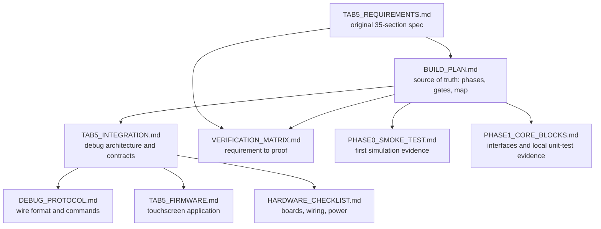

[Project README](../README.md) › **Docs index**

# Design documents

This folder holds the project's design record: the build plan, the architecture and protocol
contracts, the hardware checklist, and the evidence for passed tests. Start here to find the
right document for a question.

> [!NOTE]
> All of these documents exist now. **The designs they describe are 📋 PLANNED** unless a document
> says otherwise. Phase 0 has passed; its evidence is recorded in the build plan and the smoke-test
> record. Status labels are defined in the [root README](../README.md#2-project-status).

---

## 1. The documents and how they relate

The diagram shows which document builds on which. The original requirements feed the build plan,
which the detailed contracts elaborate.

| Document | Kind | Read it for |
| --- | --- | --- |
| [BUILD_PLAN.md](BUILD_PLAN.md) | Plan | Phases 0–7 and Tab5 milestones T0–T13, every gate, design decisions, memory map, test strategy, C flow, risks, open questions. **Its checkboxes are the record of progress.** |
| [PHASE0_SMOKE_TEST.md](PHASE0_SMOKE_TEST.md) | Simulation evidence | Working Cursor task, counter behavior, 25 passing checks, deliberate failure, observed Ubuntu tool versions and output location |
| [PHASE1_CORE_BLOCKS.md](PHASE1_CORE_BLOCKS.md) | Interfaces and verification | Six implemented CPU-block tasks, seven local passing benches, decoder policy, register-file timing and the pending CI gate |
| [TAB5_INTEGRATION.md](TAB5_INTEGRATION.md) | Architecture | What the FPGA and Tab5 each do, the debug-only Wishbone bus, RAM ownership, halt/step/breakpoint semantics, program loading, trace and counters, BIST and fault injection, block RAM budget |
| [DEBUG_PROTOCOL.md](DEBUG_PROTOCOL.md) | Interface specification | Packet framing, sessions and safe retries, status codes, the command table, payload layouts, capability bits and state machines |
| [TAB5_FIRMWARE.md](TAB5_FIRMWARE.md) | Firmware design | Framework decision, firmware modules and tasks, data-provenance labels, screens, microSD layout, reproducible builds |
| [HARDWARE_CHECKLIST.md](HARDWARE_CHECKLIST.md) | Checklist | Manufacturer references, the unknown device revisions, candidate (unapproved) wiring, portable power and flash-boot gates |
| [VERIFICATION_MATRIX.md](VERIFICATION_MATRIX.md) | Traceability | REQ-01 to REQ-35 mapped to milestones and evidence; the V-* test work packages; what a gate evidence record must contain |
| [TAB5_REQUIREMENTS.md](TAB5_REQUIREMENTS.md) | Requirements | The owner's original Tab5 proposal, preserved word for word as the statement of intended functionality |

---

## 2. Reading order

1. **[BUILD_PLAN.md](BUILD_PLAN.md)** first: everything else elaborates part of it.
2. **[TAB5_INTEGRATION.md](TAB5_INTEGRATION.md)** for anything touching debug, loading or
   diagnostics.
3. **[DEBUG_PROTOCOL.md](DEBUG_PROTOCOL.md)**, **[TAB5_FIRMWARE.md](TAB5_FIRMWARE.md)** and
   **[HARDWARE_CHECKLIST.md](HARDWARE_CHECKLIST.md)** for their specific subsystem.
4. **[VERIFICATION_MATRIX.md](VERIFICATION_MATRIX.md)** to see how each requirement will be proven.
5. **[TAB5_REQUIREMENTS.md](TAB5_REQUIREMENTS.md)** for the original intent behind any decision.

| If your question is… | Go to |
| --- | --- |
| "What do I do next?" | [Build plan: next task](BUILD_PLAN.md#15-smallest-next-implementation-task) |
| "What address is that device at?" | [Build plan: memory map](BUILD_PLAN.md#6-memory-map) |
| "How does HALT or STEP work?" | [Integration: CPU debug contract](TAB5_INTEGRATION.md#6-cpu-architectural-debug-contract) |
| "What does opcode `0x0041` do?" | [Protocol: commands](DEBUG_PROTOCOL.md#5-commands-and-state-permissions) |
| "Can I wire the Tab5 yet?" | [Hardware: T0 electrical gate](HARDWARE_CHECKLIST.md#t0-electrical-gate) |
| "How will REQ-nn be proven?" | [Verification matrix](VERIFICATION_MATRIX.md#2-complete-proposal-traceability) |

---

## 3. Diagrams

| Image | Shows | Note |
| --- | --- | --- |
| [images/pipeline.png](images/pipeline.png) | The 5-stage pipeline with forwarding paths and the hazard unit | Current |
| [images/architecture.png](images/architecture.png) | CPU, memory-mapped bus, RAM, board I/O, UART and VGA | Initial-plan artwork; it predates the Tab5 debug path |
| [images/roadmap.png](images/roadmap.png) | The eight core phases and their gates | Initial-plan artwork; the T0–T13 milestones are only in the build plan |

The Mermaid diagrams in [BUILD_PLAN.md](BUILD_PLAN.md) supersede the two initial-plan images.

---

## 4. Files with special editing rules

Two Markdown files are records whose **meaning** must not change. Both have been restyled for
easier reading, under strict limits:

| File | Rule | Why |
| --- | --- | --- |
| [TAB5_REQUIREMENTS.md](TAB5_REQUIREMENTS.md) | Every sentence of the original is kept word for word. Only layout was added: navigation, grouping into lists, and links to the verification matrix. | It is the owner's original proposal and the record of intent. Rewording it would change the requirements every other document traces back to. |
| [AGENTS.md](../AGENTS.md) | Rules may be regrouped and made easier to find, never weakened or removed. | It is the working instruction file that Codex, Cursor and other coding agents load as rules. Changing its wording changes agent behavior, so a rule change is made only on purpose. |

---

## 5. Keeping the docs honest

- Tick a build-plan checkbox only when its work is done, and distinguish a finished task from a
  passed gate.
- Update the relevant document in the same change as any interface, architecture, tooling or
  workflow change.
- Phase 0 evidence is in [the build plan](BUILD_PLAN.md#phase-0-fresh-start) and
  [PHASE0_SMOKE_TEST.md](PHASE0_SMOKE_TEST.md). Saved timing and utilization reports, board photos
  and CPU demo evidence remain pending.
- Phase 1 interfaces and local results are in [PHASE1_CORE_BLOCKS.md](PHASE1_CORE_BLOCKS.md).
  Its CI gate remains pending for the local implementation changes.

**Next step:** open the [build plan](BUILD_PLAN.md).
