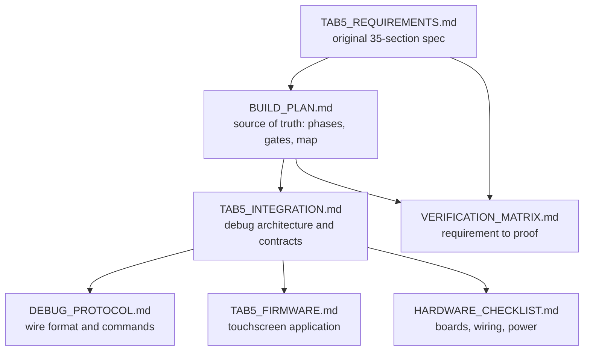

# 📚 `docs/`: design documents

[← Back to the project README](../README.md)

This folder holds the project's design record. All of these documents exist now; **the
designs they describe are 📋 PLANNED** unless a document says otherwise. Status labels are
defined in the [root README](../README.md#status).

## The documents and how they relate

| Document | Read it for | Kind |
| --- | --- | --- |
| [BUILD_PLAN.md](BUILD_PLAN.md) | Phases 0–7 and Tab5 milestones T0–T13, every gate, design decisions, memory map, test strategy, C flow, risks, open questions. **Its checkboxes are the record of progress.** | Plan |
| [PHASE0_SMOKE_TEST.md](PHASE0_SMOKE_TEST.md) | Working Cursor task, counter behavior, 25 passing checks, deliberate failure, observed Ubuntu tool versions and output location | Simulation evidence |
| [TAB5_INTEGRATION.md](TAB5_INTEGRATION.md) | What the FPGA and Tab5 each do, the debug-only Wishbone bus, RAM ownership, halt/step/breakpoint semantics, program loading, trace and counters, BIST and fault injection, block RAM budget | Architecture |
| [DEBUG_PROTOCOL.md](DEBUG_PROTOCOL.md) | Packet framing, sessions and safe retries, status codes, the command table, payload layouts, capability bits and state machines | Interface specification |
| [TAB5_FIRMWARE.md](TAB5_FIRMWARE.md) | Framework decision, firmware modules and tasks, data-provenance labels, screens, microSD layout, reproducible builds | Firmware design |
| [HARDWARE_CHECKLIST.md](HARDWARE_CHECKLIST.md) | Manufacturer references, the unknown device revisions, candidate (unapproved) wiring, portable power and flash-boot gates | Checklist |
| [VERIFICATION_MATRIX.md](VERIFICATION_MATRIX.md) | REQ-01 to REQ-35 mapped to milestones and evidence; the V-* test work packages; what a gate evidence record must contain | Traceability |
| [TAB5_REQUIREMENTS.md](TAB5_REQUIREMENTS.md) | The owner's original Tab5 proposal, preserved verbatim as the statement of intended functionality | Requirements |

## Diagrams

| Image | Shows | Note |
| --- | --- | --- |
| [images/pipeline.png](images/pipeline.png) | The 5-stage pipeline with forwarding paths and the hazard unit | Current |
| [images/architecture.png](images/architecture.png) | CPU, memory-mapped bus, RAM, board I/O, UART and VGA | Initial-plan artwork; it predates the Tab5 debug path |
| [images/roadmap.png](images/roadmap.png) | The eight core phases and their gates | Initial-plan artwork; the T0–T13 milestones are only in the build plan |

The Mermaid diagrams in [BUILD_PLAN.md](BUILD_PLAN.md) supersede the two initial-plan images.

## Reading order

1. **[BUILD_PLAN.md](BUILD_PLAN.md)** first: everything else elaborates part of it.
2. **[TAB5_INTEGRATION.md](TAB5_INTEGRATION.md)** for anything touching debug, loading or diagnostics.
3. **[DEBUG_PROTOCOL.md](DEBUG_PROTOCOL.md)**, **[TAB5_FIRMWARE.md](TAB5_FIRMWARE.md)** and
   **[HARDWARE_CHECKLIST.md](HARDWARE_CHECKLIST.md)** for their specific subsystem.
4. **[VERIFICATION_MATRIX.md](VERIFICATION_MATRIX.md)** to see how each requirement will be proven.
5. **[TAB5_REQUIREMENTS.md](TAB5_REQUIREMENTS.md)** for the original intent behind any decision.

## Files kept exactly as written

Two Markdown files are deliberately left unedited:

| File | Why it is not rewritten |
| --- | --- |
| [TAB5_REQUIREMENTS.md](TAB5_REQUIREMENTS.md) | It is the owner's original proposal, preserved word for word as the record of intent. Rewording it would change the requirements every other document traces back to. Navigation to it lives here and in the [verification matrix](VERIFICATION_MATRIX.md). |
| [AGENTS.md](../AGENTS.md) | It is the working instruction file that Codex, Cursor and other coding agents load as rules. Changing its wording changes agent behavior, so it is edited only on purpose, as a rules change. |

## Keeping the docs honest

- Tick a build-plan checkbox only when its work is done, and distinguish a finished task from a
  passed gate.
- Update the relevant document in the same change as any interface, architecture, tooling or
  workflow change.
- Phase 0 simulation evidence is in [PHASE0_SMOKE_TEST.md](PHASE0_SMOKE_TEST.md).
  Timing and utilization reports, board photos and hardware demo evidence remain pending.
