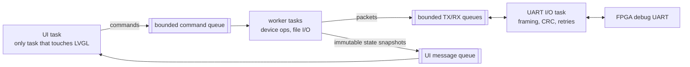

# 📱 Tab5 firmware and user-interface plan

[Project README](../README.md) · [Docs index](README.md) · [Integration architecture](TAB5_INTEGRATION.md) · [Debug protocol](DEBUG_PROTOCOL.md) · [firmware/tab5/ folder](../firmware/tab5/README.md)

> [!NOTE]
> **Status: 📋 PLANNED.** Framework selected; no firmware written. The owner's Tab5 revision is
> ❔ NOT VERIFIED, so no SDK or driver version is pinned.

<details open>
<summary><b>Contents</b></summary>

- [In plain terms](#in-plain-terms) · [Framework decision](#framework-decision) · [Modules and task ownership](#modules-and-task-ownership)
- [States and data provenance](#states-capability-checks-and-data-provenance) · [Screens](#screens-and-initial-availability) · [microSD content](#microsd-content-and-image-validation)
- [Reproducible builds and recovery](#reproducible-builds-and-recovery) · [Firmware verification](#firmware-verification)

</details>

## In plain terms

| Term | What it is | Its job here |
| --- | --- | --- |
| **ESP-IDF** | Espressif's official SDK for its chips, including the Tab5's ESP32-P4 | Build system, drivers for UART, SD card and display |
| **FreeRTOS** | A small real-time operating system bundled with ESP-IDF | Runs several **tasks** at once, so a slow SD read never freezes the screen |
| **LVGL** | A graphics library for embedded touchscreens | Draws the screens, buttons and lists; handles touch |
| **BSP** | Board support package | Knows how this exact Tab5 revision wires its display, touch and SD card |

The golden rule of the design: **the touchscreen must never wait on the FPGA.** Slow work
happens in background tasks that report back through queues.


Status: design selected; firmware not implemented and no dependency/toolchain
version has been validated on the owner's unknown hardware revision. Follow
the [integration architecture](TAB5_INTEGRATION.md),
[wire protocol](DEBUG_PROTOCOL.md), and [hardware gate](HARDWARE_CHECKLIST.md).

## Framework decision

Use **native ESP-IDF + FreeRTOS + LVGL**, with one revision-compatible Tab5
board-support layer. This gives separate transport/storage/UI tasks, bounded
queues, reproducible configuration, and an offline application without a
browser/server. Board support is an interface, not permission to assume a
particular display revision.

| Candidate | Evidence and tradeoff | Decision |
| --- | --- | --- |
| ESP-IDF, LVGL, compatible official BSP/board bindings | Espressif publishes a Tab5 BSP with LVGL/display/touch/SD support. Its listed controllers do not establish compatibility with every newer Tab5 revision. | Selected production direction; exact BSP/driver combination must pass T0. |
| M5Stack factory ESP-IDF/LVGL application | Official M5Stack source provides real device initialization and build/recovery references. It is a hardware example, not our diagnostics application. | Reference board bindings and recovery behavior; preserve licenses for any reused code. |
| Arduino + M5Unified/M5GFX | Official M5Stack libraries support Tab5 and offer a short display/touch/peripheral bring-up route. A second production stack adds duplicated builds and behavior. | Optional isolated T0 smoke experiment if useful, not a competing final firmware. |

Sources reviewed November 6, 2026:
[Espressif Tab5 BSP](https://github.com/espressif/esp-bsp/tree/master/bsp/m5stack_tab5),
[official M5Stack factory source](https://github.com/m5stack/M5Tab5-UserDemo),
[M5GFX](https://github.com/m5stack/M5GFX), and
[M5Unified](https://github.com/m5stack/M5Unified).
The factory README names an ESP-IDF version for its example; that is evidence
of that example's build, not an automatic version pin for this project.

T0 must identify the actual display/touch controller, build an appropriate
vendor-supported sample, and test display, touch, SD and UART together. Then
record exact ESP-IDF, BSP, LVGL and driver versions/commit IDs, lockfiles,
configuration defaults, licenses and recovery steps. If the chosen BSP does
not support the actual revision, use compatible official board bindings or a
documented driver adaptation before continuing. Do not flash an assumed panel
configuration and call the device validated.

## Modules and task ownership

Planned home: `firmware/tab5/`. Do not create an enormous application source file.

| Component | Responsibility / concurrency boundary |
| --- | --- |
| `board/` | Display, touch, SD, power-status and UART pin bindings for the verified revision. |
| `transport/` | UART driver/events, bounded RX/TX queues, COBS/CRC codec, resynchronization. |
| `protocol/` | Typed commands, session IDs, replay-safe retry policy, capability discovery. |
| `device/` | Asynchronous CPU control, memory/register operations, loader, captures, counters. |
| `storage/` | microSD manifest validation, file streaming, expected traces, atomic report export. |
| `state/` | Connection state, CPU state, operation state, image/capture generations and stale timestamps. |
| `ui/` | LVGL screens/components, touch actions, navigation, status labels and local assets. |
| `diagnostics/` | BIST/injection workflow, reference comparison and structured results. |



One task owns UART I/O and packet processing. Worker tasks perform file and
device operations. The UI task alone mutates LVGL objects, using messages to
receive immutable state snapshots. Keep LVGL callbacks short; no blocking
serial reads, sleeps, full program transfers, or SD scans in touch callbacks.
Keepalive/status work must remain scheduled during large transfers. Use
bounded buffers rather than repeatedly allocating whole image/trace files.

The device layer provides request/accepted/progress/completed/error callbacks.
An operation ID is not a successful result. UI navigation does not cancel a
hardware action implicitly; explicit cancellation follows the hardware cleanup
contract. Update the application model only after verified device responses.

## States, capability checks, and data provenance

Track three independent state machines: connection, CPU, and operation, as
defined in the protocol. The top bar always shows connection health, current
hardware identity, execution state and the age of displayed data.

Use badges **LIVE**, **CAPTURED**, **HISTORICAL**, and **MOCK**. T1 may use mock
data with an unmistakable persistent MOCK badge; do not expose real mutation
controls through a mock backend. A frozen pipeline capture includes cycle,
generation and trigger. An old benchmark is historical even if the FPGA is
connected now. After disconnect, retain data only with an explicit stale label.

Discover FPGA capabilities before enabling an operation. A disabled control
should explain the relevant missing capability or state. An unimplemented
hardware command cannot be simulated behind a button while claiming LIVE.
The FPGA remains the authority on permission/state; UI checks are not the
only protection for register edits, BIST, or fault injection.

Demo Mode and Engineering Mode are views of the same application state and
protocol. Switching views does not reset the FPGA, lose the loaded program,
or change register state. Destructive actions require an explicit operator
confirmation and explain the affected memory/program, as required by the brief.

## Screens and initial availability

Use the verified 1280×720 landscape display orientation with large touch
targets, readable hex values, consistent spacing and restrained animation.
Start with a 5 Hz status/counter refresh budget; measure frame responsiveness
while transferring an image, streaming console text, and running diagnostics.
An initial target is touch feedback within 100 ms, to be measured at T1/T5.

| Screen | Content | Enable milestone |
| --- | --- | --- |
| Home | Identity, link/CPU/program state, configured clock, PC labels, summary counters and launch shortcuts. | T1 MOCK; T5 LIVE. |
| Programs | Local manifests/descriptions, verify/load/run/stop/restart with bounded progress. | T5. |
| Terminal | Genuine CPU output, scroll/clear, bounded text buffer and optional input; overflow visible. | T5. |
| CPU Control | HALT/RESUME/RESET, last-retired/next PC; later STEP and breakpoint slots. | T4 then T6/T7. |
| Registers | x0–x31 plus ABI names, hex/decimal/binary views, changed-register highlight and halted edits. | T4; step highlight at T6. |
| Memory | Bounded RAM address viewer, words/bytes/ASCII, explicit edit/readback; no automatic MMIO dump. | T3 reset-held; T4 halted. |
| Pipeline | Coherent IF/ID/EX/MEM/WB captures, valid/bubble/stall/flush labels and capture age. | T8, verified pipeline only. |
| Trace | Frozen retirement records, supported RV32I disassembly, register/store effects, loss/generation information. | T8. |
| Performance | Atomic counters, interval CPI, event definitions, historical comparison and export. | Baseline T5; full T9. |
| Diagnostics | Real memory/ALU BIST, PASS/FAIL/ERROR, range/case counts and first failure. | T10. |
| Fault Injection | Target/mask/trigger, one-use arm/fire, original/observed value, detection and cleanup. | T11. |
| System | Device/protocol/build versions, capability list, communication errors, actual power status where available. | T0/T2 then T5. |
| Presentation / About | Locally stored one-minute explanation, ownership of FPGA/firmware design and short/deep guided sequences. | T1 static; verified actions T13. |
| Reference report | Expected versus actual retirement, earliest proven mismatch and surrounding complete trace. | T12. |

The final presentation may render program-generated graphics or input on Tab5,
but the simulated world/game/algorithm must run on the FPGA. If a screen only
illustrates architecture, label it as an explanation rather than a cycle capture.

## microSD content and image validation

Use a simple local layout, with generated binaries prepared on the development
computer. Example logical paths, not files already supplied:

```text
/programs/<name>/manifest.json
/programs/<name>/program.bin
/expected/<test-id>/reference-data
/reports/<run-id>.json
/reports/<run-id>.csv
```

Manifest schema version 1 fields: name, description, ISA `rv32i`, ABI `ilp32`,
binary path, byte count, load/entry address, CRC-32, BSS bounds, stack bounds,
required FPGA capabilities, and program/build identifier. Initial constraints
and memory reservations are in the architecture document. A development-side
packaging tool should generate metadata from the actual ELF/linker output,
not ask an operator to type checksums or guess BSS bounds.

Validate before LOAD_BEGIN, then let the FPGA independently validate bounds
and readback. Stream chunks instead of copying every program into UI RAM.
Disallow path traversal and oversized/missing files. Switching from A to B
clears the prior program's console/counter baseline only at defined launch
boundaries, while preserving historical reports with their own image hashes.
Missing/corrupt SD yields a clear recoverable state; static About and status
screens still work. Use temporary report files then rename after successful
write, and report removal/full-card errors without blocking the UI.

## Reproducible builds and recovery

At implementation, commit source, `CMakeLists.txt`, component manifests,
`sdkconfig.defaults`, board profile, dependency lockfiles, local fonts/assets,
and documented SDK version. Generated build files, managed component downloads,
local `sdkconfig`, and compiled firmware stay ignored. A lockfile is source
configuration, not generated clutter to discard.

Document clean environment setup, `esp32p4` target, actual USB/serial port,
build/flash/monitor steps, supported boot/recovery procedure, partition layout,
and restoring a known-good image. Keep a tested recovery path even after the
unit auto-starts the app. No Wi-Fi/cloud service is required for runtime.
Do not install a second production toolchain merely for a prototype screen.

`host/` will provide the Python protocol client and deterministic preparation
tools for development/testing. Declare any serial dependency when introduced;
do not borrow the unrelated project's Python/uv restrictions. Host tooling
is optional during the final portable demonstration.

## Firmware verification

Test codecs and application state independently of LVGL/hardware. Use a fake
transport only in explicit MOCK mode. Exercise unsupported capabilities,
late replies, duplicated/reordered messages, connection loss during loads,
SD removal/full card, control navigation during long operations, queue overflow,
and recovery when either device resets first. Validate live behaviors against
FPGA tests rather than just screen appearance. Record measured responsiveness,
heap/stack use, protocol errors, and actual hardware/driver versions at gates.

---

<sub>Related: [firmware/tab5/ overview](../firmware/tab5/README.md) · [Debug protocol](DEBUG_PROTOCOL.md) · [Integration architecture](TAB5_INTEGRATION.md) · [Hardware checklist](HARDWARE_CHECKLIST.md) · [Build plan T0, T1, T5](BUILD_PLAN.md#t0-identify-and-bring-up-the-actual-tab5) · [Docs index](README.md)</sub>
