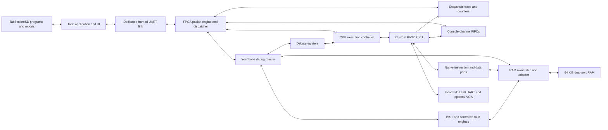
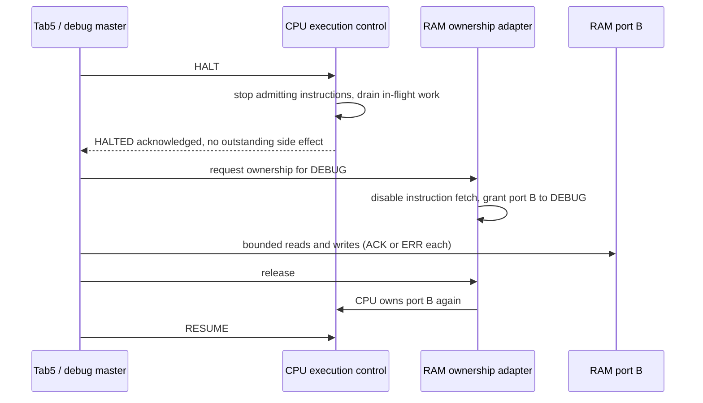
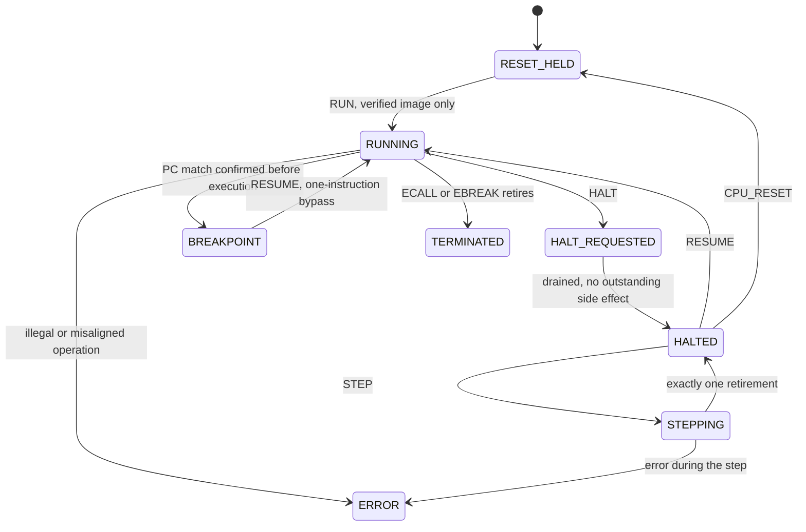
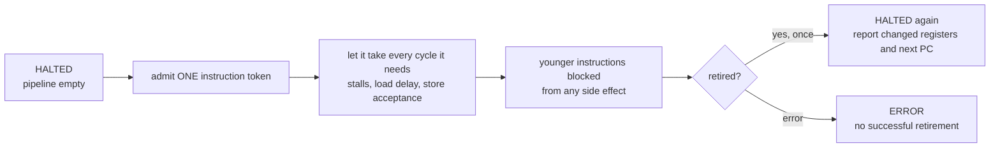
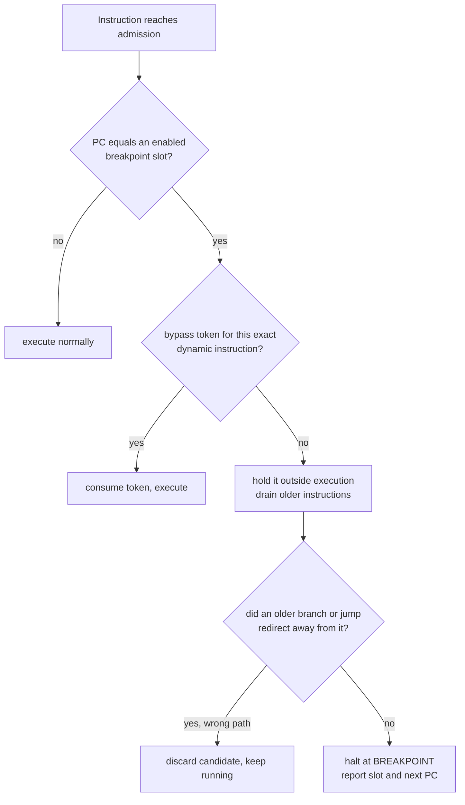
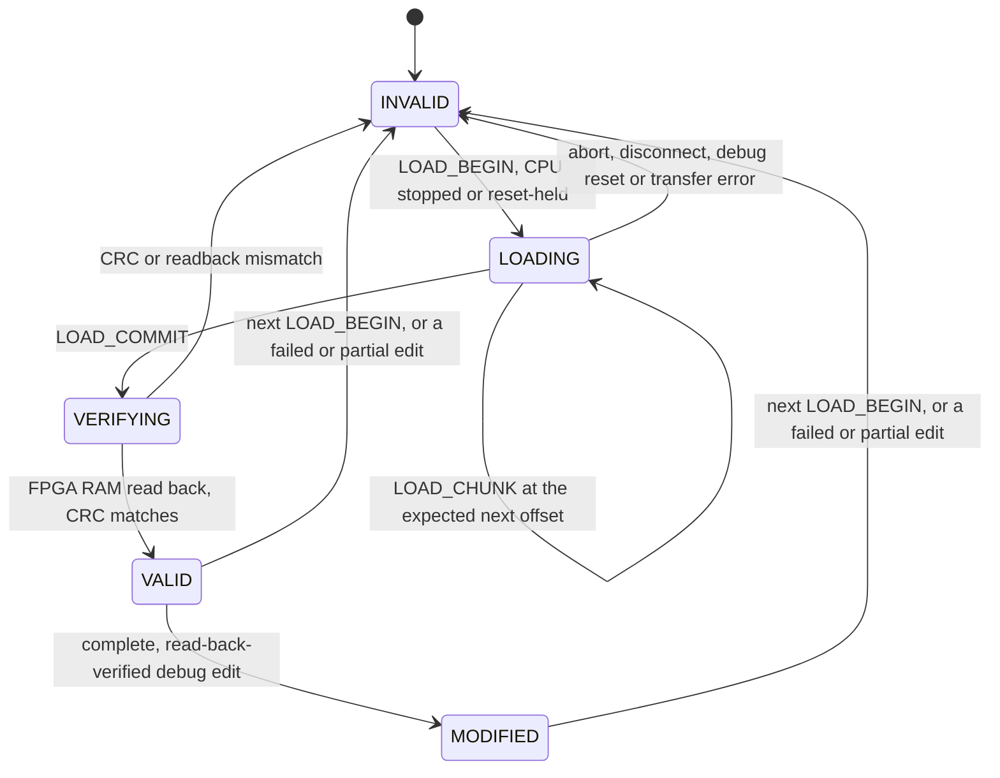

[Project README](../README.md) › [Docs index](README.md) › **Integration architecture**

# Tab5 integration architecture

This is the architecture contract for the debug, loading and diagnostics system: the hardware
that lets the Tab5 pause, inspect, load, measure and self-test the custom CPU. Read it before
designing anything in `rtl/debug/`, `rtl/diag/`, `firmware/tab5/` or `host/`.

> [!NOTE]
> **Status: 📋 PLANNED design.** Nothing this document describes is implemented yet. The Phase 0
> build-and-test flow it builds on has passed.

<b>Contents</b>

1. [In plain terms](#1-in-plain-terms)
2. [Product boundary and acceptance](#2-product-boundary-and-acceptance)
3. [Actual implementation and reuse audit](#3-actual-implementation-and-reuse-audit)
4. [Command and observation paths](#4-command-and-observation-paths)
5. [Wishbone profile and memory ownership](#5-wishbone-profile-and-memory-ownership) · [Debug-only address allocation](#debug-only-address-allocation)
6. [CPU architectural debug contract](#6-cpu-architectural-debug-contract): [halt](#halt-and-resume) · [step](#exactly-one-retired-instruction-per-step) · [breakpoints](#break-before-the-selected-instruction-executes) · [registers and memory](#register-and-memory-access)
7. [Program images, loading, and launch](#7-program-images-loading-and-launch)
8. [Observation and performance](#8-observation-and-performance)
9. [Hardware tests, faults, and reference comparison](#9-hardware-tests-faults-and-reference-comparison)
10. [Firmware, resource budget, and failure handling](#10-firmware-resource-budget-and-failure-handling)
11. [Interfaces to establish before the relevant implementation](#11-interfaces-to-establish-before-the-relevant-implementation)

---

## 1. In plain terms

Debugging a program on a laptop is easy because the operating system can pause it, look at its
memory and restart it. A CPU that we build ourselves has none of that: if we want to pause it,
look inside, or check that it is healthy, **we have to build the hardware that does those
things**. This document designs that hardware and the rules that keep it safe.

Three ideas carry most of the design:

| Idea | Everyday picture | Why it matters |
| --- | --- | --- |
| **Ownership** | One key to the RAM room: whoever holds it may enter | The CPU, the debugger and the self-test engine can never write the same memory at the same time |
| **Retirement** | An instruction counts as done only when its results are final | Stepping, breakpoints, trace and counters all agree on what "one instruction" means |
| **Provenance** | Every number is labelled LIVE, CAPTURED, HISTORICAL or MOCK | A screen can never pass off a recording or a simulation as the real hardware |

**Document history.** Planning baseline, November 6, 2026. No CPU, debug RTL, protocol engine,
Tab5 firmware, or hardware acceptance test is implemented yet.

| Related document | Role |
| --- | --- |
| [TAB5_REQUIREMENTS.md](TAB5_REQUIREMENTS.md) | The user's 35-section proposal, preserved. Its functionality is intended scope. |
| [BUILD_PLAN.md](BUILD_PLAN.md) | Schedules implementation. |
| [VERIFICATION_MATRIX.md](VERIFICATION_MATRIX.md) | Tracks proof. |

---

## 2. Product boundary and acceptance

Each device has a fixed job:

| Device | Runs |
| --- | --- |
| **Basys 3** | The custom RV32I processor, plus execution control, debug access, observation, self-test, and deliberate fault hooks. |
| **Tab5** | The touchscreen, files, protocol client, test orchestration, and optional reference computation. |

> [!IMPORTANT]
> - A program advertised as running on our CPU must run on the FPGA.
> - Reference results are expected values, never substitutes for observed hardware results.
> - This is FPGA processor bring-up and diagnostics; fault models do not establish a
>   manufacturing defect in a fabricated ASIC.

**Primary interface.** Tab5 is the primary portable interface. VGA and the laptop USB console
remain supported development/display paths; VGA is not a prerequisite for either portable
acceptance gate. Normal demonstrations need no laptop, keyboard, external monitor, network, or
cloud. Development still uses a computer.

### The two acceptance gates

| Gate | Milestone | Must demonstrate |
| --- | --- | --- |
| **P1, first standalone system** | T5 | Portable power, FPGA flash boot, Tab5 app auto-start/discovery, microSD program selection, verified RAM load, real CPU output and baseline counters; run A then B without a new bitstream. A verified single-cycle CPU is sufficient for this gate. |
| **P2, complete portable diagnostics** | T13 | Verified pipeline, halt/resume, exact instruction step, pre-execution breakpoints, register/memory access, coherent snapshots, retirement trace, performance, real hardware BIST, controlled fault detection, offline reference comparison, and repeatable short/deep demonstrations. The full checklist is in the build plan. |

P1 and P2 are not marked passed by completing this planning document.

---

## 3. Actual implementation and reuse audit

What exists in the repository now, and how each piece is reused (updated November 7, 2026):

| Component | Present now | Reuse / integration decision |
| --- | --- | --- |
| CPU, pipeline, retirement port | No | Define the retirement/debug boundary before wiring Phase 2; implement the CPU in the original order. |
| RAM and CPU bus | No | Keep the planned native CPU ports and CPU address map; add a separate debug adapter and ownership protocol. |
| UART | No | Implement/test the reusable UART blocks in Phase 4; instantiate a separate debug endpoint, not a second incompatible UART design. |
| Top, MMCM, reset, XDC | Phase 0 blink only: `basys3_top.sv` with a synchronized reset button, and an XDC for clock, center button and LEDs. No MMCM. | Add debug connections only after the documented electrical gate. CPU reset must not reset the transport. |
| Tests, scripts, CI, C runtime | Counter and blink benches, `run_tests.py`, `build.tcl`, `program.tcl` and GitHub Actions CI. C runtime pending. | [Phase 0 evidence](BUILD_PLAN.md#phase-0-fresh-start). Extend the runner for debug/diagnostic benches; it already discovers every `tb/**/*_tb.sv`. |
| Tab5 firmware / host client | No | New modular firmware and Python reference client; share the protocol specification and vectors. |
| Existing content | Skeleton, instructions, plan, three diagrams, the Phase 0 flow | Preserve it. Historical blink source at `9341a22` is reference material, not current validated RTL. |

> [!WARNING]
> There is no existing Wishbone implementation to preserve or replace. Do not claim the native
> CPU bus is Wishbone merely because devices are memory-mapped.

---

## 4. Command and observation paths

The diagram shows how a command travels from the Tab5 to the hardware, and how observations
travel back. The CPU keeps its native ports; everything debug-related goes through the packet
engine and the ownership adapter.

- Packets are validated before any action.
- Commands reach an explicit execution controller or a Wishbone slave; observations return as
  bounded, typed payloads.
- Live state, captures, historical results, and MOCK data carry distinct labels.
- No CPU text byte enters the packet-command parser as a command.

### Separate debug and software-console paths

There are two UART paths, and they never share a parser:

| Path | Purpose | Pins |
| --- | --- | --- |
| Normal CPU MMIO UART | Retains its existing addresses and USB-UART path | Onboard USB-UART |
| Dedicated Tab5 debug UART | Packet link to the Tab5 | Independently checked external pins |

The same tested UART transmitter/receiver modules may be instantiated twice.

**Console FIFOs and backend selection:**

- Add console TX/RX FIFOs behind the CPU UART interface, with an explicit backend selection while
  safely stopped: USB UART for development, packet console for portable use.
- Initially select one consumer; do not accidentally consume the same RX byte twice or let two
  output drivers share a pin.
- If mirroring is implemented later, give each output its own queue and overflow policy.

**Console traffic rules:**

- Console packets have their own channel, bounded queues, credit/polling, and drop counters.
- Debug status/halt responses have priority over console traffic.
- On disconnect, a bounded console queue may drop new output with a visible overflow count; it
  must not silently stall the CPU indefinitely.

---

## 5. Wishbone profile and memory ownership

**Chosen design:** a **debug-only Wishbone B4 Classic, 32-bit data, single-outstanding master**
with four byte selects, ACK/ERR termination, registered adapters, and a bounded watchdog.

- Classic wait states do not require a pipelined STALL interface.
- This is a deliberately small interoperability profile, not a claim to implement every optional
  B4 feature.
- Validate it against the [OpenCores B4 specification](https://cdn.opencores.org/downloads/wbspec_b4.pdf)
  at T3. The full PDF fetch timed out during this planning review.

### Bus rules

| Rule | Detail |
| --- | --- |
| Addressing | Packet addresses are byte addresses. On Wishbone, `adr[29:0]` is the aligned word address (`byte_address >> 2`); `sel[3:0]` selects little-endian byte lanes. |
| Stable request | Keep CYC/STB, address, WE, data, and SEL stable until ACK or ERR. |
| Termination | Slaves must terminate a request once, deassert termination after the request drops, and never produce simultaneous ACK and ERR. |
| Out of profile | RTY, bursts, pipelined requests, LOCK, and extra clock domains are outside the initial profile. |
| Watchdog | No slave access is allowed to wait forever. |

> [!WARNING]
> A timed-out write has an unknown completion outcome until reconciled; timeout does not prove
> the write never happened.

### RAM ownership

The CPU instruction/data interfaces stay native. **There is no third RAM port.**

- Port A remains instruction fetch.
- Port B is multiplexed between CPU data, debug access, and memory BIST.
- Only one owner is granted at a time.

To lend port B to DEBUG or BIST:

1. Stop admission of new CPU instructions and reach HALTED, or hold the CPU in RESET_HELD during
   initial loader development.
2. Wait for all CPU reads/writes and peripheral side effects to complete.
3. Disable instruction fetch enables and grant port B to DEBUG or BIST.
4. Complete every granted bus transfer; restore CPU ownership before resume.

The sequence diagram shows the same handshake between the Tab5, the CPU's execution control and
the ownership adapter.

**Ownership rules:**

- Do not switch an owner mid-transaction.
- A transfer error, disconnect, or watchdog leaves the CPU stopped and the image validity
  explicitly recorded.
- No generic debug memory reads or writes while running in version 1.
- Safe latched status/counters and observation buffers are separate slaves, available without
  borrowing CPU RAM.
- MMIO is denied to generic memory dumps.

### Debug-only address allocation

This allocation follows review of the existing CPU map. It is an internal debug-master address
space, not a new CPU MMIO region. Freeze it with T3 tests.

| Byte address | Debug target / access policy |
| --- | --- |
| `0x0000_0000–0x0000_FFFF` | Existing main RAM through the ownership adapter; stopped/reset-held only. |
| `0x4000_0000–0x4000_00FF` | Identity, capabilities, clock metadata, CPU state, operation status. |
| `0x4000_0100–0x4000_01FF` | Controlled architectural register access and PC state; halted only. |
| `0x4000_0200–0x4000_02FF` | One or two execution-breakpoint slots and one-instruction bypass token. |
| `0x4000_0300–0x4000_03FF` | Latched counters and snapshot descriptors. |
| `0x4000_0400–0x4000_04FF` | Trace control, descriptors, and bounded record access. |
| `0x4000_0500–0x4000_05FF` | Console channel control/FIFO status, accessed through typed commands. |
| `0x4000_0600–0x4000_06FF` | BIST control/results; explicit test ranges. |
| `0x4000_0700–0x4000_07FF` | Disarmed-by-default fault-injection controls/results. |
| Other addresses | ERR / invalid-address response; no alias to physical RAM or CPU MMIO. |

> [!NOTE]
> Offsets above reserve windows, not completed CSR layouts. T3 defines individual register
> offsets, permissions, and reset values before implementing slaves. The
> [wire protocol](DEBUG_PROTOCOL.md) exposes semantic commands so the UI does not depend on raw
> implementation-specific CSR offsets.

---

## 6. CPU architectural debug contract

The state diagram shows the CPU execution states named in the
[protocol](DEBUG_PROTOCOL.md#capabilities-and-state-machines), with the transitions this section
describes. It is a reading aid drawn from the text below; the exact state machine is frozen and
tested at T4 and T6.

### Common signals and reset domains

**The retirement record.** Plan one record shared by CPU tests, trace, counters, and debug. Its
fields:

| Group | Fields |
| --- | --- |
| Identity | `valid`, monotonically increasing order, PC, instruction, next PC |
| Register write | Destination write / index / value |
| Memory | Operation / address / size / byte mask / data |
| Termination | Halt/error reason |

**Retirement rules:**

- Instructions without a register write still retire; flushed bubbles never do.
- Stores retire only after their one architectural side effect is accepted.
- Unsupported/misaligned instructions report an error rather than pretending to retire
  successfully.
- In this project's halt execution environment, ECALL/EBREAK each produce exactly one retirement
  with a terminal flag, increment the retired counter once, then halt.
- Illegal/misaligned operations produce an ERROR without a successful retirement.
- Use this convention consistently in trace, stepping, counters and the reference model; it is
  not a privileged trap implementation.

**Control handshakes.** Expose request/acknowledged state for halt, resume, step, restart,
register access, and ownership. Define priority, highest first:

1. reset
2. unrecoverable error
3. breakpoint
4. external halt
5. step completion
6. resume

**Reset domains:**

| Reset | Effect |
| --- | --- |
| CPU reset | Clears core state, flushes in-flight work, disarms injection, and preserves an active link. |
| Board/debug reset | Also clears transport sessions. |
| Every reset path | Clears active fault hooks before releasing the CPU. |

> [!NOTE]
> Neither reset means RAM was erased unless an explicit memory-clear operation ran. Startup code
> initializes its own `.bss`, stack, and supported ABI state.

**Program counter reporting:**

- Report both `last_retired_pc` (with a valid flag) and `next_pc`. `current PC` alone is
  insufficient.
- Register reads are committed architectural state, with a snapshot generation.
- Provide an explicit entry-PC load during restart, initially restricted to the linker entry 0,
  with all prefetch/valid state reset.

### Halt and resume

HALT is asynchronous as a *command*, not as a clock gate:

1. Stop admitting new instructions.
2. Drain accepted operations.
3. Acknowledge HALTED with an empty pipeline and no outstanding side effect.

While halted:

- The debug clock and UART stay running.
- Keep the next unexecuted PC, including the result of older branches.
- Resume re-enables admission from that PC.
- Repeated HALT has no extra effect.

> [!CAUTION]
> A halt timeout is an error, not a license to lend RAM to a second owner.

### Exactly one retired instruction per STEP

1. Require a stable, drained HALTED state.
2. Admit one instruction token.
3. Permit all cycles and waits necessary for it, and block younger instructions from any side
   effect.
4. Return HALTED after its single retirement (including terminal ECALL/EBREAK).

The flowchart shows the same sequence, including the error exit.

**Step rules:**

- An error ends the step in ERROR with no successful retirement.
- Stores must not update RAM before a future halt while appearing unretired.
- Branches/jumps update next PC normally; flushed wrong-path work cannot consume the step token.
- Count NOPs and writes to x0 as instructions too.
- Test load delays, store acceptance, dependencies, taken/not-taken branches, JAL/JALR,
  ECALL/EBREAK, and reset during a step.

> [!WARNING]
> One clock enable is not STEP.

### Break before the selected instruction executes

Start with two hardware PC comparators.

1. Check an instruction's address at admission, before it can perform an architectural side
   effect.
2. On a candidate, hold that instruction outside execution and drain older instructions.
3. Commit the breakpoint halt only if no older branch redirects away from it. Flushed wrong-path
   candidates must not stop the program.

The flowchart shows the decision for each instruction, including the bypass token used when
resuming.

**Reporting and resuming:**

- Report slot and next PC.
- RESUME/STEP from a breakpoint gives a one-instruction bypass token for that exact dynamic
  instruction; it is consumed after real progress.
- It must not suppress a later loop iteration at the same address.
- Memory watchpoints and conditional breakpoints stay optional extensions.

### Register and memory access

**Registers:**

- Multiplex an explicit debug register-file port while halted; preserve one sequential writer and
  defined read timing.
- x0 writes return an error; x0 remains zero.
- Readback confirms other writes.
- Any edited state invalidates comparison baselines.

**Memory:**

- Memory uses size/alignment checks, address bounds, byte selects, and read-after-write
  verification.
- Ordinary RAM is distinct from side-effecting devices.
- PC editing is a typed restart operation, not an arbitrary write into a live pipeline register.
- Bulk edits are not atomic: report completed elements and any final uncertain address on a bus
  failure, keep the CPU halted, and reconcile/read back before continuing.

**Edited images:**

- A deliberate, completely readback-verified debug edit marks program/state MODIFIED and
  invalidates the original reference baseline.
- It may resume as that explicitly edited state; it cannot be labelled an unchanged original
  image.
- Failed/partial edits to the loaded image invalidate runnable state until reload in version 1.
- Interrupted program loading is always invalid and can never take this intentional-edit path.

---

## 7. Program images, loading, and launch

Keep the FPGA configuration image separate from RV32I software images.

- The Tab5 microSD stores manifests and raw binaries prepared by the development toolchain; ELF
  parsing is a later option.
- The raw loader accepts RV32I/ILP32, little-endian images linked at 0 with a word-aligned entry
  0 initially.

### Proposed linker policy (to prove in Phase 3)

| Range | Size | Contents |
| --- | --- | --- |
| `0x0000_0000–0x0000_CFFF` | 52 KiB | Code, `.data`, `.bss`, and heap |
| `0x0000_D000–0x0000_DFFF` | 4 KiB | Diagnostic scratch |
| `0x0000_E000–0x0000_FFFF` | 8 KiB | Stack, initial SP `0x0001_0000` |

- These are software reservations inside the unchanged physical 64 KiB RAM, not additional
  memory.
- Linker assertions must reject image/BSS/heap/stack collisions.
- If measured program needs require a different split, revise manifest, linker, loader, BIST, and
  tests together before freezing the Phase 3/T5 format.

### The program manifest

The manifest includes:

- schema version, name/description;
- target ISA/ABI, binary filename;
- load address, entry, byte count, initialized-image CRC-32;
- `.bss` range, stack bounds, and required capabilities.

The loader limits names/paths and rejects:

- traversal and absent files;
- unsupported ISA;
- overflow in address+length;
- out-of-bounds sections and overlapping scratch/stack;
- invalid entry and checksum mismatch.

> [!NOTE]
> CRC detects accidental corruption; it is not an authenticity claim.

### Image validity

The state diagram shows image validity as the loader moves through its steps. It is a reading
aid for the rules below it.

> [!IMPORTANT]
> Only VALID or MODIFIED images may RUN, and a MODIFIED image can never be labelled the unchanged
> original.

### Load sequence

Loading uses BEGIN -> ordered offset-labelled CHUNKs -> VERIFY/COMMIT -> RUN.

1. **BEGIN** requires a stopped/reset-held CPU and marks the previous image invalid *before* the
   first write. The complete range is bounded.
2. **CHUNKs** arrive in order. Chunk retries are deduplicated; offsets cannot skip a hole.
3. **COMMIT** runs a readback CRC that verifies actual FPGA RAM, not a copy cached on Tab5. Only
   COMMIT makes the image runnable.
4. **RUN / restart** initializes architectural state/entry and invalidates fetch buffers without
   erasing the newly loaded image. CPU startup handles ABI initialization.

Abort, disconnect, reset of the debug domain, or transfer failure leaves the image not runnable.

### The optional ROM loader

The optional ROM UART loader in the original Phase 4 is a separate recovery path.

- A ROM at `0x10000` cannot be assumed to execute after reset to RAM 0: it needs an explicit boot
  selector/vector if implemented.
- The portable primary loader is hardware debug access and works while the CPU is reset-held.

---

## 8. Observation and performance

### Coherent snapshots

- Latch all pipeline stage PCs/instructions/valid bits, stall/flush flags, counters, CPU state,
  and a capture cycle in one coherent snapshot.
- Publish an epoch/id and timestamp; retrieve the frozen snapshot without pausing the UI.
- After drain-and-halt, pipeline stages are empty; showing a pre-halt triggered capture is useful
  but must not be labelled the current filled pipeline.

### Retirement trace

Start with **256 circular retirement records, 32 bytes each (8 KiB payload)**.

| Part | Contents |
| --- | --- |
| Each record | PC, instruction, register/event flags, destination value, memory address, memory data, auxiliary flags, and low retirement-order bits |
| Descriptor | Full first/last order, generation, record format, count, write index, overflow, trigger and frozen status |

- Establish reconstruction around 32-bit order wrap.
- Freeze-and-read is version 1; trace reads never race ongoing writes.
- A complete wider record is optional if resources permit.

### Counters

| When | Requirement |
| --- | --- |
| **P1** | A coherent latch of the baseline cycle/retirement counters through STATUS, with the actual width advertised and wrap-aware, bounded measurement intervals. It need not wait for the full event dashboard. |
| **T9** | Standardize 64-bit cycles, retirements, load-use/other stalls, taken branches and flushes with precise definitions and an atomic latch; preserve original 32-bit CPU MMIO views as documented low-word views. |

Definitions:

- Define active-execution cycles separately from wall cycles and halted time.
- **CPI = interval active cycles / interval retired instructions**; show N/A for zero
  instructions.
- Clock metadata comes from the configured clock profile; measured Fmax is a separately labelled
  report value.

### Link bandwidth

> [!WARNING]
> 115200 baud, 8N1 provides at most 11,520 wire bytes/second before framing, requests, and
> responses (derived from ten wire bits/byte). It cannot transmit every cycle of a tens-of-MHz
> CPU.

- Refresh coarse snapshots around 5 Hz at first.
- Retrieve detailed trace only on request.
- Track dropped console/trace events.

---

## 9. Hardware tests, faults, and reference comparison

### Memory BIST

- Memory BIST is an RTL controller, initially March C- over the reserved scratch range, using the
  real RAM access path while stopped.
- Record range, phase, cases, failure count, first address, expected and observed values.
- Do not promise that saving/restoring RAM is possible without verifying capacity and
  power-failure recovery.

> [!CAUTION]
> Full-RAM testing is explicitly destructive: confirm in the UI, invalidate the loaded program,
> and require reload.

### ALU BIST

- ALU BIST reuses the actual CPU ALU through an owned test mux while halted, with independently
  specified known-answer vectors. Testing a duplicate ALU would not test the CPU's hardware.
- Software diagnostic programs are separately labelled CPU self-tests.
- Neither test proves exhaustive physical fault coverage.

### Fault injection

- Fault injection is disarmed on reset, exclusive-owner only, and bounded to supported scratch
  addresses or explicitly selected halted registers.
- Record target, original value, mask, resulting value, trigger count, restoration, and
  detection.
- Keep ordinary debug writes distinct from injected read corruption or deliberately modelled
  stuck-at behavior in a hardware wrapper.

> [!IMPORTANT]
> A March test writes patterns before reading; a pre-test stored bit flip can be overwritten and
> disappear. For a detection demonstration:
>
> - inject a controlled read-path XOR/stuck-at fault during the relevant BIST read, **or**
> - verify an independently seeded baseline before any rewriting.
>
> Test that only the selected address/bit/time is affected. Cleanup must disarm the hook and
> release ownership even after an error. A software change is never relabelled as a physical
> silicon failure.

### Offline reference comparison

1. Begin with deterministic RAM-only programs and identical PC/register/memory initialization.
2. Compare retirement PC, instruction, destination, next PC, and stores against independently
   defined RV32I behavior.
3. Replay or exclude nondeterministic input/MMIO.
4. Begin with halt/step comparison or bounded complete captures: a 256-record rolling window and
   lossy UART do not justify a claim to find the first divergence of an unbounded execution.
5. Detect missing records and report comparison inconclusive.

Where the expected results come from:

- Tab5 may run a small reference model if measured resources allow, **or**
- read precomputed expected records from microSD.

Neither path supplies the displayed live FPGA result.

---

## 10. Firmware, resource budget, and failure handling

### Firmware direction

The selected framework direction is native ESP-IDF with FreeRTOS, LVGL, and a
revision-compatible Tab5 board support layer. Versions and driver selection are pinned only
after the actual device passes T0. Compare alternatives and build/recovery requirements in
[TAB5_FIRMWARE.md](TAB5_FIRMWARE.md).

### Block RAM budget

The Basys 3 manual lists 1,800 Kbits of block RAM. The budget below is an allocation target, not
a synthesis result. The manual and power/configuration sources are linked in
[HARDWARE_CHECKLIST.md](HARDWARE_CHECKLIST.md).

| Consumer | Payload target | Provisional RAMB36-equivalent allowance |
| --- | --- | --- |
| Main RAM | 64 KiB | 16 with a suitable 32-bit dual-port arrangement |
| Optional ROM | 2 KiB | 1 |
| Retirement trace | 8 KiB initially | 4–8 depending on port widths/packing |
| UART/console queues | Bounded, about 2–4 KiB | 2–4 |
| Packet buffers and replay cache | Bounded, about 1–2 KiB | 1–2 |
| Optional VGA text/font/pixels | Existing plan targets | Measure separately, reserve about 7–9 |

- Widths and dual-port inference can waste capacity; byte-count division alone does not predict
  BRAM use.
- Synthesize each subsystem, report LUT/FF/BRAM and critical paths with debug idle/enabled, and
  keep margin for routing and ILA.
- Reduce trace depth/format or optional display storage before compromising CPU correctness.
- No Fmax or whole-system fit claim exists until implementation.

### Failure handling

- UART parsing, debug clocks and status stay responsive during CPU halt and BIST.
- Queues/timeouts are bounded.
- The Tab5 reconnects, discovers capabilities, reconciles operation state, and asks the operator
  to choose a safe next action where needed.
- See the hardware checklist for portable power, configuration flash, and cold-start
  qualification.

> [!CAUTION]
> A UI disconnect never automatically resumes a halted CPU, replays a destructive command, or runs
> an unverified image.

---

## 11. Interfaces to establish before the relevant implementation

Each original phase must leave a seam that the debug work can attach to later:

| Original phase | Required design seam / verification |
| --- | --- |
| 0 | Reusable module discovery, bounded tests, ignored build output; no debug implementation prerequisite. |
| 1 | Preserve x0; plan one controlled register writer and an owned ALU test mux. |
| 2 | Retirement/terminal event, next-PC meaning, reset-held RAM access and proven memory timing. |
| 3 | Linker reservations, native RAM ownership contract, reset domains, original counters. |
| 4 | Reusable UART blocks, separate physical debug endpoint and virtual console backend. |
| 5 | Drain-and-stop, one-instruction admission, wrong-path breakpoint handling, atomic observation. |

All capabilities remain hidden/disabled in the UI until the matching FPGA capability and
verification gate exist.

**Next step:** Phase 0 has passed, so the next implementation work is
[Phase 1](BUILD_PLAN.md#phase-1-building-blocks). Its seam above (preserve x0, one controlled
register writer, an owned ALU test mux) applies from the first module.

---

**Related:** [Build plan](BUILD_PLAN.md) · [Debug protocol](DEBUG_PROTOCOL.md) · [Tab5 firmware](TAB5_FIRMWARE.md) · [Hardware checklist](HARDWARE_CHECKLIST.md) · [Verification matrix](VERIFICATION_MATRIX.md) · [Original Tab5 requirements](TAB5_REQUIREMENTS.md) · [Docs index](README.md)
