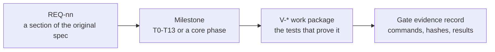

[Project README](../README.md) › [Docs index](README.md) › **Verification matrix**

# Requirements and verification matrix

This matrix maps every section of the original [Tab5 specification](TAB5_REQUIREMENTS.md) to the
milestone that delivers it and the test that will prove it. Use it to check that nothing in the
specification is forgotten, and to see what evidence a gate needs before it can be ticked.

> [!NOTE]
> **Status: 📋 PLANNED.** Every row maps a requirement to future proof. No Tab5 test in this file
> has run. Core CPU testing (unit tests, rv32ui, lockstep) is described in
> [How we test](BUILD_PLAN.md#8-how-we-test) and [tb/README.md](../tb/README.md); this matrix
> covers the 35 sections of the [Tab5 specification](TAB5_REQUIREMENTS.md).

<details open>
<summary><b>Contents</b></summary>

1. [How traceability works](#1-how-traceability-works)
2. [Complete proposal traceability](#2-complete-proposal-traceability)
3. [Verification work packages](#3-verification-work-packages)
4. [Gate evidence record](#4-gate-evidence-record)

</details>

---

## 1. How traceability works

Each requirement flows through a milestone and a test package into a recorded result:



| Word | Meaning | Today |
| --- | --- | --- |
| **Covered** | The requirement has a milestone and defined proof. | Every requirement is covered. |
| **Met** | That proof exists as an evidence record and passes. | None is met. |

**Status.** All implementation and hardware evidence below is **planned**, not passed. The
repository has a skeleton, design documents and a passed Phase 0 (the
[counter smoke test](PHASE0_SMOKE_TEST.md), the test runner, the scripted blink build and CI);
none of that satisfies any of the Tab5 acceptance requirements below.

Where the details live:

| Topic | Document |
| --- | --- |
| Milestone definitions and dependencies | [BUILD_PLAN.md](BUILD_PLAN.md) |
| Debug architecture and contracts | [TAB5_INTEGRATION.md](TAB5_INTEGRATION.md) |
| Wire protocol | [DEBUG_PROTOCOL.md](DEBUG_PROTOCOL.md) |
| Firmware | [TAB5_FIRMWARE.md](TAB5_FIRMWARE.md) |
| Hardware, wiring and power | [HARDWARE_CHECKLIST.md](HARDWARE_CHECKLIST.md) |

---

## 2. Complete proposal traceability

`REQ-nn` matches section nn of the original specification; each ID links to that section. These
are coverage links, not completion checkboxes.

> [!WARNING]
> A passed simulation does not substitute for the indicated hardware evidence.

### Purpose, roles and portability (REQ-01–REQ-06)

| Requirement | Intended behavior / design coverage | Milestone and required proof |
| --- | --- | --- |
| [REQ-01](TAB5_REQUIREMENTS.md#1-overview-and-main-objective): objective | One portable FPGA CPU and Tab5 diagnostics system; real execution remains on FPGA. | T5 P1 and T13 P2, laptop-free observed program execution. |
| [REQ-02](TAB5_REQUIREMENTS.md#2-existing-project-context): existing context | Preserve CPU order, unified RAM and map; no claim of an existing Wishbone bus. | Audit in architecture; Phases 0–5 regressions continue to pass as built. |
| [REQ-03](TAB5_REQUIREMENTS.md#3-main-design-philosophy): hardware/software roles | Every live control/value is backed by FPGA behavior; MOCK distinct. | T1 labels, T4/T8 hardware observations, T13 provenance review. |
| [REQ-04](TAB5_REQUIREMENTS.md#4-standalone-and-portable-operation): portability | Independent power, flash boot, local firmware, reconnect and cold-start. | T0/T5/T13 power/startup trial record. |
| [REQ-05](TAB5_REQUIREMENTS.md#5-tab5-as-the-main-display-of-the-risc-v-computer): primary display | Readable touchscreen home/state/control; VGA not prerequisite. | T1/T5/T13, real state and UI responsiveness tests. |
| [REQ-06](TAB5_REQUIREMENTS.md#6-two-main-application-modes): modes | Demo/Engineering share state and transport; view change preserves program. | T1/T13 mode-switch invariance test. |

### Communication and bus (REQ-07–REQ-08)

| Requirement | Intended behavior / design coverage | Milestone and required proof |
| --- | --- | --- |
| [REQ-07](TAB5_REQUIREMENTS.md#7-direct-communication-between-tab5-and-fpga): UART protocol | Dedicated framed/versioned transport, CRC, IDs, safe retries and chunking. | T2 golden vectors, corrupt/reset/retry tests, real-link test. |
| [REQ-08](TAB5_REQUIREMENTS.md#8-wishbone-debug-bus-integration): Wishbone | Debug-only B4 Classic bridge, safe native-memory adapter and arbitration. | T3 ACK/ERR/wait/watchdog/ownership simulation and scratch readback. |

### CPU control and state access (REQ-09–REQ-13)

| Requirement | Intended behavior / design coverage | Milestone and required proof |
| --- | --- | --- |
| [REQ-09](TAB5_REQUIREMENTS.md#9-hardware-cpu-halt-resume-and-reset): execution control | Drain-and-stop, clean resume/reset, defined PC and status. | T4/T7 halted-state and side-effect equivalence tests. |
| [REQ-10](TAB5_REQUIREMENTS.md#10-true-instruction-level-single-stepping): instruction step | Exactly one retirement/terminal event with correct side effects. | T6/T7 directed branch/load/store/stall/termination tests. |
| [REQ-11](TAB5_REQUIREMENTS.md#11-hardware-breakpoints): breakpoints | Stop before selected instruction, ignore wrong-path candidates, resume once. | T6/T7 breakpoint and retrigger tests, board confirmation. |
| [REQ-12](TAB5_REQUIREMENTS.md#12-register-inspection-and-modification): registers | Real committed x0–x31, ABI names, safe edits and changed values. | T4 x0 rejection/readback, T6 step-delta UI test. |
| [REQ-13](TAB5_REQUIREMENTS.md#13-memory-viewer-and-editor): memory | Real RAM viewer/editor, alignment/range/SEL, no destructive MMIO dump. | T3/T4 byte/half/word tests and hardware readback. |

### Program loading and console (REQ-14–REQ-15)

| Requirement | Intended behavior / design coverage | Milestone and required proof |
| --- | --- | --- |
| [REQ-14](TAB5_REQUIREMENTS.md#14-program-loading-directly-from-the-tab5): program loading | Local manifest/binary, validated transfer, image invalidation and A-to-B run. | T5 interrupted/corrupt/out-of-range loads, real offline two-program gate. |
| [REQ-15](TAB5_REQUIREMENTS.md#15-cpu-software-console-on-the-tab5): terminal | CPU printf/input via isolated console channel, bounded buffering. | T5 console/debug interleaving, overflow, echo and disconnect tests. |

### Observation and performance (REQ-16–REQ-18)

| Requirement | Intended behavior / design coverage | Milestone and required proof |
| --- | --- | --- |
| [REQ-16](TAB5_REQUIREMENTS.md#16-live-five-stage-pipeline-visualization): pipeline | Coherent stage snapshots with age/valid/bubble/stall/flush labels. | T8 compare captured signals to simulation/board event programs. |
| [REQ-17](TAB5_REQUIREMENTS.md#17-instruction-retirement-trace-buffer): trace | Real circular retirement records, freeze/read, disassembly, no flushed records. | T8 ordering/wrap/generation/loss tests and real trace retrieval. |
| [REQ-18](TAB5_REQUIREMENTS.md#18-performance-monitoring-and-hardware-counters): performance | Real atomic counters, defined intervals/CPI/clock, labelled history/export. | T9 exact-event programs, rollover/zero/division/snapshot tests. |

### Self-test, faults and reference comparison (REQ-19–REQ-21)

| Requirement | Intended behavior / design coverage | Milestone and required proof |
| --- | --- | --- |
| [REQ-19](TAB5_REQUIREMENTS.md#19-built-in-self-test-system): BIST | Actual RAM controller and actual-ALU path, meaningful PASS/FAIL/ERROR. | T10 known-good and known-fault tests; destructive-range consent/reload. |
| [REQ-20](TAB5_REQUIREMENTS.md#20-controlled-fault-injection): fault injection | Bounded hardware hook, arm/fire/cleanup, actual target/mask/result recorded. | T11 selected-bit/time/address confinement and detection/restore tests. |
| [REQ-21](TAB5_REQUIREMENTS.md#21-automated-diagnostic-comparison-against-a-reference-model): reference comparison | Equivalent initial state, complete deterministic retirement comparisons. | T12 known mismatch/no-mismatch tests, gaps yield inconclusive. |

### Screens, demo flow and firmware (REQ-22–REQ-24)

| Requirement | Intended behavior / design coverage | Milestone and required proof |
| --- | --- | --- |
| [REQ-22](TAB5_REQUIREMENTS.md#22-user-interface-screens): screens | Home, Programs, Terminal, CPU, Registers, Memory, Pipeline, Trace, Performance, Diagnostics, Injection, System, About. | T1/T5/T8–T13 capability-gated screen acceptance. |
| [REQ-23](TAB5_REQUIREMENTS.md#23-career-fair-demonstration-mode): career-fair flow | Short reliable demo plus deeper engineering/diagnostics route. | T13 timed rehearsals from cold boot with no laptop. |
| [REQ-24](TAB5_REQUIREMENTS.md#24-firmware-architecture-on-the-tab5): firmware | Modular board/transport/protocol/device/storage/state/UI/diagnostics, async. | T0/T1/T5 clean build, recovery and responsiveness/resource results. |

### Engineering process and physical design (REQ-25–REQ-28)

| Requirement | Intended behavior / design coverage | Milestone and required proof |
| --- | --- | --- |
| [REQ-25](TAB5_REQUIREMENTS.md#25-fpga-rtl-architecture-for-the-diagnostics-system): RTL organization | Explicit modules, bounded interfaces, safe clocks, resource/timing evidence. | T2–T12 self-checking benches and synthesis deltas. |
| [REQ-26](TAB5_REQUIREMENTS.md#26-verification-and-testing-requirements): verification | Unit, integration, failure injection, debug-idle equivalence and board tests. | This matrix plus per-gate evidence reports, continuously updated. |
| [REQ-27](TAB5_REQUIREMENTS.md#27-power-reliability-and-physical-design): power/physical | Verified supplies, retained cable, mounting, low-power handling and runtime. | T0/T13 electrical checklist and measured portable trial. |
| [REQ-28](TAB5_REQUIREMENTS.md#28-development-order-and-integration-strategy): order | Small testable milestones linked to CPU gates; no whole-system rewrite. | Build-plan dependency graph T0–T13 and preserved CPU phase gates. |

### Demonstrations (REQ-29–REQ-30)

| Requirement | Intended behavior / design coverage | Milestone and required proof |
| --- | --- | --- |
| [REQ-29](TAB5_REQUIREMENTS.md#29-first-complete-standalone-demonstration): first demo | Flash boot -> discovery -> SD load -> run -> real output/counters. | T5 P1, ten cold boots and program A-to-B without reconfiguration. |
| [REQ-30](TAB5_REQUIREMENTS.md#30-final-complete-demonstration): full demo | Pipeline control, break/step/registers/trace/perf/BIST/fault/reference offline. | T13 P2, twenty cold boots and complete deeper sequence. |

### Documentation, extensions, constraints and vision (REQ-31–REQ-35)

| Requirement | Intended behavior / design coverage | Milestone and required proof |
| --- | --- | --- |
| [REQ-31](TAB5_REQUIREMENTS.md#31-documentation-and-portfolio-requirements): portfolio/docs | Reproducible FPGA/firmware/program builds, verified claims and reports/video. | T13 evidence bundle, README reproduction review and architecture sheet. |
| [REQ-32](TAB5_REQUIREMENTS.md#32-additional-features-that-could-be-added-later): extensions | SPI, watchpoints, triggered trace, richer reference/symbols remain ordered options. | Separate stretch backlog after the required portable gates. |
| [REQ-33](TAB5_REQUIREMENTS.md#33-technical-constraints-and-important-design-decisions): constraints | Genuine FPGA execution, safe memory/clocking, accurate provenance, no cloud runtime. | Architecture/instruction rules; negative tests and T13 audit. |
| [REQ-34](TAB5_REQUIREMENTS.md#34-what-i-want-you-to-do-with-my-existing-codebase): integration work | Audit, architecture, firmware selection, protocol/map, risks, roadmap and next task. | Planning package delivered; Phase 0 flow verified (counter smoke test, test runner, scripted build and CI); next implementation is Phase 1. |
| [REQ-35](TAB5_REQUIREMENTS.md#35-final-vision): unified final vision | One coherent portable bring-up/diagnostics platform with independent proof. | T13 combined hardware/software acceptance and reproducibility. |

---

## 3. Verification work packages

These are planned test identities, not filenames or scripts already present.

- Implement meaningful assertions and keep expected behavior independent of the block under test.
- Extend the existing runner, `scripts/run_tests.py`; it already builds and runs every
  `tb/**/*_tb.sv`.

### Core regression

| ID | Scope | Cases / invariant |
| --- | --- | --- |
| V-CORE | Original core regression | Unit/directed/rv32ui/lockstep pass after each debug integration; stores and non-register-writing instructions checked. |
| V-IDLE | Debug has no unintended CPU effect | Same deterministic program with debug disabled, idle, and read-only observation: same retirement/store/output sequence; measure any declared observation stalls. |

### Link, bus and ownership

| ID | Scope | Cases / invariant |
| --- | --- | --- |
| V-LINK | Packet codec and sessions | All bytes, zero/max payload, CRC vector, bounds, malformed/truncated frame, recovery, timeouts, lost ACK, duplicate/stale/ID conflict, session reset/wrap. |
| V-WB | Bus bridge | Byte-to-word address conversion, SEL, ACK/ERR exclusive, wait states, stable request, one side effect, watchdog, uncertain write, invalid decode. |
| V-OWNER | RAM ownership | CPU/DEBUG/BIST never overlap; no owner switch mid-transfer; instruction port held; reset/disconnect/abort cannot grant access prematurely. |

### Execution control and state

| ID | Scope | Cases / invariant |
| --- | --- | --- |
| V-HALT | CPU control | Halt during each stage and pending memory operation; no lost/duplicated store, drained acknowledgment, stable regs, correct next PC, reset domains. |
| V-STEP | Architectural step | Exactly one instruction for NOP, x0 destination, ALU, load/store delays, branch both outcomes, JAL/JALR, hazard, ECALL/EBREAK and error. |
| V-BREAK | Pre-execution break | No selected instruction side effect; older branch redirects cancel wrong-path match; repeated loop PC and one-use bypass make progress. |
| V-STATE | Register and memory | x0, all registers, byte/half/word, sign/byte ordering, boundaries/overflow, write/readback, no MMIO dump, generation freshness. |

### Loading and console

| ID | Scope | Cases / invariant |
| --- | --- | --- |
| V-LOAD | Manifest and loader | ISA/ABI, file/path/bounds/BSS/stack validation, corrupt/reordered/missing chunk, readback CRC, invalid image cannot run, reset/disconnect, A-to-B no bitstream change. |
| V-CONSOLE | Console isolation | Binary console resembling packets is data; debug commands never become program input; queues bounded, overflow visible, replayed reads do not consume twice. |

### Observation

| ID | Scope | Cases / invariant |
| --- | --- | --- |
| V-SNAPSHOT | Coherent captures | All stage/counter values from one epoch, valid/flush consistency, stale labels, snapshot during branch/halt, CDC review if domains differ. |
| V-TRACE | Retirement history | No bubbles/flushed records, store ordering, circular wrap, low order-bit wrap, freeze at whole record, bounds, missing-record detection, disassembly against encodings. |
| V-PERF | Event counters | Defined active/wall/halted time, exact branch/stall/flush counts, 64-bit rollover/carry, atomic latch, interval reset, CPI zero denominator and configured clock identity. |

### Diagnostics

| ID | Scope | Cases / invariant |
| --- | --- | --- |
| V-BIST | Hardware self-test | Scratch/full-RAM ownership, March phase order/results, actual ALU under test, independent vectors, injected faults detected, abort cleanup, image invalidation. |
| V-FAULT | Controlled corruption | Default disarmed, exact address/bit/trigger/duration, original/changed/readback values, read-path injection during BIST, no neighboring changes, restoration after failure. |
| V-REF | Offline comparison | Equal initial state, independent expected behavior, registers/next PC/stores, deterministic MMIO policy, first proven mismatch, incomplete trace inconclusive. |

### Firmware and standalone system

| ID | Scope | Cases / invariant |
| --- | --- | --- |
| V-UI | Firmware/UI | MOCK/LIVE/CAPTURED/HISTORICAL labels, capability/state gating, mode switch preserves state, touch response during load/SD errors/disconnect, memory/stack bounds. |
| V-BOOT | Standalone hardware | Flash configuration, both boot orders, SD failures, program validity, reset/reconnect, laptop/monitor absent, ten P1 and twenty P2 cold boots. |
| V-POWER | Physical/reliability | Correct revision/pins/logic levels, no back-power, current margin, brownouts, bank auto-off, cable/strain/thermal review, measured runtime. |

---

## 4. Gate evidence record

For every passed gate, record the fields in the template below.

> [!IMPORTANT]
> If a test fails, keep the failure and reproduction rather than replacing it with a screenshot
> of a successful UI button.

Template for one record, using exactly the required fields:

```text
Gate / milestone:        e.g. Phase 1 or T2
Requirement / test IDs:  REQ-nn, V-xxx
Command or procedure:    exact command line or manual steps
Source snapshot:         commit hash
Build hashes:            FPGA bitstream, Tab5 firmware
Tool / driver versions:  Verilator, Vivado, GCC, ESP-IDF, ...
Hardware:                board revisions, power source
Seed / trial count:      ...
Expected result:         ...
Observed result:         ...
Artifact paths:          logs, reports, captures
Known limits:            ...
```

| Coverage level | Complete when |
| --- | --- |
| **Planning coverage** | All REQ-01 through REQ-35 have an owner milestone and defined evidence. |
| **Implementation coverage** | Those evidence records exist and their underlying behavior passes. |

No measured CPU performance, power/runtime, BIST coverage, timing closure, or portable hardware
success is claimed by this planning pass.

---

**Related:** [Build plan](BUILD_PLAN.md) · [tb/ testbenches](../tb/README.md) · [Integration architecture](TAB5_INTEGRATION.md) · [Debug protocol](DEBUG_PROTOCOL.md) · [Original Tab5 requirements](TAB5_REQUIREMENTS.md) · [Docs index](README.md)
