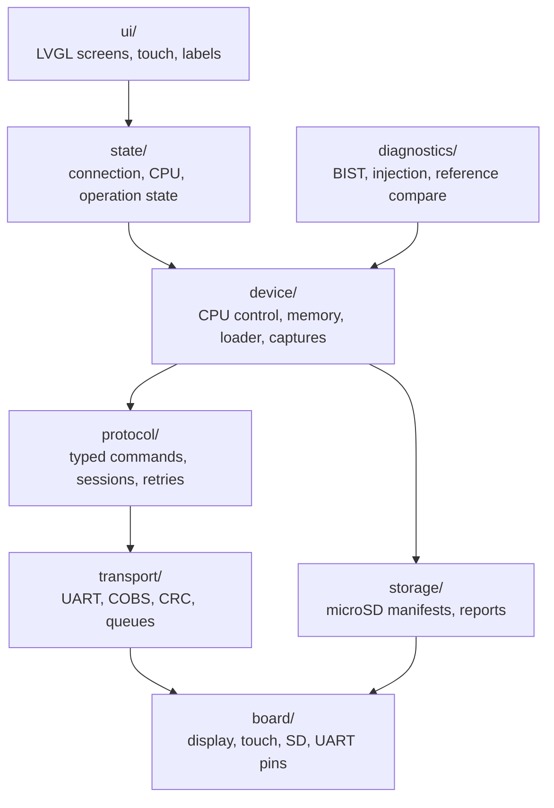

# 📱 `firmware/tab5/`: the touchscreen application

> [!NOTE]
> **Status: 📋 PLANNED.** This folder holds only a `.gitkeep` placeholder. No firmware has been
> written, built or flashed, and the owner's exact Tab5 model and revision are ❔ **NOT
> VERIFIED**. The full design is in [TAB5_FIRMWARE.md](../../docs/TAB5_FIRMWARE.md). Status
> labels are defined in the [root README](../../README.md#status).

[← Back to the project README](../../README.md)

## What it will do

The M5Stack Tab5 (an ESP32-P4 device with a 5-inch 1280 × 720 touchscreen and microSD) becomes
the portable front panel of the RISC-V computer. It will load programs from microSD, show the
CPU's console output, and drive the FPGA's debug hardware: halt, resume, step, breakpoints,
registers, memory, trace, performance counters, self-test and fault injection.

It is a **controller and observer**. The ESP32-P4 never runs the RISC-V programs being
demonstrated; those always execute on the FPGA. Anything that is not live hardware data is
labelled on screen.

| Badge | Meaning |
| --- | --- |
| **LIVE** | Just read from the connected FPGA |
| **CAPTURED** | A frozen hardware snapshot, shown with its age |
| **HISTORICAL** | A stored earlier result, such as an old benchmark |
| **MOCK** | Simulated data for UI development; never mixed with real controls |

## Framework

**Native ESP-IDF + FreeRTOS + LVGL** with one board-support layer matched to the actual
device revision. Exact versions are pinned only after the real device passes milestone T0.
Arduino with M5Unified/M5GFX is allowed only as an isolated bring-up experiment.

## Planned module structure



One task owns UART I/O and packet processing; worker tasks do file and device operations; only
the UI task touches LVGL objects. Touch callbacks never block on serial or file access.

## Screens and when they become real

| Screen | Enabled at |
| --- | --- |
| Home, Programs, Terminal, System | T1 as MOCK; T5 live |
| CPU Control, Registers, Memory | T3–T4, then STEP and breakpoints at T6–T7 |
| Pipeline, Trace | T8, verified pipeline only |
| Performance | Baseline at T5, full at T9 |
| Diagnostics, Fault Injection | T10, T11 |
| Reference report | T12 |
| Presentation / About | T1 static; verified actions at T13 |

## microSD layout (example paths, not files that exist)

```text
/programs/<name>/manifest.json
/programs/<name>/program.bin
/expected/<test-id>/reference-data
/reports/<run-id>.json
/reports/<run-id>.csv
```

## Build and recovery

> 📋 **PLANNED.** No build commands are documented yet because no SDK version has been
> validated on the real device. At implementation, the source, `CMakeLists.txt`, component
> manifests, `sdkconfig.defaults`, board profile, dependency lockfiles and local assets are
> committed; `build/`, `managed_components/` and `sdkconfig` stay ignored (already in
> `.gitignore`). The target chip is the ESP32-P4.

## Related

- Full firmware design: [TAB5_FIRMWARE.md](../../docs/TAB5_FIRMWARE.md)
- The wire protocol it speaks: [protocol/README.md](../../protocol/README.md)
- Hardware identification, wiring and power: [HARDWARE_CHECKLIST.md](../../docs/HARDWARE_CHECKLIST.md)
- Milestones T0–T13: [BUILD_PLAN.md](../../docs/BUILD_PLAN.md#tab5-milestones-portable-control-and-diagnostics)
