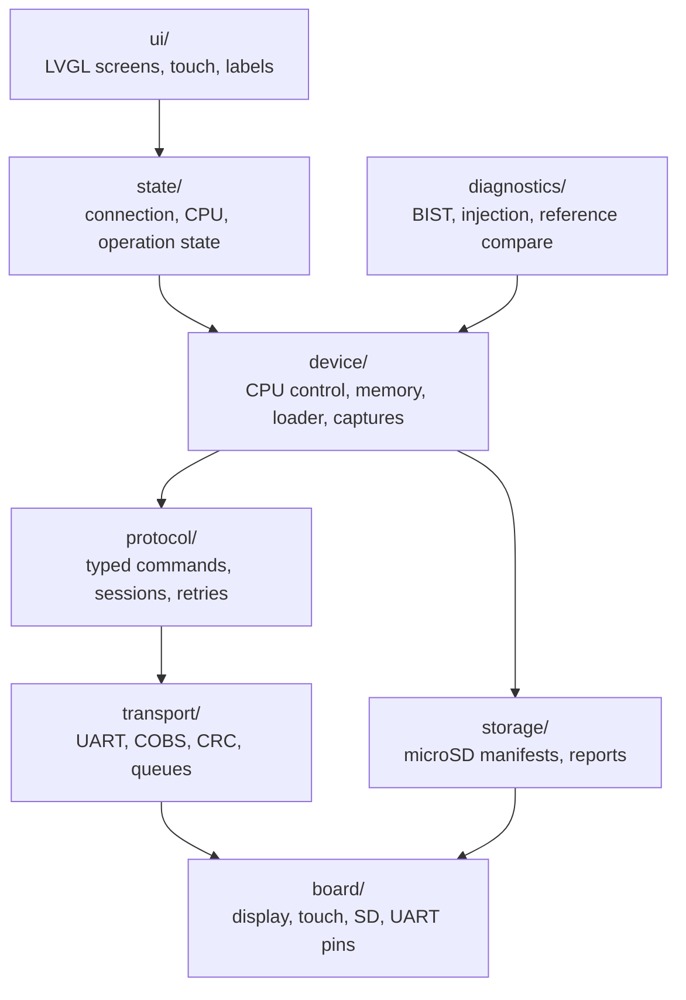

[Project README](../../README.md) › **firmware/tab5/**

# `firmware/tab5/`: the touchscreen application

This folder will hold the firmware that turns the M5Stack Tab5 into the portable front panel of
the RISC-V computer. Read this page for a short overview; the full design is in
[TAB5_FIRMWARE.md](../../docs/TAB5_FIRMWARE.md).

> [!NOTE]
> **Status: 📋 PLANNED.** This folder holds only a `.gitkeep` placeholder. No firmware has been
> written, built or flashed, and the owner's exact Tab5 model and revision are ❔ **NOT
> VERIFIED**. Status labels are defined in the [root README](../../README.md#2-project-status).

<details open>
<summary><b>On this page</b></summary>

1. [What it will do](#1-what-it-will-do)
2. [Framework](#2-framework)
3. [Planned module structure](#3-planned-module-structure)
4. [Screens and when they become real](#4-screens-and-when-they-become-real)
5. [microSD layout](#5-microsd-layout)
6. [Build and recovery](#6-build-and-recovery)
7. [Related](#7-related)

</details>

---

## 1. What it will do

The M5Stack Tab5 is an ESP32-P4 device with a 5-inch 1280 × 720 touchscreen and microSD. The
firmware will:

- load programs from microSD;
- show the CPU's console output;
- drive the FPGA's debug hardware: halt, resume, step, breakpoints, registers, memory, trace,
  performance counters, self-test and fault injection.

> [!IMPORTANT]
> It is a **controller and observer**. The ESP32-P4 never runs the RISC-V programs being
> demonstrated; those always execute on the FPGA. Anything that is not live hardware data is
> labelled on screen.

| Badge | Meaning |
| --- | --- |
| **LIVE** | Just read from the connected FPGA |
| **CAPTURED** | A frozen hardware snapshot, shown with its age |
| **HISTORICAL** | A stored earlier result, such as an old benchmark |
| **MOCK** | Simulated data for UI development; never mixed with real controls |

---

## 2. Framework

| Choice | Role |
| --- | --- |
| **Native ESP-IDF + FreeRTOS + LVGL**, with one board-support layer matched to the actual device revision | The framework |
| Arduino with M5Unified/M5GFX | Allowed only as an isolated bring-up experiment |

Exact versions are pinned only after the real device passes milestone T0.

---

## 3. Planned module structure

The diagram shows the firmware layers, from the screens at the top to the board hardware at the
bottom. Each layer only calls the one below it.



Task ownership:

- One task owns UART I/O and packet processing.
- Worker tasks do file and device operations.
- Only the UI task touches LVGL objects.
- Touch callbacks never block on serial or file access.

---

## 4. Screens and when they become real

| Screen | Enabled at |
| --- | --- |
| Home, Programs, Terminal, System | T1 as MOCK; T5 live |
| CPU Control, Registers, Memory | T3–T4, then STEP and breakpoints at T6–T7 |
| Pipeline, Trace | T8, verified pipeline only |
| Performance | Baseline at T5, full at T9 |
| Diagnostics, Fault Injection | T10, T11 |
| Reference report | T12 |
| Presentation / About | T1 static; verified actions at T13 |

---

## 5. microSD layout

These are example paths, not files that exist:

```text
/programs/<name>/manifest.json
/programs/<name>/program.bin
/expected/<test-id>/reference-data
/reports/<run-id>.json
/reports/<run-id>.csv
```

---

## 6. Build and recovery

> [!NOTE]
> 📋 **PLANNED.** No build commands are documented yet because no SDK version has been validated
> on the real device. The target chip is the ESP32-P4.

At implementation:

| Goes into Git | Stays ignored (already in `.gitignore`) |
| --- | --- |
| Source, `CMakeLists.txt`, component manifests, `sdkconfig.defaults`, board profile, dependency lockfiles, local assets | `build/`, `managed_components/`, `sdkconfig` |

---

## 7. Related

| For | See |
| --- | --- |
| Full firmware design | [TAB5_FIRMWARE.md](../../docs/TAB5_FIRMWARE.md) |
| The wire protocol it speaks | [protocol/README.md](../../protocol/README.md) |
| Hardware identification, wiring and power | [HARDWARE_CHECKLIST.md](../../docs/HARDWARE_CHECKLIST.md) |
| Milestones T0–T13 | [BUILD_PLAN.md](../../docs/BUILD_PLAN.md#10-tab5-milestones-portable-control-and-diagnostics) |

**Next step:** [T0: identify and bring up the actual Tab5](../../docs/BUILD_PLAN.md#t0-identify-and-bring-up-the-actual-tab5).
