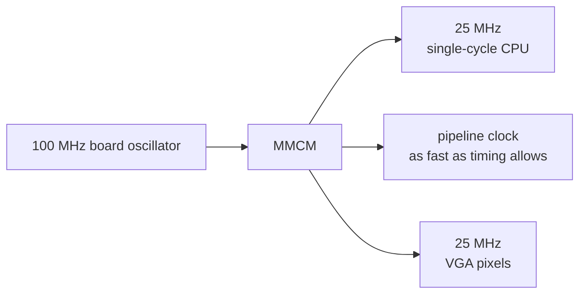

[Project README](../README.md) › **fpga/**

# `fpga/`: Basys 3 pins and timing

This folder holds the constraints file that connects the RTL to the physical Basys 3 board. Read
this page to see which pins are mapped now, what the full file will contain, and how the clocks
are planned.

> [!NOTE]
> **Status: 🚧 IN PROGRESS.** [basys3.xdc](basys3.xdc) exists for the Phase 0 blink: the 100 MHz
> clock, the center button and the 16 LEDs. The blink met timing at 100 MHz (WNS +7.066 ns,
> WHS +0.268 ns) and runs on the board. The CPU's pins and the MMCM clocks remain **PLANNED**.
> Status labels are defined in the [root README](../README.md#2-project-status).

<b>On this page</b>

1. [What lives here](#1-what-lives-here)
2. [What `basys3.xdc` maps now](#2-what-basys3xdc-maps-now)
3. [Planned contents](#3-planned-contents)
4. [Clocks](#4-clocks)
5. [Tab5 debug link pins](#5-tab5-debug-link-pins)
6. [Related](#6-related)

---

## 1. What lives here

An **XDC file** (Xilinx design constraints) is the bridge between the RTL and the physical board.
It does two jobs:

1. **Pin mapping:** it tells Vivado which FPGA package pin each top-level signal uses. For
   example, a signal named `led[0]` has to reach the pin that is actually wired to LED 0.
2. **Timing:** it declares the clocks, so Vivado can check that every signal settles within one
   clock period.

> [!WARNING]
> Any **negative slack** in the timing report means the design may fail on real hardware even if
> it passed in simulation.

---

## 2. What `basys3.xdc` maps now

Pin locations come from the official
[Digilent Basys 3 master XDC](https://github.com/Digilent/digilent-xdc/blob/master/Basys-3-Master.xdc).
Only the signals used by [rtl/top/basys3_top.sv](../rtl/top/basys3_top.sv) are listed; more are
added as the top level grows.

| Signal | Pin | Constraint |
| --- | --- | --- |
| `clk` | W5 | LVCMOS33; clock `sys_clk_pin`, period 10.00 ns (100 MHz) |
| `btnC` | U18 | LVCMOS33; `set_false_path` because the synchronizer handles the asynchronous button |
| `led[0]`–`led[15]` | U16, E19, U19, V19, W18, U15, U14, V14, V13, V3, W3, U3, P3, N3, P1, L1 | LVCMOS33 |
| Configuration | | `CFGBVS VCCO`, `CONFIG_VOLTAGE 3.3`, compressed bitstream |

---

## 3. Planned contents

Copied from the Digilent master XDC, keeping only the signals the design uses (Phase 3):

| Signal group | Use |
| --- | --- |
| 100 MHz clock | Input to the MMCM |
| Center button | Reset, through a synchronizer |
| 16 LEDs, 16 switches, 5 buttons | Board I/O at `0x8000_0000` – `0x8000_000C` |
| 7-segment display | Shows a 16-bit value in hex, cycling through 4 digits about 1,000 times a second |
| USB-UART pins | CPU console at 115200 baud |
| VGA pins (Phase 6) | 12-bit color (4 bits each of red, green and blue) plus sync |

---

## 4. Clocks

The diagram shows the planned clock tree: one board oscillator feeds an MMCM, which makes every
clock the design uses.

> [!IMPORTANT]
> Clocks are never made by dividing with counters; slow logic uses clock enables.

| Goal | Phase | Result |
| --- | --- | --- |
| Blink at 100 MHz, no MMCM | 0 | ✅ Met: WNS +7.066 ns, WHS +0.268 ns |
| No negative slack at 25 MHz for the single-cycle CPU | 3 | Not yet run |
| Push the pipeline to 50 MHz and higher until timing fails, and record the top speed | 5 | Not yet run |

---

## 5. Tab5 debug link pins

> [!CAUTION]
> ❔ **NOT APPROVED.** A candidate only, from [HARDWARE_CHECKLIST.md](../docs/HARDWARE_CHECKLIST.md#3-candidate-uart-cable-not-an-approved-wiring-instruction).
> Do not wire it.

| Direction | Tab5 candidate | Basys 3 candidate |
| --- | --- | --- |
| Tab5 → FPGA | PORT.A G53 (UART TX) | JA1, FPGA pin J1, `dbg_uart_rx` |
| FPGA → Tab5 | PORT.A G54 (UART RX) | JA2, FPGA pin L2, `dbg_uart_tx` |
| Reference | PORT.A GND | A verified JA ground pin |
| Power | PORT.A 5V | **Leave unconnected** |

These pins go into the XDC only after the [T0 electrical gate](../docs/HARDWARE_CHECKLIST.md#t0-electrical-gate):

- [ ] both board revisions identified;
- [ ] logic levels and idle states verified;
- [ ] no back-powering;
- [ ] continuity checked.

The master XDC file describes rev. B of the board; reconcile it with the actual board before use.

---

## 6. Related

| For | See |
| --- | --- |
| The top-level module these constraints attach to | [rtl/README.md](../rtl/README.md) |
| The build script that reads this file | [scripts/README.md](../scripts/README.md#5-build-the-bitstream-buildtcl) |
| Hardware identification and power | [HARDWARE_CHECKLIST.md](../docs/HARDWARE_CHECKLIST.md) |

**Next step:** the switches, 7-segment and MMCM arrive with the [Phase 3](../docs/BUILD_PLAN.md#phase-3-on-the-board-running-c) top level.
