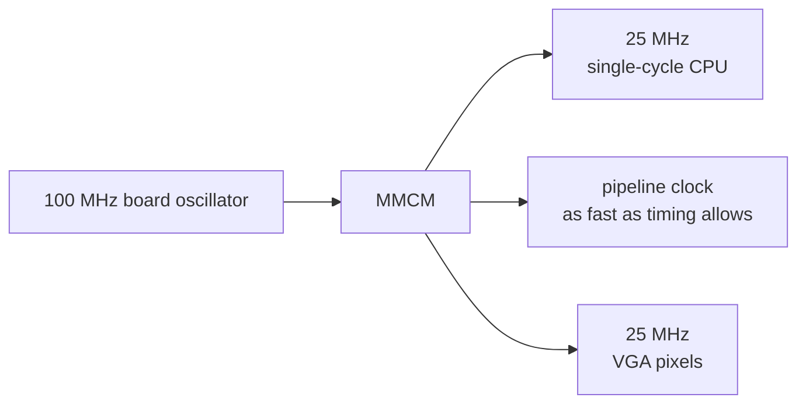

# 📍 `fpga/`: Basys 3 pins and timing

> [!NOTE]
> **Status: 📋 PLANNED.** This folder holds only a `.gitkeep` placeholder. `basys3.xdc` has not
> been written, and no design has been synthesized or timed. Status labels are defined in the
> [root README](../README.md#status).

[← Back to the project README](../README.md)

## What lives here

An **XDC file** (Xilinx design constraints) is the bridge between the RTL and the physical
board. It does two jobs:

1. **Pin mapping:** it tells Vivado which FPGA package pin each top-level signal uses. For
   example, a signal named `led[0]` has to reach the pin that is actually wired to LED 0.
2. **Timing:** it declares the clocks, so Vivado can check that every signal settles within
   one clock period. Any **negative slack** in the timing report means the design may fail on
   real hardware even if it passed in simulation.

## Planned contents of `basys3.xdc`

Copied from the official [Digilent Basys 3 master XDC](https://github.com/Digilent/digilent-xdc/blob/master/Basys-3-Master.xdc),
keeping only the signals the design uses (Phase 3):

| Signal group | Use |
| --- | --- |
| 100 MHz clock | Input to the MMCM |
| Center button | Reset, through a synchronizer |
| 16 LEDs, 16 switches, 5 buttons | Board I/O at `0x8000_0000` – `0x8000_000C` |
| 7-segment display | Shows a 16-bit value in hex, cycling through 4 digits about 1,000 times a second |
| USB-UART pins | CPU console at 115200 baud |
| VGA pins (Phase 6) | 12-bit color (4 bits each of red, green and blue) plus sync |

## Clocks

Clocks are never made by dividing with counters; slow logic uses clock enables. Timing goals:
no negative slack at 25 MHz for the single-cycle CPU (Phase 3), then push the pipeline to
50 MHz and higher until timing fails, and record the top speed (Phase 5). No timing result
exists yet.

## Tab5 debug link pins

> ❔ **NOT APPROVED.** A candidate only, from [HARDWARE_CHECKLIST.md](../docs/HARDWARE_CHECKLIST.md).

| Direction | Tab5 candidate | Basys 3 candidate |
| --- | --- | --- |
| Tab5 → FPGA | PORT.A G53 (UART TX) | JA1, FPGA pin J1, `dbg_uart_rx` |
| FPGA → Tab5 | PORT.A G54 (UART RX) | JA2, FPGA pin L2, `dbg_uart_tx` |
| Reference | PORT.A GND | A verified JA ground pin |
| Power | PORT.A 5V | **Leave unconnected** |

These pins go into the XDC only after the T0 electrical gate: both board revisions identified,
logic levels and idle states verified, no back-powering, and continuity checked. The master XDC
file describes rev. B of the board; reconcile it with the actual board before use.

## Related

- The top-level module these constraints attach to: [rtl/README.md](../rtl/README.md)
- The build script that reads this file: [scripts/README.md](../scripts/README.md)
- Hardware identification and power: [HARDWARE_CHECKLIST.md](../docs/HARDWARE_CHECKLIST.md)
