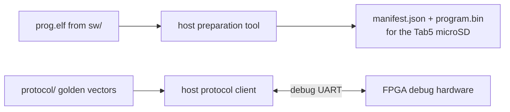

[Project README](../README.md) › **host/**

# `host/`: development-side Python tools

This folder will hold Python tools that run on the **development computer**, not on the CPU or
the Tab5. Read this page to see which tools are planned, when, and the rules they follow.

> [!NOTE]
> **Status: 📋 PLANNED.** This folder holds only a `.gitkeep` placeholder. No tool exists yet.
> Status labels are defined in the [root README](../README.md#2-project-status).

---

## 1. What will live here

| Tool | Job | Milestone |
| --- | --- | --- |
| Protocol client | Speaks the [debug protocol](../docs/DEBUG_PROTOCOL.md) to the FPGA over a serial port, so the debug hardware can be tested before the Tab5 is involved | T2 onward |
| Program preparation | Generates program manifests (sizes, CRC-32, `.bss` and stack bounds) from the real ELF and linker output, ready for microSD | T5 |
| Reference tools | Produce independent expected results for comparison tests | T12 |

The diagram shows the two jobs: preparing programs for the Tab5's microSD, and testing the FPGA
debug hardware directly over the debug UART.

---

## 2. Ground rules

> [!IMPORTANT]
> The protocol client is an **independent** implementation checked against the shared golden
> vectors in [`protocol/`](../protocol/README.md), so the FPGA codec is never tested only
> against itself.

- Prefer the Python standard library; declare a serial-port dependency when it is introduced.
- These tools are for development and testing. The final portable demonstration must work
  without a laptop, so nothing here is required at runtime.

---

## 3. Related

| For | See |
| --- | --- |
| The protocol | [DEBUG_PROTOCOL.md](../docs/DEBUG_PROTOCOL.md) |
| Manifest rules | [TAB5_INTEGRATION.md](../docs/TAB5_INTEGRATION.md#7-program-images-loading-and-launch) |
| Build scripts (separate from these tools) | [scripts/README.md](../scripts/README.md) |

**Next step:** the protocol client starts at [T2](../docs/BUILD_PLAN.md#t2-reliable-framed-debug-communication).
