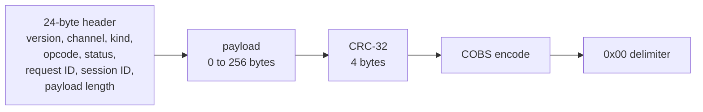

# 📡 `protocol/`: the shared debug-link contract

> [!NOTE]
> **Status: 📋 PLANNED.** This folder holds only a `.gitkeep` placeholder. The version 1 wire
> format is a **proposed design** in [DEBUG_PROTOCOL.md](../docs/DEBUG_PROTOCOL.md); it is
> frozen only after independent host and RTL codec tests pass at milestone T2. Status labels
> are defined in the [root README](../README.md#status).

[← Back to the project README](../README.md)

## Why a shared folder

Three separate implementations will speak the same protocol: the FPGA RTL, the Tab5 firmware
and the Python host client. If each kept its own command table they would drift apart. This
folder will hold the **single source** they all follow:

- versioned schemas: header fields, opcodes, status codes, capability bits and payload layouts;
- **golden vectors**: exact byte sequences with their expected decoded meaning, so each
  implementation is tested against known answers rather than against itself.

## The frame in one picture

| Property | Version 1 design |
| --- | --- |
| Physical link | Dedicated UART, 115200 baud, 8N1, no flow control |
| Framing | `COBS(header ‖ payload ‖ crc32) ‖ 0x00`; COBS removes zero bytes so `0x00` marks the end |
| Integrity | CRC-32/ISO-HDLC (check value for ASCII `123456789` is `0xCBF43926`), little-endian |
| Size limits | Payload 0–256 bytes; decoded frame at most 284 bytes; 287 bytes on the wire |
| Channels | 0 control, 1 CPU console, 2 observation events |
| Safe retries | One controlling session; increasing request IDs; an identical retry replays the stored reply instead of acting twice |

## Planned golden-vector coverage

Empty and maximum payloads, all 256 byte values, embedded zeros, the CRC check vector,
little-endian fields, oversized and invalid headers, partial frames, garbage recovery,
invalid commands, duplicate IDs, same ID with a different body, lost acknowledgments, stale
replies, ID wrap and session renewal, reset during a command, BUSY, and uncertain write
outcomes. Loading adds missing, reordered and duplicate chunks and bad image CRCs.

## Related

- Full specification: [DEBUG_PROTOCOL.md](../docs/DEBUG_PROTOCOL.md)
- FPGA side: [rtl/README.md](../rtl/README.md) (`rtl/debug/`)
- Tab5 side: [firmware/tab5/README.md](../firmware/tab5/README.md)
- Host side: [host/README.md](../host/README.md)
