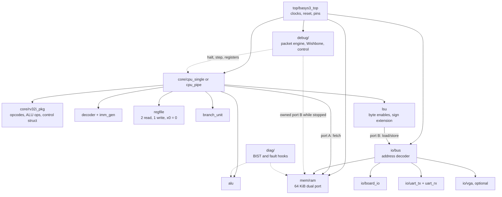
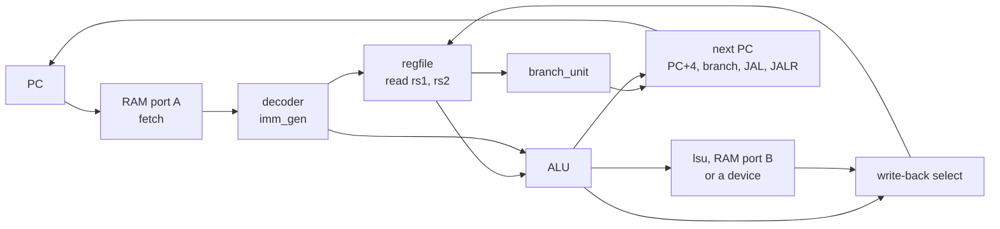

# 🔌 `rtl/`: the hardware

> [!NOTE]
> **Status: 📋 PLANNED.** Every subfolder here holds only a `.gitkeep` placeholder. No RTL has
> been written, simulated or synthesized. This page describes the planned design from the
> [build plan](../docs/BUILD_PLAN.md) and [integration architecture](../docs/TAB5_INTEGRATION.md),
> so the code has a clear home and contract when it arrives.
> Status labels are defined in the [root README](../README.md#status).

[← Back to the project README](../README.md)

## What lives here

**RTL** (register-transfer level) is hardware written as code. Each SystemVerilog file
describes a circuit: **registers** that hold values from one clock tick to the next, and the
**combinational logic** (pure gates, no memory) that computes their next values. Vivado turns
these files into a configuration for the Basys 3's FPGA; Verilator turns them into a fast
C++ simulation for testing.

Everything the CPU *is* will live in this folder: the processor, its memory, its
peripherals, the debug hardware the Tab5 talks to, and the board's top level.

## Folder map

| Folder | Contents (planned files) | Built in |
| --- | --- | --- |
| [`core/`](core/) | `rv32i_pkg.sv` shared types, `alu.sv`, `regfile.sv`, `imm_gen.sv`, `decoder.sv`, `branch_unit.sv`, `lsu.sv`, `cpu_single.sv`, later `cpu_pipe.sv`, `forward.sv`, `hazard.sv` | Phases 1, 2, 5 |
| [`mem/`](mem/) | `ram.sv`: 64 KiB dual-port block RAM with byte-write enables, loaded with `$readmemh`; optional 2 KiB boot ROM | Phases 2, 4 |
| [`io/`](io/) | `bus.sv` address decoder, `board_io.sv` (LEDs, switches, buttons, 7-segment), `uart_tx.sv`, `uart_rx.sv`, `vga_timing.sv` and the VGA text/pixel path | Phases 3, 4, 6 |
| [`debug/`](debug/) | Packet engine, debug-only Wishbone master and slaves, RAM ownership adapter, CPU execution control, breakpoints, snapshots, retirement trace | T2–T8 |
| [`diag/`](diag/) | Memory March BIST controller, ALU self-test mux, controlled fault-injection hooks | T10–T11 |
| [`top/`](top/) | `basys3_top.sv`: MMCM clocking, reset synchronizer, button debouncing, physical I/O | Phase 3 |

## How the pieces fit

## The CPU core, block by block

| Block | Job | Planned test |
| --- | --- | --- |
| `rv32i_pkg` | Opcodes, the ALU operation list and the control-signal struct, shared by every module | Used by all benches |
| `alu` | ADD, SUB, AND, OR, XOR, SLL, SRL, SRA, SLT, SLTU | Tricky values (0, −1, largest/smallest numbers, shifts of 31 and 32) plus 1,000 random inputs per operation against a reference model |
| `regfile` | 32 × 32-bit registers, 2 read ports, 1 write port, `x0` always 0. `BYPASS` parameter: off for single-cycle (on would form a loop), on for the pipeline | Every register written and read back; writes to `x0` ignored; random sequences against a model |
| `imm_gen` | Builds the sign-extended I, S, B, U and J immediates | Hand-encoded instructions per format, including negative and maximum values |
| `decoder` | Turns opcode, funct3 and funct7 into control signals: ALU op, operand sources, register write, load/store size, branch type, jump, write-back source, illegal | Representative encodings of all 40 base instructions; unknown encodings raise illegal |
| `branch_unit` | BEQ, BNE, BLT, BGE, BLTU, BGEU | Signed vs unsigned edge cases, such as −1 vs 1 |
| `lsu` | Byte, halfword and word accesses; store byte enables; load sign/zero extension; misaligned access stops with a documented error | Alignment contract tested explicitly |

### Single-cycle datapath

Next-PC rules: PC + 4 normally; PC + immediate for taken branches and JAL; for JALR,
(rs1 + immediate) with bit 0 cleared. Reset sends the PC to `0x0000_0000`.

### Pipeline additions (Phase 5)

The pipeline splits the datapath into IF, ID, EX, MEM and WB with a packed struct for each
pipeline register and a **valid bit** that travels with every instruction.

| Module | Rule |
| --- | --- |
| `forward` | EX/MEM → EX and MEM/WB → EX, for both source registers and for store data. The register-file bypass covers WB → ID. A write to `x0` is never forwarded. |
| `hazard` | A load followed by an instruction that uses its result stalls 1 cycle. A taken branch, JAL or JALR flushes the 2 younger instructions. |

## Key interfaces and contracts

<b>Retirement record</b> (shared by tests, counters, trace and debug)

Planned fields: `valid`, a monotonically increasing order number, PC, instruction, next PC,
destination write enable / index / value, and memory operation / address / size / byte mask
/ data, plus a halt or error reason.

- Instructions without a register write (stores, branches, NOPs) still retire.
- Flushed bubbles never retire.
- A store retires only after its single side effect is accepted.
- ECALL and EBREAK produce exactly one retirement with a terminal flag, then halt.
- Illegal or misaligned operations report an error without a successful retirement.

<b>Memory ports and ownership</b>

- Port A is instruction fetch; port B serves CPU loads and stores.
- There is no third RAM port. Debug access and memory BIST borrow port B through an
  ownership adapter, only when the CPU is HALTED (drained) or held in reset, with instruction
  fetch disabled. Owners are CPU, DEBUG or BIST, exactly one at a time, and never switched in
  the middle of a transfer.
- Single-cycle: falling-edge reads are the initial candidate and must be proven first.
  Pipeline: normal synchronous reads.

<b>Clocking and reset</b>

- One 100 MHz board clock feeds an MMCM: 25 MHz for the single-cycle CPU and VGA pixels; the
  pipeline as fast as timing allows. Never divide clocks with counters; use clock enables.
- Reset is `rst`, active high and synchronous inside the design. The external reset button
  goes through a synchronizer; buttons are debounced.
- CPU reset must not reset the debug transport; a board/debug reset also clears sessions.
- The VGA text buffer is dual-port RAM so the CPU and pixel clocks never share logic.

## Coding rules

From [AGENTS.md](../AGENTS.md):

- One module per file, file named after the module in `snake_case`.
- `logic` everywhere; `always_ff` for flip-flops with nonblocking assignments; `always_comb`
  for logic with every output assigned on every path. No latches.
- Implementation RTL stays synthesizable; test-only code stays in testbenches.
- Verilator `-Wall` stays clean, without suppressing warnings to hide defects.
- Make widths, signedness, extension, shift amounts and byte enables explicit, and test them.

## Related

- Tests for these modules: [tb/README.md](../tb/README.md)
- Pins and timing constraints: [fpga/README.md](../fpga/README.md)
- Debug and diagnostic contracts: [TAB5_INTEGRATION.md](../docs/TAB5_INTEGRATION.md)
- Software that drives these devices: [sw/README.md](../sw/README.md)
