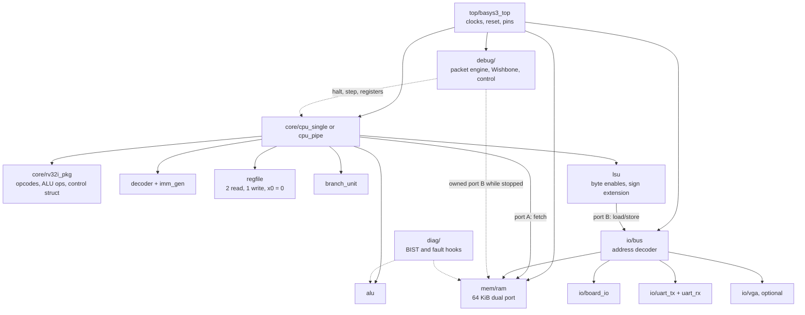
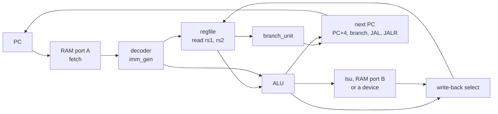

[Project README](../README.md) › **rtl/**

# `rtl/`: the hardware

This folder holds every circuit in the project, written in SystemVerilog: the processor, its
memory, its peripherals, the debug hardware the Tab5 talks to, and the board's top level. Read
this page to find where a module belongs and which rules it must follow.

> [!NOTE]
> **Status: 🚧 IN PROGRESS.** Two Phase 0 modules are implemented and pass in simulation:
> [core/counter.sv](core/counter.sv) and [top/basys3_top.sv](top/basys3_top.sv). The blink top
> level was also built with Vivado and runs on the board. CPU, memory, peripherals and debug RTL
> remain **PLANNED**, as described by the [build plan](../docs/BUILD_PLAN.md) and
> [integration architecture](../docs/TAB5_INTEGRATION.md). Status labels are defined in the
> [root README](../README.md#2-project-status).

<b>On this page</b>

1. [What lives here](#1-what-lives-here)
2. [What exists now](#2-what-exists-now)
3. [Folder map](#3-folder-map)
4. [How the pieces fit](#4-how-the-pieces-fit)
5. [The CPU core, block by block](#5-the-cpu-core-block-by-block)
6. [Key interfaces and contracts](#6-key-interfaces-and-contracts)
7. [Coding rules](#7-coding-rules)
8. [Related](#8-related)

---

## 1. What lives here

**RTL** (register-transfer level) is hardware written as code. Each SystemVerilog file describes a
circuit:

- **registers** that hold values from one clock tick to the next;
- the **combinational logic** (pure gates, no memory) that computes their next values.

Two tools read these files:

| Tool | Turns the RTL into |
| --- | --- |
| Vivado | A configuration for the Basys 3's FPGA |
| Verilator | A fast C++ simulation for testing |

Everything the CPU *is* will live in this folder: the processor, its memory, its peripherals, the
debug hardware the Tab5 talks to, and the board's top level.

---

## 2. What exists now

| File | What it does | Tested by |
| --- | --- | --- |
| [core/counter.sv](core/counter.sv) | Four-bit counter that checks the simulation workflow: active-high synchronous reset, incrementing, wraparound and restart. | [tb/counter_tb.sv](../tb/counter_tb.sv), 25 checks ([smoke-test record](../docs/PHASE0_SMOKE_TEST.md)) |
| [top/basys3_top.sv](top/basys3_top.sv) | Phase 0 blink. The 16 LEDs show a binary count; with the default `DIV_BITS = 24` and the 100 MHz clock, LED 0 blinks at about 3 Hz. The center button (`btnC`) is reset, through a two-flop synchronizer. | [tb/basys3_top_tb.sv](../tb/basys3_top_tb.sv); built with `scripts/build.tcl` and programmed on the board |

To run both tests, use `python3 scripts/run_tests.py` in WSL. In Cursor's **WSL: Ubuntu**
window, **Ctrl+Shift+B** builds and runs just the counter test.

> [!NOTE]
> `scripts/run_tests.py` and `scripts/build.tcl` compile **every** `rtl/**/*.sv` file, with
> `*_pkg.sv` packages first. A new module is picked up automatically; it must not break any other
> test or the bitstream build.

---

## 3. Folder map

| Folder | Contents (planned unless marked implemented) | Built in |
| --- | --- | --- |
| [`core/`](core/) | **Implemented:** `counter.sv` smoke module. **Planned:** `rv32i_pkg.sv` shared types, `alu.sv`, `regfile.sv`, `imm_gen.sv`, `decoder.sv`, `branch_unit.sv`, `lsu.sv`, `cpu_single.sv`, later `cpu_pipe.sv`, `forward.sv`, `hazard.sv` | Counter: Phase 0; CPU: Phases 1, 2, 5 |
| [`mem/`](mem/) | `ram.sv`: 64 KiB dual-port block RAM with byte-write enables, loaded with `$readmemh`; optional 2 KiB boot ROM | Phases 2, 4 |
| [`io/`](io/) | `bus.sv` address decoder, `board_io.sv` (LEDs, switches, buttons, 7-segment), `uart_tx.sv`, `uart_rx.sv`, `vga_timing.sv` and the VGA text/pixel path | Phases 3, 4, 6 |
| [`debug/`](debug/) | Packet engine, debug-only Wishbone master and slaves, RAM ownership adapter, CPU execution control, breakpoints, snapshots, retirement trace | T2–T8 |
| [`diag/`](diag/) | Memory March BIST controller, ALU self-test mux, controlled fault-injection hooks | T10–T11 |
| [`top/`](top/) | **Implemented:** `basys3_top.sv` Phase 0 blink. **Planned:** MMCM clocking, reset synchronizer, button debouncing, physical I/O for the CPU | Blink: Phase 0; CPU top level: Phase 3 |

---

## 4. How the pieces fit

The diagram shows the planned module hierarchy. Solid arrows are normal CPU paths; dotted arrows
are debug and self-test paths that only act while the CPU is stopped.

---

## 5. The CPU core, block by block

| Block | Job | Planned test |
| --- | --- | --- |
| `rv32i_pkg` | Opcodes, the ALU operation list and the control-signal struct, shared by every module | Used by all benches |
| `alu` | ADD, SUB, AND, OR, XOR, SLL, SRL, SRA, SLT, SLTU | Tricky values (0, −1, largest/smallest numbers, shifts of 31 and 32) plus 1,000 random inputs per operation against a reference model |
| `regfile` | 32 × 32-bit registers, 2 read ports, 1 write port, `x0` always 0. `BYPASS` parameter: off for single-cycle (on would form a loop), on for the pipeline | Every register written and read back; writes to `x0` ignored; random sequences against a model |
| `imm_gen` | Builds the sign-extended I, S, B, U and J immediates | Hand-encoded instructions per format, including negative and maximum values |
| `decoder` | Turns opcode, funct3 and funct7 into control signals: ALU op, operand sources, register write, load/store size, branch type, jump, write-back source, illegal | Representative encodings of all 40 base instructions; unknown encodings raise illegal |
| `branch_unit` | BEQ, BNE, BLT, BGE, BLTU, BGEU | Signed vs unsigned edge cases, such as −1 vs 1 |
| `lsu` | Byte, halfword and word accesses; store byte enables; load sign/zero extension; misaligned access stops with a documented error | Alignment contract tested explicitly |

### Single-cycle datapath

The diagram shows one instruction's path through the single-cycle CPU, from the PC back to the
next PC.

**Next-PC rules:**

| Instruction | Next PC |
| --- | --- |
| Normal | PC + 4 |
| Taken branch, JAL | PC + immediate |
| JALR | (rs1 + immediate) with bit 0 cleared |
| Reset | `0x0000_0000` |

### Pipeline additions (Phase 5)

The pipeline splits the datapath into IF, ID, EX, MEM and WB with a packed struct for each
pipeline register and a **valid bit** that travels with every instruction.

| Module | Rule |
| --- | --- |
| `forward` | EX/MEM → EX and MEM/WB → EX, for both source registers and for store data. The register-file bypass covers WB → ID. A write to `x0` is never forwarded. |
| `hazard` | A load followed by an instruction that uses its result stalls 1 cycle. A taken branch, JAL or JALR flushes the 2 younger instructions. |

---

## 6. Key interfaces and contracts

These contracts are shared with the debug hardware; the full versions are in the
[integration architecture](../docs/TAB5_INTEGRATION.md#6-cpu-architectural-debug-contract).

<b>Retirement record</b> (shared by tests, counters, trace and debug)

Planned fields: `valid`, a monotonically increasing order number, PC, instruction, next PC,
destination write enable / index / value, and memory operation / address / size / byte mask /
data, plus a halt or error reason.

- Instructions without a register write (stores, branches, NOPs) still retire.
- Flushed bubbles never retire.
- A store retires only after its single side effect is accepted.
- ECALL and EBREAK produce exactly one retirement with a terminal flag, then halt.
- Illegal or misaligned operations report an error without a successful retirement.

<b>Memory ports and ownership</b>

- Port A is instruction fetch; port B serves CPU loads and stores.
- There is no third RAM port. Debug access and memory BIST borrow port B through an ownership
  adapter, only when the CPU is HALTED (drained) or held in reset, with instruction fetch
  disabled. Owners are CPU, DEBUG or BIST, exactly one at a time, and never switched in the
  middle of a transfer.
- Single-cycle: falling-edge reads are the initial candidate and must be proven first. Pipeline:
  normal synchronous reads.

<b>Clocking and reset</b>

- One 100 MHz board clock feeds an MMCM: 25 MHz for the single-cycle CPU and VGA pixels; the
  pipeline as fast as timing allows. Never divide clocks with counters; use clock enables.
- Reset is `rst`, active high and synchronous inside the design. The external reset button goes
  through a synchronizer; buttons are debounced.
- CPU reset must not reset the debug transport; a board/debug reset also clears sessions.
- The VGA text buffer is dual-port RAM so the CPU and pixel clocks never share logic.

> [!NOTE]
> The Phase 0 blink runs directly on the 100 MHz board clock and already synchronizes its reset
> button with two flip-flops. The MMCM and debouncer arrive with the Phase 3 top level.

---

## 7. Coding rules

From [AGENTS.md](../AGENTS.md):

- One module per file, file named after the module in `snake_case`.
- `logic` everywhere; `always_ff` for flip-flops with nonblocking assignments; `always_comb` for
  logic with every output assigned on every path. No latches.
- Implementation RTL stays synthesizable; test-only code stays in testbenches.
- Verilator `-Wall` stays clean, without suppressing warnings to hide defects.
- Make widths, signedness, extension, shift amounts and byte enables explicit, and test them.

> [!IMPORTANT]
> Every new module lands in the same commit as its self-checking testbench in `tb/`.

---

## 8. Related

| For | See |
| --- | --- |
| Tests for these modules | [tb/README.md](../tb/README.md) |
| Pins and timing constraints | [fpga/README.md](../fpga/README.md) |
| Debug and diagnostic contracts | [TAB5_INTEGRATION.md](../docs/TAB5_INTEGRATION.md) |
| Software that drives these devices | [sw/README.md](../sw/README.md) |
| The next module to write | [Phase 1 in the build plan](../docs/BUILD_PLAN.md#phase-1-building-blocks) |
