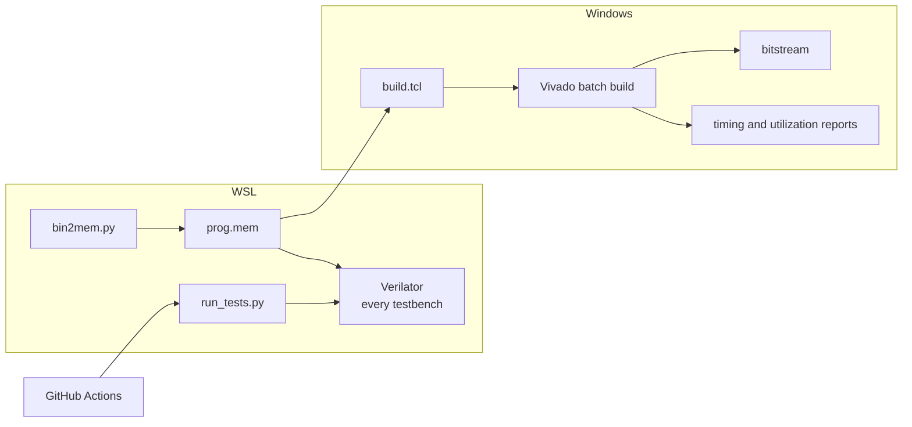

# ⚙️ `scripts/`: one command per job

> [!NOTE]
> **Status: 📋 PLANNED.** This folder holds only a `.gitkeep` placeholder. **None of the
> scripts below exist yet; the commands under Planned usage are future entry points.** They are the
> documented entry points from the [build plan](../docs/BUILD_PLAN.md) and
> [AGENTS.md](../AGENTS.md). Status labels are defined in the [root README](../README.md#status).

[← Back to the project README](../README.md)

The **current counter smoke test** runs through the shared
[Cursor task](../.vscode/tasks.json), outside this scripts folder. In a **WSL: Ubuntu**
window, press **Ctrl+Shift+B**. Its 25 passing checks and deliberate failure check are
recorded in [PHASE0_SMOKE_TEST.md](../docs/PHASE0_SMOKE_TEST.md).

## Why scripts

Hardware projects drift when builds depend on clicking through a GUI. Here every routine job
gets one script, so any test run or bitstream can be rebuilt with a single command, by a
person or by CI, with no Vivado project files stored in Git.

## Planned scripts

| Script | Environment | Job | Phase |
| --- | --- | --- | --- |
| `run_tests.py` | WSL | Find every testbench, build and run each with Verilator, print a pass/fail table | 0 |
| `build.tcl` | Windows, Vivado | Non-project build that reads `rtl/` and `fpga/basys3.xdc`, writes the bitstream plus timing and utilization reports | 0 |
| `bin2mem.py` | WSL | Convert a compiled `.bin` into a `.mem` file for `$readmemh` | 3 |
| `upload.py` | Windows or WSL | Optional: send a program over the USB UART to the boot-ROM recovery loader | 4 |

## How they connect



## Planned usage

```bash
# WSL, from the repository root
python3 scripts/run_tests.py
python3 scripts/bin2mem.py prog.bin prog.mem
```

```bash
# Windows, from the repository root, with Vivado on PATH
vivado -mode batch -source scripts/build.tcl
```

Inspect each script's supported options before relying on these forms; the options are not
designed yet.

## Ground rules

- Generated output goes in ignored `build/` or another documented output location.
  The Cursor smoke task uses Ubuntu's local `$HOME/.cache/risc-v-computer/smoke`.
- Prefer the Python standard library for small utilities; declare any dependency when it is
  introduced.
- A test runner's verdict must come from assertions and process exit status.
- Building a bitstream and programming the board are separate actions.
- Never report a command as passing while its script is absent.

## Phase 0 checklist

- [x] Repository skeleton, `.gitignore`, `.gitattributes`
- [x] Verilator smoke test in WSL: counter and testbench pass 25 checks through the default Cursor task; intentional failure detected
- [x] `run_tests.py`
- [x] `build.tcl`
- [x] Blink rebuilt through `build.tcl` and programmed onto the board
- [ ] GitHub Actions workflow running `run_tests.py`, with a status badge in the README

The authoritative checklist is [Phase 0 in the build plan](../docs/BUILD_PLAN.md#phase-0-fresh-start).

## Related

- What the tests check: [tb/README.md](../tb/README.md)
- What the build constrains: [fpga/README.md](../fpga/README.md)
- The C-to-image flow: [sw/README.md](../sw/README.md#from-c-to-the-board)
