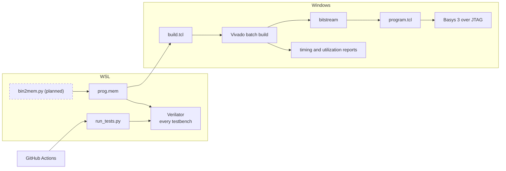

[Project README](../README.md) › **scripts/**

# `scripts/`: one command per job

This folder holds the scripts that test, build and program the design, so every routine job is a
single command that a person or CI can repeat. Read this page for each script's command,
options, expected output and common errors.

> [!NOTE]
> **Status: 🚧 IN PROGRESS.** `run_tests.py`, `build.tcl` and `program.tcl` exist and passed
> Phase 0 on November 7, 2026. `synth_blocks.tcl` (Phase 1 block synthesis check) exists but
> is **NOT VERIFIED**: it has not been run in Vivado yet. `bin2mem.py` and `upload.py` remain
> **PLANNED**. Status labels
> are defined in the [root README](../README.md#2-project-status).

<details open>
<summary><b>On this page</b></summary>

1. [Why scripts](#1-why-scripts)
2. [The scripts](#2-the-scripts)
3. [How they connect](#3-how-they-connect)
4. [Run the tests: `run_tests.py`](#4-run-the-tests-run_testspy)
5. [Build the bitstream: `build.tcl`](#5-build-the-bitstream-buildtcl)
6. [Program the board: `program.tcl`](#6-program-the-board-programtcl)
7. [Ground rules](#7-ground-rules)
8. [Phase 0 checklist](#8-phase-0-checklist)
9. [Related](#9-related)

</details>

---

## 1. Why scripts

Hardware projects drift when builds depend on clicking through a GUI. Here every routine job
gets one script, so any test run or bitstream can be rebuilt with a single command, by a person
or by CI, with no Vivado project files stored in Git.

---

## 2. The scripts

| Script | Status | Environment | Job | Phase |
| --- | --- | --- | --- | --- |
| [`run_tests.py`](run_tests.py) | ✅ Exists | WSL | Find every testbench, build and run each with Verilator, print a pass/fail table | 0 |
| [`build.tcl`](build.tcl) | ✅ Exists | Windows, Vivado | Non-project build that reads `rtl/` and `fpga/basys3.xdc`, writes the bitstream plus timing and utilization reports | 0 |
| [`program.tcl`](program.tcl) | ✅ Exists | Windows, Vivado | Load a bitstream from `build.tcl` onto the Basys 3 over USB (JTAG) | 0 |
| [`synth_blocks.tcl`](synth_blocks.tcl) | ⚠️ Exists, not yet run | Windows, Vivado | Synthesize each Phase 1 block on its own; fail on a latch; write per-block utilization reports | 1 |
| `bin2mem.py` | 📋 Planned | WSL | Convert a compiled `.bin` into a `.mem` file for `$readmemh` | 3 |
| `upload.py` | 📋 Planned | Windows or WSL | Optional: send a program over the USB UART to the boot-ROM recovery loader | 4 |

Planned usage of the converter, once it exists (WSL, from the repository root):

```bash
python3 scripts/bin2mem.py prog.bin prog.mem
```

Its options are not designed yet; inspect the script before relying on this form.

In a **WSL: Ubuntu** Cursor window, **Ctrl+Shift+B** runs the complete regression through
the shared [task file](../.vscode/tasks.json). **Terminal > Run Task > Smoke: build and run
counter** still selects the original counter-only task. Its 25 passing checks and deliberate
failure check are recorded in [PHASE0_SMOKE_TEST.md](../docs/PHASE0_SMOKE_TEST.md).

---

## 3. How they connect

The diagram shows which environment runs each script and what it produces. Dashed boxes are
planned.



---

## 4. Run the tests: `run_tests.py`

From WSL, at any directory:

```bash
python3 scripts/run_tests.py
```

Expected result: a version line, one `running <name> ... PASS` line per bench, a results table
and a final line such as `7/7 passed`. The exit status is nonzero if any test fails.

| Option | What it does | Default |
| --- | --- | --- |
| `PATTERN` | Only run tests whose name contains `PATTERN`, for example `counter` | All tests |
| `-v`, `--verbose` | Print every test's output | Off |
| `--list` | List tests and exit | |
| `--build-dir DIR` | Where Verilator writes its files | `$HOME/.cache/risc-v-computer/tests`, or `RVC_BUILD_DIR` if set |
| `-j N`, `--jobs N` | Parallel compile jobs | Up to 4 |
| `--timeout SECONDS` | Kill a simulation that runs longer | 60 |

How it decides:

- **Discovery:** every `tb/**/<name>_tb.sv` is one test, and its top module must be `<name>_tb`.
- **Sources:** every `rtl/**/*.sv` file is compiled with each test, with `*_pkg.sv` packages
  first so later files can import them.
- **Flags:** `--binary --timing --assert -Wall`.
- **Verdict:** a test passes only when Verilator builds it, the simulation exits with status 0
  within the timeout, and its output contains a line starting with `PASS`. Otherwise it is
  reported as `FAIL`, `BUILD` or `TIMEOUT`.
- **Detail column:** for a pass, the bench's `PASS` line; for a failure, the first `%Fatal`
  line (the failed check's own message), else the first `%Error` or `%Warning`.

> [!IMPORTANT]
> A bench that finishes without printing `PASS` is treated as a failure, so a missing `$display`
> cannot hide a test that checked nothing.

| Problem | Fix |
| --- | --- |
| `verilator not found on PATH (run this from WSL)` | Open a WSL terminal; Verilator is installed in Ubuntu, not Windows. |
| `No testbenches found in tb/` | Check the bench file name ends in `_tb.sv`. |
| A test shows `BUILD` | Rerun with `-v` to see Verilator's error. |

---

## 5. Build the bitstream: `build.tcl`

From a Windows terminal at the repository root, with Vivado on `PATH`:

```bash
vivado -mode batch -nojournal -nolog -source scripts/build.tcl
```

To build a different top module, add `-tclargs TOP_MODULE`. Replace `TOP_MODULE` with the module
name; the default is `basys3_top`.

What it does:

1. Reads every `rtl/**/*.sv` file (packages first) and `fpga/basys3.xdc`.
2. Runs synthesis, placement and routing for part `xc7a35tcpg236-1`.
3. Writes into `build/vivado/`:

   | File | Contents |
   | --- | --- |
   | `<top>.bit` | The bitstream |
   | `timing_summary.rpt` | Check that `WNS` is not negative |
   | `utilization.rpt` | LUTs, flip-flops, BRAM, DSP used |
   | `drc.rpt`, `post_synth_*.rpt` | Extra detail for debugging |

Expected result: `== TIMING MET`. The Phase 0 blink build recorded WNS +7.066 ns and
WHS +0.268 ns.

Vivado also writes scratch files (`clockInfo.txt`, `.Xil/`, `dfx_runtime.txt`) into its working
directory. The script changes into `build/vivado/` first, so they stay out of the repository root.

> [!NOTE]
> Synthesis only includes modules reachable from the top level. Until Phase 2 connects the CPU,
> the Phase 1 blocks are read but **not synthesized** by this build.

### Check the Phase 1 blocks: `synth_blocks.tcl`

This optional check synthesizes `alu`, `branch_unit`, `decoder`, `imm_gen` and `regfile` one at
a time, out of context (no pins, no top level):

```bash
vivado -mode batch -nojournal -nolog -source scripts/synth_blocks.tcl
```

Expected result: one summary line per block with its LUT, flip-flop, LUTRAM and latch counts,
then `== ALL BLOCKS SYNTHESIZED, NO LATCHES`. Per-block reports go to `build/vivado/blocks/`.
The script exits nonzero if a block fails to synthesize or infers a latch. These numbers
describe each block alone, not a connected CPU.

> [!WARNING]
> If setup or hold slack is negative, the script prints `== TIMING FAILED: negative slack…` and
> exits nonzero. Do not program that bitstream; the design may fail on real hardware even though
> it passed in simulation.

---

## 6. Program the board: `program.tcl`

Building and programming are separate steps. Plug in the Basys 3, switch it on, then run:

```bash
vivado -mode batch -nojournal -nolog -source scripts/program.tcl
```

Add `-tclargs TOP_MODULE` to program a bitstream other than `basys3_top`.

Expected result: `== Programmed <device> with <bitstream>`, and the board starts running the
design.

> [!NOTE]
> This loads volatile configuration: the design is lost at power-off. Flash programming comes
> later (see [HARDWARE_CHECKLIST.md](../docs/HARDWARE_CHECKLIST.md#5-fpga-configuration-and-offline-startup)).

| Problem | Fix |
| --- | --- |
| `missing …bit: run scripts/build.tcl first` | Build the bitstream first. |
| `no xc7a35t found: is the Basys 3 connected and on?` | Check the USB cable and the power switch. |

---

## 7. Ground rules

- Generated output goes in ignored `build/` or another documented output location. The test
  runner uses `$HOME/.cache/risc-v-computer/tests`; the Cursor smoke task uses Ubuntu's local
  `$HOME/.cache/risc-v-computer/smoke`.
- Prefer the Python standard library for small utilities; declare any dependency when it is
  introduced.
- A test runner's verdict must come from assertions and process exit status.
- Building a bitstream and programming the board are separate actions.

> [!CAUTION]
> Never report a command as passing while its script is absent.

---

## 8. Phase 0 checklist

- [x] Repository skeleton, `.gitignore`, `.gitattributes`
- [x] Verilator smoke test in WSL: counter and testbench pass 25 checks through the default Cursor task; intentional failure detected
- [x] `run_tests.py`
- [x] `build.tcl`
- [x] Blink rebuilt through `build.tcl` and programmed onto the board
- [x] GitHub Actions workflow running `run_tests.py`, with a status badge in the README

The authoritative checklist is [Phase 0 in the build plan](../docs/BUILD_PLAN.md#phase-0-fresh-start).

---

## 9. Related

| For | See |
| --- | --- |
| What the tests check | [tb/README.md](../tb/README.md) |
| What the build constrains | [fpga/README.md](../fpga/README.md) |
| The C-to-image flow | [sw/README.md](../sw/README.md#4-from-c-to-the-board) |
| The CI workflow | [.github/workflows/tests.yml](../.github/workflows/tests.yml) |

**Next step:** `bin2mem.py`, planned for [Phase 3](../docs/BUILD_PLAN.md#phase-3-on-the-board-running-c).
