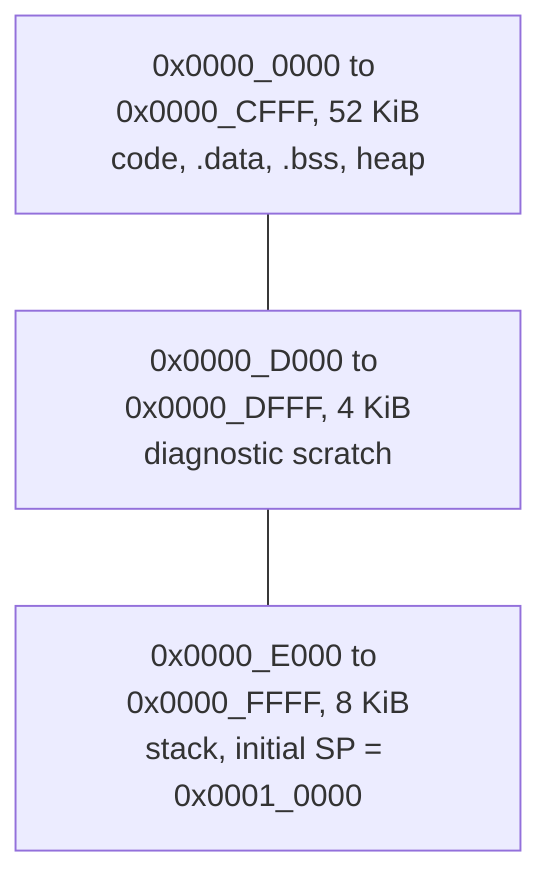
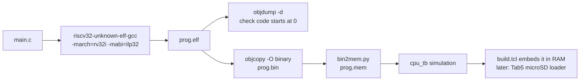

# 💾 `sw/`: software that runs on the CPU

> [!NOTE]
> **Status: 📋 PLANNED.** `common/`, `tests/`, `riscv-tests/` and `programs/` hold only
> `.gitkeep` placeholders. There is no startup code, linker script, header, test or program
> yet, and no command on this page has been run. Status labels are defined in the
> [root README](../README.md#status).

[← Back to the project README](../README.md)

## What lives here

This folder holds the programs that will run **on the custom CPU**, not on your computer.
They are compiled on a development machine with the RISC-V GCC cross-compiler, turned into a
memory image, and placed in the CPU's RAM.

These programs are **bare-metal** and **freestanding**: there is no operating system and no C
standard library, so the project supplies its own minimal startup code, memory layout and
`printf`. That keeps binaries small and leaves nothing hidden.

| Folder | Planned contents | Phase |
| --- | --- | --- |
| [`common/`](common/) | `crt0.S` (sets the stack pointer, clears `.bss`, calls `main`), `link.ld` (places code and data in the 64 KiB RAM), `mmio.h` (one name per device address), `printf.c` | 3, 4 |
| [`tests/`](tests/) | Hand-written assembly tests, one per group: register ALU, immediate ALU, loads and stores, branches, jumps, LUI/AUIPC; Fibonacci in assembly; the pipeline hazard zoo | 2, 5 |
| [`riscv-tests/`](riscv-tests/) | Reserved for the official rv32ui suite as a Git submodule, plus a small custom environment header (the stock one uses CSR instructions this CPU does not implement). Remove `.gitkeep` before adding the submodule. | 2 |
| [`programs/`](programs/) | C and assembly demos: fib, sieve, Game of Life, Snake | 3–7 |

## The memory a program sees

All code, data and stack share the single 64 KiB RAM starting at address 0. The proposed
software layout, to be proven by linker assertions in Phase 3:



Devices are just addresses. A load or store to one of them reaches the device instead of RAM,
so a device register looks like a variable at a fixed address. This illustrative sketch shows
the idea that `mmio.h` will wrap, using the planned LED and switch addresses:

```c
/* Illustration only: the real names will be defined in sw/common/mmio.h. */
#define LEDS      (*(volatile unsigned int *)0x80000000u)
#define SWITCHES  (*(volatile unsigned int *)0x80000008u)

int main(void) {
    for (;;)
        LEDS = SWITCHES;   /* one load from the switches, one store to the LEDs */
}
```

`volatile` tells the compiler that every read and write matters, so it cannot cache the value
or remove the loop body. The full list of device addresses is in the
[memory map](../README.md#architecture).

<a id="from-c-to-the-board"></a>

## From C to the board

> 📋 **PLANNED** flow from the [build plan](../docs/BUILD_PLAN.md#software-flow-from-c-to-the-board).
> `crt0.S`, `link.ld`, `printf.c` and `scripts/bin2mem.py` do not exist yet.



1. Write `main.c` in `sw/programs/<name>/`, using the names from `mmio.h`.
2. Compile and link for RV32I with no standard library. RV32I has no multiply or divide
   instructions, so `-lgcc` pulls in GCC's software versions:

   ```bash
   riscv32-unknown-elf-gcc -march=rv32i -mabi=ilp32 -O2 -ffreestanding -nostdlib \
       -T sw/common/link.ld sw/common/crt0.S main.c sw/common/printf.c -lgcc -o prog.elf
   ```

3. Check the output: `riscv32-unknown-elf-objdump -d prog.elf`. Code should start at address
   0 and use only RV32I instructions.
4. Convert it:

   ```bash
   riscv32-unknown-elf-objcopy -O binary prog.elf prog.bin
   python3 scripts/bin2mem.py prog.bin prog.mem
   ```

5. Simulate it: `cpu_tb` loads `prog.mem` and runs it. Bugs are caught here, where every
   signal is visible.
6. Put it on the board: initially `build.tcl` embeds `prog.mem` in RAM. From milestone T5, the
   binary and a checked manifest go on the Tab5's microSD card and are loaded, verified and run
   without rebuilding the bitstream.

If the toolchain was installed as `riscv64-unknown-elf-*`, the same flags work with that prefix,
provided it was built with 32-bit (multilib) support.

## Program manifests (milestone T5)

Programs loaded from the Tab5 carry a manifest generated from the real ELF and linker output,
never typed by hand: schema version, name, description, ISA `rv32i`, ABI `ilp32`, binary path,
byte count, load and entry address, CRC-32, `.bss` bounds, stack bounds, required FPGA
capabilities and a build identifier. The loader rejects anything out of bounds, overlapping the
scratch or stack region, with a bad entry point, or with a checksum mismatch. Details:
[TAB5_INTEGRATION.md](../docs/TAB5_INTEGRATION.md#program-images-loading-and-launch).

## Planned demo programs

| Program | Shows | Phase |
| --- | --- | --- |
| Fibonacci (assembly) | fib(1)–fib(20) written to memory and checked by the testbench | 2 |
| Fibonacci (C) | Reads the switches, shows the result on the 7-segment; fib(20) = 6765 = `0x1A6D` | 3 |
| hello, world | UART output, a live counter and echo | 4 |
| Prime sieve | Prints primes over UART with a cycle count | 7 |
| Game of Life | VGA framebuffer, switches choose the pattern | 7 |
| Snake or Pong | Playable with the board's buttons | 7 |

## Limits to know

- No C standard library, no operating system, no floating point hardware, no multiply/divide
  instructions (handled by `libgcc`).
- Misaligned loads and stores stop the CPU with an error.
- ECALL and EBREAK halt the CPU (project policy).
- 64 KiB total for code, data and stack.

## Related

- How the CPU executes these instructions: [rtl/README.md](../rtl/README.md)
- How they are tested: [tb/README.md](../tb/README.md)
- Conversion and build scripts: [scripts/README.md](../scripts/README.md)
