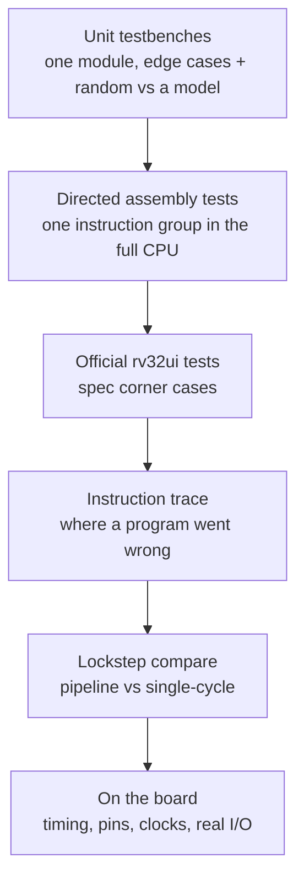
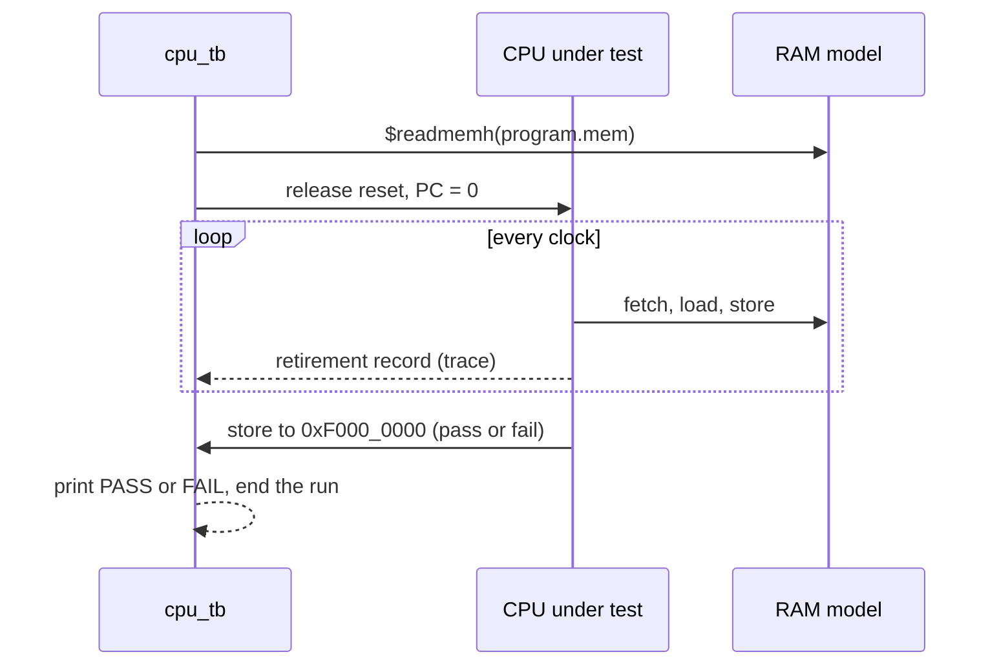
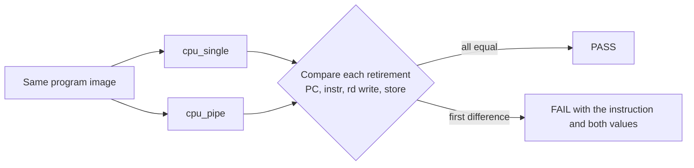

[Project README](../README.md) › **tb/**

# `tb/`: testbenches and verification

This folder holds the testbenches: SystemVerilog that checks the hardware in simulation and is
never built into the FPGA. Read this page to run the tests, to see which layer of testing
catches which kind of bug, and for the rules every new test must follow.

> [!NOTE]
> **Status: 🚧 IN PROGRESS.** All seven benches pass locally: five Phase 1 unit tests plus
> [counter_tb.sv](counter_tb.sv) and [basys3_top_tb.sv](basys3_top_tb.sv). GitHub Actions
> has passed Phase 0; the new Phase 1 run is pending. CPU program/integration tests remain **PLANNED**;
> `debug/` and `diag/` still hold placeholders. Status labels are defined in the
> [root README](../README.md#2-project-status).

<details open>
<summary><b>On this page</b></summary>

1. [Run the tests](#1-run-the-tests)
2. [What exists now](#2-what-exists-now)
3. [Why testbenches matter](#3-why-testbenches-matter)
4. [Test layers](#4-test-layers)
5. [The CPU program runner, `cpu_tb.sv`](#5-the-cpu-program-runner-cpu_tbsv)
6. [The lockstep test (Phase 5)](#6-the-lockstep-test-phase-5)
7. [Debug and diagnostics suites](#7-debug-and-diagnostics-suites)
8. [Rules for every test](#8-rules-for-every-test)
9. [Related](#9-related)

</details>

---

## 1. Run the tests

From a WSL terminal at the repository root, run every testbench:

```bash
python3 scripts/run_tests.py
```

Expected result: a table with one row per bench, ending in `7/7 passed`.

| To | Run |
| --- | --- |
| Run only matching benches | `python3 scripts/run_tests.py counter` |
| See each bench's output | `python3 scripts/run_tests.py -v` |
| List benches without running | `python3 scripts/run_tests.py --list` |

In Cursor's **WSL: Ubuntu** window, **Ctrl+Shift+B** defaults to **Tests: run all testbenches**.
**Terminal > Run Task > Smoke: build and run counter** selects just the original counter.
Every runner option is described in
[scripts/README.md](../scripts/README.md).

> [!TIP]
> The runner finds every `tb/**/<name>_tb.sv` by itself. A new bench needs no registration, but
> its top module must be named `<name>_tb` and it must print a line starting with `PASS`.

---

## 2. What exists now

| Bench | Checks | Evidence |
| --- | --- | --- |
| [counter_tb.sv](counter_tb.sv) | Initial and held reset, twenty increments including wraparound, reset asserted between clock edges, reset at the next rising edge, counting afterward. A timeout guard fails a stuck run; `+force_failure` proves a failed check exits nonzero. | 25 checks pass ([smoke-test record](../docs/PHASE0_SMOKE_TEST.md)) |
| [basys3_top_tb.sv](basys3_top_tb.sv) | The blink top level with `DIV_BITS = 2`, so the LEDs step every 4 clocks: reset, counting steps, the 16-bit wrap and a reset in the middle of a count. A 10 ms timeout guards the run. | Passes in `run_tests.py` and CI |
| [alu_tb.sv](alu_tb.sv) | Ten operations, signed and unsigned edges, wraparound and overflow, all edge pairs, shift-count masking and 1,000 random pairs/operation, against a bit-by-bit ripple-carry model. | 11,709 local checks |
| [regfile_tb.sv](regfile_tb.sv) | Both BYPASS settings, before/after-edge reads, every read-address pair, x0, reset priority, write enable, back-to-back writes and random modelled cycles. | 6,140 local check groups |
| [imm_gen_tb.sv](imm_gen_tb.sv) | Literal encodings, one-hot wiring, sign limits, random encode/decode round trips and reserved formats. | 10,343 local checks |
| [decoder_tb.sv](decoder_tb.sv) | All control fields for 40 instructions, exhaustive opcode/funct3/funct7 combinations and invalid-instruction side-effect rejection. | 133,700 local checks |
| [branch_unit_tb.sv](branch_unit_tb.sv) | All conditions, equal operands, signed-vs-unsigned extremes, subtraction overflow, edge pairs, random data and disabled selectors. | 8,522 local checks |

The five new benches use deterministic seeds and expected values computed a different way from
the RTL. A bug-injection check (24 single-line RTL changes) showed every real bug makes its bench
fail. A failing check prints the operation and operands; the decoder bench also names each
mismatching control field. Commands, interfaces, counts, the injected bugs and the pending CI
gate are recorded in [PHASE1_CORE_BLOCKS.md](../docs/PHASE1_CORE_BLOCKS.md#5-recorded-verification-november-7-2026).

---

## 3. Why testbenches matter

A **testbench** wraps a module, drives its inputs and checks its outputs. In this project every
testbench is **self-checking**: it computes the expected answer independently and fails by
itself on any mismatch, so nobody has to stare at waveforms to know whether a test passed.

> [!IMPORTANT]
> **Catch each bug at the cheapest layer that can catch it.** A wrong ALU result found by a unit
> test takes minutes to fix; the same bug found on the board can take a day.

---

## 4. Test layers

The diagram shows the order in which the layers come into use. Each one catches bugs the layer
before it cannot.



| Layer | What it catches | How | Starts in |
| --- | --- | --- | --- |
| Unit testbenches | Wrong logic inside one block | Edge cases plus random inputs against a reference model | Phase 1 |
| Directed assembly tests | An instruction behaving wrong in the full CPU | Small programs that write pass/fail to `0xF000_0000`; `cpu_tb` runs them | Phase 2 |
| Official riscv-tests (rv32ui) | Spec corner cases nobody thought of | About 40 programs, one per instruction, with a custom environment header | Phase 2 |
| Instruction trace | Where exactly a program went wrong | `cpu_tb` prints PC, instruction, destination register and value per instruction | Phase 2 |
| Lockstep compare | Missed forwarding, bad stalls and flushes | Single-cycle and pipeline run side by side; every retirement is compared | Phase 5 |
| On the board | Timing, pins, clocks, real I/O | Timing report with no negative slack, LEDs, 7-segment, serial terminal, ILA | Phase 3 |
| Continuous integration | Old features breaking | GitHub Actions runs every test on every push (✅ running since Phase 0) | Phase 0 |

---

## 5. The CPU program runner, `cpu_tb.sv`

📋 Planned for Phase 2. It loads any program image, runs until the program halts or a timeout
expires, checks the pass/fail word, and can print an instruction trace and dump waveforms for
GTKWave.

The sequence shows one run from loading the image to the verdict:



> [!IMPORTANT]
> The pass/fail address `0xF000_0000` is simulation-only and must be preserved.

---

## 6. The lockstep test (Phase 5)

The single-cycle CPU is kept as the **reference model** for the pipeline. Both run the same
program and the testbench compares their ordered retirement streams:

- PC and instruction;
- register writes;
- memory side effects, including instructions that write no register.

The first mismatch points at the failing instruction. Comparing stores matters, because an
incorrect store can otherwise pass unnoticed.



The **hazard zoo** test exercises:

- dependencies at distances 1, 2 and 3;
- load-use;
- a load then a store of the same register;
- a branch on a just-computed value;
- JAL/JALR with the return address used immediately;
- `x0` as a destination.

---

## 7. Debug and diagnostics suites

`tb/debug/` and `tb/diag/` are reserved for the Tab5 milestones. The planned work packages are
defined in the [verification matrix](../docs/VERIFICATION_MATRIX.md#3-verification-work-packages):

| Folder | Work packages |
| --- | --- |
| `tb/debug/` | V-LINK (packet codec, sessions), V-WB (Wishbone bridge), V-OWNER (RAM ownership), V-HALT, V-STEP, V-BREAK, V-STATE, V-LOAD, V-CONSOLE, V-SNAPSHOT, V-TRACE, V-PERF |
| `tb/diag/` | V-BIST (memory and ALU self-test), V-FAULT (controlled fault injection) |
| Cross-cutting | V-CORE (original regression always passes), V-IDLE (debug present but idle changes nothing) |

---

## 8. Rules for every test

- [ ] Add a self-checking testbench with each new RTL module, in the same commit.
- [ ] Keep the expected result independent of the block under test; do not generate expected
      and observed values with the same code.
- [ ] Tie the runner's verdict to assertions and process exit status.
- [ ] Simulate every C program before it goes near the board.
- [ ] Report exactly which checks ran.

> [!WARNING]
> Simulation success, synthesis success, timing closure and observed board behavior are four
> different claims. Never report one as another.

---

## 9. Related

| For | See |
| --- | --- |
| Modules under test | [rtl/README.md](../rtl/README.md) |
| Test programs | [sw/README.md](../sw/README.md) |
| The test runner's options | [scripts/README.md](../scripts/README.md) |
| Requirement traceability | [VERIFICATION_MATRIX.md](../docs/VERIFICATION_MATRIX.md) |
| First simulation evidence | [PHASE0_SMOKE_TEST.md](../docs/PHASE0_SMOKE_TEST.md) |

**Next step:** verify the new regression in GitHub Actions to pass the
[Phase 1 gate](../docs/BUILD_PLAN.md#phase-1-building-blocks), before adding Phase 2 CPU tests.
