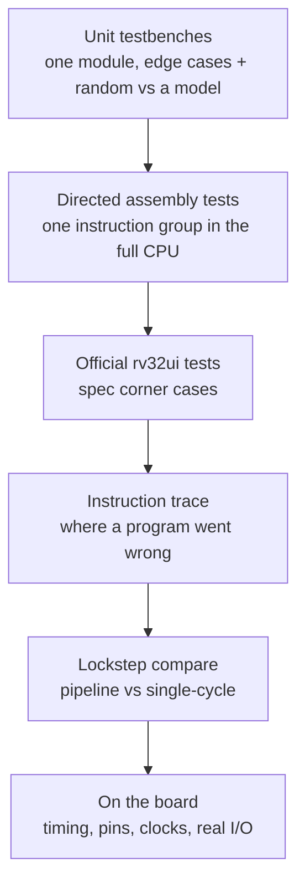
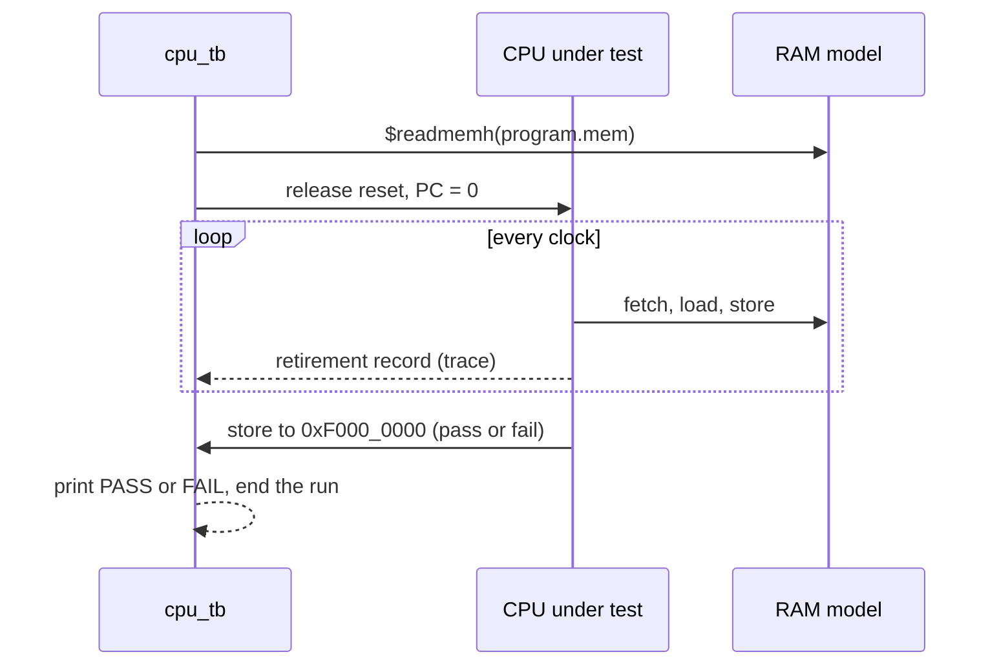
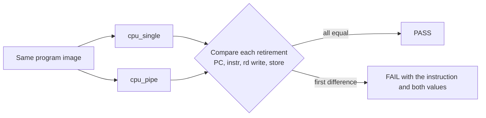

# 🧪 `tb/`: testbenches and verification

> [!NOTE]
> **Status: 📋 PLANNED.** `tb/`, `tb/debug/` and `tb/diag/` hold only `.gitkeep` placeholders.
> No testbench exists and no test has run. This page describes the planned verification
> approach. Status labels are defined in the [root README](../README.md#status).

[← Back to the project README](../README.md)

## Why testbenches matter

A **testbench** is SystemVerilog that is never built into the FPGA. It wraps a module, drives
its inputs, and checks its outputs. In this project every testbench is **self-checking**: it
computes the expected answer independently and fails by itself on any mismatch, so nobody has
to stare at waveforms to know whether a test passed.

The guiding rule: **catch each bug at the cheapest layer that can catch it.** A wrong ALU
result found by a unit test takes minutes to fix; the same bug found on the board can take a
day.

## Test layers



| Layer | What it catches | How | Starts in |
| --- | --- | --- | --- |
| Unit testbenches | Wrong logic inside one block | Edge cases plus random inputs against a reference model | Phase 1 |
| Directed assembly tests | An instruction behaving wrong in the full CPU | Small programs that write pass/fail to `0xF000_0000`; `cpu_tb` runs them | Phase 2 |
| Official riscv-tests (rv32ui) | Spec corner cases nobody thought of | About 40 programs, one per instruction, with a custom environment header | Phase 2 |
| Instruction trace | Where exactly a program went wrong | `cpu_tb` prints PC, instruction, destination register and value per instruction | Phase 2 |
| Lockstep compare | Missed forwarding, bad stalls and flushes | Single-cycle and pipeline run side by side; every retirement is compared | Phase 5 |
| On the board | Timing, pins, clocks, real I/O | Timing report with no negative slack, LEDs, 7-segment, serial terminal, ILA | Phase 3 |
| Continuous integration | Old features breaking | GitHub Actions runs every test on every push | Phase 0 |

## The CPU program runner, `cpu_tb.sv`

Planned for Phase 2. It loads any program image, runs until the program halts or a timeout
expires, checks the pass/fail word, and can print an instruction trace and dump waveforms for
GTKWave.



The pass/fail address `0xF000_0000` is simulation-only and must be preserved.

## The lockstep test (Phase 5)

The single-cycle CPU is kept as the **reference model** for the pipeline. Both run the same
program and the testbench compares their ordered retirement streams: PC, instruction,
register writes and memory side effects, including instructions that write no register.
The first mismatch points at the failing instruction. Comparing stores matters, because an
incorrect store can otherwise pass unnoticed.



The **hazard zoo** test exercises dependencies at distances 1, 2 and 3, load-use, a load then
a store of the same register, a branch on a just-computed value, JAL/JALR with the return
address used immediately, and `x0` as a destination.

## Debug and diagnostics suites

`tb/debug/` and `tb/diag/` are reserved for the Tab5 milestones. The planned work packages
are defined in the [verification matrix](../docs/VERIFICATION_MATRIX.md#verification-work-packages):

| Folder | Work packages |
| --- | --- |
| `tb/debug/` | V-LINK (packet codec, sessions), V-WB (Wishbone bridge), V-OWNER (RAM ownership), V-HALT, V-STEP, V-BREAK, V-STATE, V-LOAD, V-CONSOLE, V-SNAPSHOT, V-TRACE, V-PERF |
| `tb/diag/` | V-BIST (memory and ALU self-test), V-FAULT (controlled fault injection) |
| Cross-cutting | V-CORE (original regression always passes), V-IDLE (debug present but idle changes nothing) |

## Rules for every test

- Add a self-checking testbench with each new RTL module, in the same commit.
- Keep the expected result independent of the block under test; do not generate expected
  and observed values with the same code.
- Tie the runner's verdict to assertions and process exit status.
- Simulate every C program before it goes near the board.
- Report exactly which checks ran. Simulation success, synthesis success, timing closure and
  observed board behavior are four different claims.

## Running the tests

> 📋 **PLANNED.** `scripts/run_tests.py` does not exist yet.

```bash
python3 scripts/run_tests.py   # WSL, repository root: build and run every testbench, print a table
```

See [scripts/README.md](../scripts/README.md).

## Related

- Modules under test: [rtl/README.md](../rtl/README.md)
- Test programs: [sw/README.md](../sw/README.md)
- Requirement traceability: [VERIFICATION_MATRIX.md](../docs/VERIFICATION_MATRIX.md)
